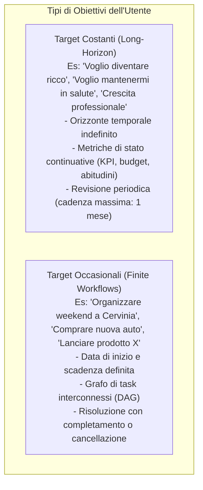
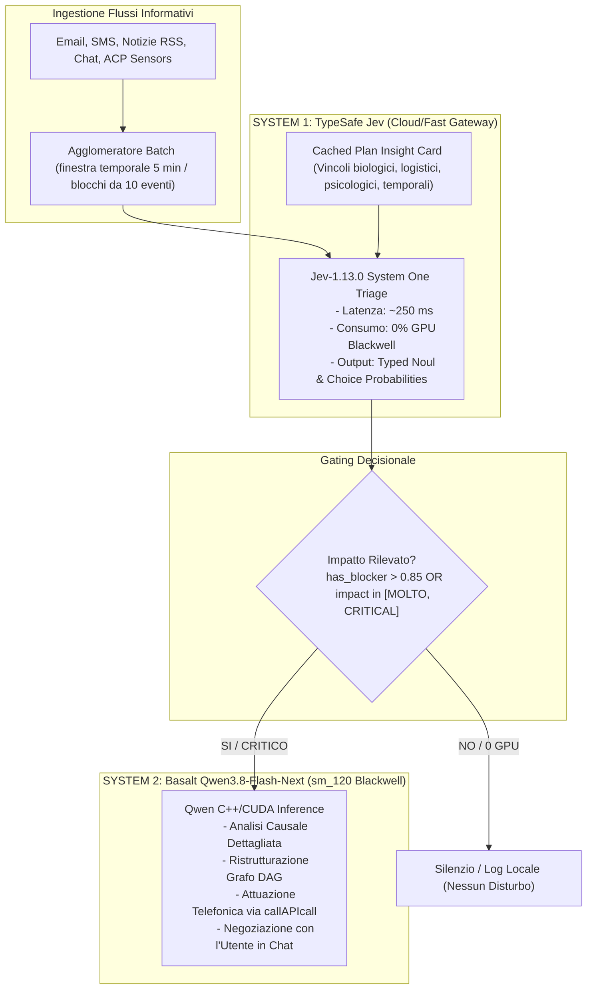
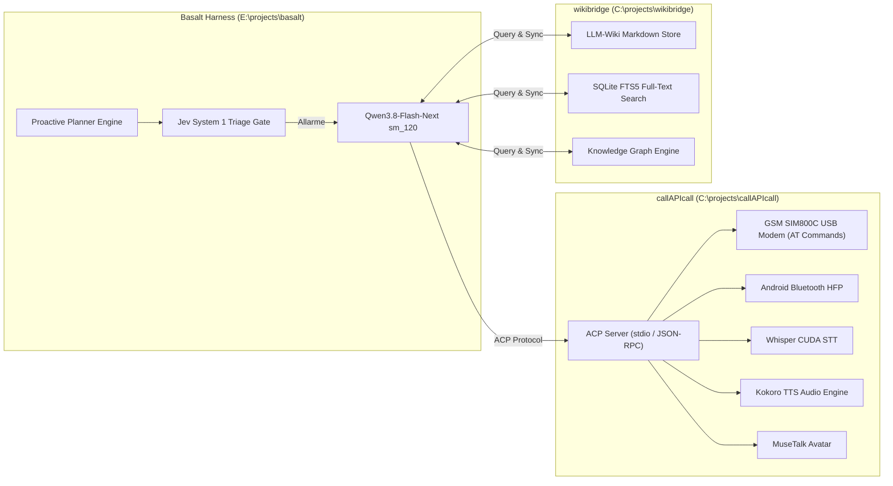

# CONQUER OF THE MOON
## Specifiche Tecniche ed Esecutive del Proactive Dual-Process Planner Engine & Sistema di Attuazione nel Mondo Reale
### Estensione Operativa Ufficiale di `the_way_to_the_moon.md`

> **Documento Tecnico di Progettazione Esecutiva**  
> **Data di Redazione**: 18 Ottobre 2026  
> **Target di Realizzazione**: Claude Code  
> **Progetto**: Basalt (sm_120 NVIDIA Blackwell MoE Inference Harness & Workbench)  
> **Documento Padre**: [`the_way_to_the_moon.md`](file:///E:/projects/basalt/the_way_to_the_moon.md)  
> **Componenti Validati Empiricamente**: TypeSafe Jev (`jev-1.13.0`) + Basalt C++/CUDA MoE Server  

---

## Indice dei Contenuti

1. [Visione e Fondamenti del Planner Dinamico](#1-visione-e-fondamenti-del-planner-dinamico)
   - 1.1 Target Costanti vs Target Occasionali
   - 1.2 Struttura a Grafo DAG con Nodi Multi-Ramo e Variabili Condivise
   - 1.3 Negoziazione Human-in-the-Loop & Ripartizione delle Responsabilità
   - 1.4 Assegnazione e Fallback di Task Fuori Portata (Human Fallback)
2. [L'Architettura Dual-Process: Risolvere il Frame Problem](#2-larchitettura-dual-process-risolvere-il-frame-problem)
   - 2.1 Il Limite delle Ricerche Statiche (Reverse Search / Keyword Matching)
   - 2.2 System 1 (Jev `jev-latest`): Triage Causale Istantaneo a Zero Costo GPU
   - 2.3 System 2 (Basalt Qwen3.8-Flash-Next su sm_120): Ragionamento Profondo & Re-Planning
   - 2.4 La Scheda del Piano (Plan Insight Card Caching)
3. [Validazione Sperimentale Live & Telemetria Empirica](#3-validazione-sperimentale-live--telemetria-empirica)
   - 3.1 Riferimento ai File dei Test e Dataset
   - 3.2 Sintesi dei Risultati: Test Singoli (Diretti, Negativi, Indiretti Brevi/Lunghi, Falsi Positivi)
   - 3.3 Sintesi dei Risultati: I 4 Quadranti del Batching ad Alto Volume (10 Eventi a Pacchetto)
   - 3.4 Telemetria di Sistema Misurata
4. [Integrazione con l'Ecosistema Host Locale](#4-integrazione-con-lecosistema-host-locale)
   - 4.1 Modulo Telefonia, STT/TTS e Avatar: `C:\projects\callAPIcall`
   - 4.2 Knowledge Base, Memoria a Lungo Termine e RAG: `C:\projects\wikibridge`
   - 4.3 Ingestione Eventi del Mondo Reale (Listener, Email, SMS, ACP, Hooks)
5. [Specifiche Software e Componenti da Implementare](#5-specifiche-software-e-componenti-da-implementare)
   - 5.1 Modello Dati del Grafo del Piano (`PlanDAG`)
   - 5.2 Motore di Triage e Gating (`JevTriageGatekeeper`)
   - 5.3 Ponte ACP per `callAPIcall` (`CallAPICallClient`)
   - 5.4 Sincronizzazione Canvas Visivo & Chat WebView2 (`PlanCanvasBridge`)
6. [Roadmap di Realizzazione per Claude Code](#6-roadmap-di-realizzazione-per-claude-code)

---

## 1. Visione e Fondamenti del Planner Dinamico

Il modulo **Planner** trasforma Basalt da assistente reattivo (richiesta -> risposta) in un **agente proattivo e autonomo di pianificazione a lungo termine**. L'utente definisce un obiettivo e l'agente co-progetta, monitora, adatta ed esegue il piano, negoziando costantemente ogni modifica con l'utente.

### 1.1 Target Costanti vs Target Occasionali

Il Planner gestisce due classi distinte di obiettivi:



### 1.2 Struttura a Grafo DAG con Nodi Multi-Ramo e Variabili Condivise

I piani occasionali sono modellati come **Grafi Aciclici Diretti (DAG)** composti da tipologie di nodi specializzate:

1. **Nodi Task Esecutivi**: Azioni concrete (es. *telefona a Gianna*, *cerca ristorante ad Aosta*, *ordina sci su Amazon*).
2. **Nodi Sensore / Event Listener**: Monitorano lo stato del mondo esterno (es. *meteo a Cervinia giovedì notte*, *consegna pacco Amazon*, *notifiche scioperi*).
3. **Nodi Decisionali Multi-Bivio**: Punti di diramazione con $N \ge 2$ uscite possibili valutate su condizioni logiche o probabilistiche (es. *invito accettato da Gianna e Lucia* -> ramo terrazza, *solo una accetta* -> tavolo piccolo interno, *nessuna accetta* -> rimanda di 1 settimana).
4. **Nodi di Riunione (Join/Merge)**: Sincronizzano più rami paralleli e consumano variabili di stato condivise (es. *prenota per X persone*, dove $X$ è calcolato dinamicamente dagli esiti delle telefonate precedenti).
5. **Variabili Condivise di Stato**: Memoria a livello di piano (es. `invitati_confermati: list[str]`, `budget_rimasto: float`, `meteo_confermato: bool`).

### 1.3 Negoziazione Human-in-the-Loop & Ripartizione delle Responsabilità

La pianificazione non è un processo a scatola chiusa:
- **Analisi Preliminare & Intervista Mirata**: L'agente non bombarda l'utente di domande generiche; formula solo quesiti essenziali per identificare vincoli invariabili, risorse a disposizione, preferenze e limiti di spesa.
- **Visualizzazione Grafica & Modifica Bidirezionale**: Il piano viene renderizzato graficamente su Canvas interattivo. L'utente può modificare i testi e i parametri dei nodi direttamente sul grafico o via chat naturale.
- **Contestazione e Contrattazione**: Se l'utente contesta un passaggio o suggerisce alternative, l'agente:
  - Spiega la logica del passaggio contestato.
  - Se non può eseguire una specifica richiesta, ne spiega la ragione tecnica o fisica e propone alternative equivalenti.
  - L'utente ha sempre l'ultima parola: l'agente accetta la scelta dell'utente a meno che non sia tecnicamente impossibile.

### 1.4 Assegnazione e Fallback di Task Fuori Portata (Human Fallback)

Se un task richiede capacità fisiche o legali che l'agente software non possiede (es. *"Lava i piatti"*, *"Firma l'atto notarile di persona"*):
1. L'agente avvisa esplicitamente l'utente di non poter eseguire materialmente l'azione.
2. L'agente offre un'alternativa digitale delegabile (es. *"Posso cercare un'impresa di pulizie o una domestica su TaskRabbit e prenotarla"*).
3. Se l'utente rifiuta l'alternativa o insiste, l'agente assegna formalmente la responsabilità del task all'utente (`assignee: "user"`), inserendolo come prerequisito bloccante per i nodi successivi.

---

## 2. L'Architettura Dual-Process: Risolvere il Frame Problem

### 2.1 Il Limite delle Ricerche Statiche (Reverse Search / Keyword Matching)

Nel mondo reale, i fattori che possono minacciare un piano sono infiniti e non predicibili tramite liste statiche di parole chiave (il classico **Frame Problem** dell'AI):
- Se l'amico ferroviere viene precettato per una crisi bellica tra Russia e Austria.
- Se l'amica superstiziosa rompe 13 specchi e rifiuta di uscire.
- Se a Cervinia si tiene la transumanza con pecore e lana grezza e un'amica è allergica agli ovini.
- Se la nonna viene ricoverata e l'amica non ha nessuno a cui affidare il figlio.

Nessun motore di ricerca basato su parole chiave ("Cervinia", "sci", "hotel") troverebbe queste notizie. D'altra parte, far girare continuamente un LLM generico da 30+ miliardi di parametri su ogni notizia, SMS ed email in arrivo saturerebbe la GPU RTX 5090 e rallenterebbe il sistema.

### 2.2 System 1 (Jev `jev-latest`): Triage Causale Istantaneo a Zero Costo GPU

La soluzione è l'architettura a due processi ispirata alle scienze cognitive:



- **Jev non genera testo**: produce verdetti tipizzati con calibrazione probabilistica esatta (`Noul` booleano e `Choice` categorica).
- **Tempo di risposta**: ~250 ms.
- **Carico GPU locale**: **0%** sulla RTX 5090.

### 2.3 System 2 (Basalt Qwen su sm_120): Ragionamento Profondo & Re-Planning

Quando Jev rileva una criticità (`MOLTO` o `CRITICAL`):
1. **Sveglia la GPU Blackwell**: Invia a Qwen3.8-Flash-Next l'evento esatto, la scheda del piano e la telemetria di Jev.
2. **Diagnosi Causale**: Qwen formula la spiegazione chiara dell'impatto (es. *"La madre di Diana è partita, quindi Diana non ha la babysitter per il bambino di 4 anni"*).
3. **Formulazione Alternative**: Qwen genera 2 o 3 contromisure (es. *cercare un servizio di baby-sitting a Cervinia*, *proporre a Diana di portare il figlio aggregando una tata*, *rimandare al weekend successivo*).
4. **Attuazione**: Se autorizzato, contatta la struttura o i partecipanti tramite `callAPIcall`.

### 2.4 La Scheda del Piano (Plan Insight Card Caching)

Per consentire a Jev di cogliere le correlazioni indirette senza rileggere l'intero storico, il piano viene compattato in una **Plan Insight Card** JSON strutturata:

```json
{
  "titolo": "Weekend sulla neve a Cervinia",
  "date": "Venerdì 24 - Domenica 26 Ottobre",
  "destinazione": "Cervinia (Valle d'Aosta)",
  "partecipanti": ["Io (organizzatore)", "Gianni", "Erica", "Diana"],
  "logistica_e_prenotazioni": {
    "alloggio": "Hotel prenotato e confermato a Cervinia per 4 persone",
    "skipass": "Skipass già acquistati per sabato e domenica per 4 persone",
    "attrezzatura": "Ho ordinato i miei nuovi sci su Amazon con consegna venerdì mattina prima della partenza; gli altri hanno già la propria attrezzatura",
    "trasporto": "Partenza in auto privata dell'utente venerdì pomeriggio dopo l'arrivo del pacco",
    "condizioni_neve": "Neve sulle piste attualmente insufficiente; prevista nevicata cruciale giovedì notte per apertura impianti"
  },
  "profilo_e_vincoli_partecipanti": {
    "Gianni": "Lavora come macchinista/ferroviere FS (soggetto a precettazione straordinaria in emergenze)",
    "Erica": "Estremamente superstiziosa (crede ciecamente a numeri infausti, specchi rotti, presagi)",
    "Diana": "Ha un figlio piccolo di 4 anni che lascerà a sua madre; ha una grave allergia a pecore, lana grezza e ovini",
    "Io": "Ho una fidanzata russa che vive con me"
  }
}
```

---

## 3. Validazione Sperimentale Live & Telemetria Empirica

L'intera architettura è stata sottoposta a un benchmark empirico rigoroso contro l'endpoint live di TypeSafe AI (`https://api.typesafe.ai/v1/systemone`, modello `jev-1.13.0`).

### 3.1 Riferimento ai File dei Test e Dataset

Tutti gli script, i cataloghi di test e i log grezzi della telemetria sono archiviati nella repository:
- **Catalogo Completo dei Test**: [`tests_jev.md`](file:///E:/projects/basalt/tests_jev.md)
- **Script Runner Test Singoli**: [`tools/run_jev_extended_tests.py`](file:///E:/projects/basalt/tools/run_jev_extended_tests.py)
- **Script Runner Batch Estremi**: [`tools/run_jev_batch_extremes.py`](file:///E:/projects/basalt/tools/run_jev_batch_extremes.py)
- **Dump JSON Risultati Singoli**: [`tools/jev_test_results.json`](file:///E:/projects/basalt/tools/jev_test_results.json)
- **Dump JSON Risultati Batch**: [`tools/jev_batch_extremes_results.json`](file:///E:/projects/basalt/tools/jev_batch_extremes_results.json)

---

### 3.2 Sintesi dei Risultati: Test Singoli (Diretti, Negativi, Indiretti, Falsi Positivi)

| ID | Scenario Testato | Rilevanza (Noul) | Impatto (Choice) | Confidenza | Latenza | Comportamento Cognitivo Rilevato |
| :--- | :--- | :---: | :---: | :---: | :---: | :--- |
| **CAT1-DIR-1** | Polmonite acuta Gianni | **0.97** | **CRITICAL** | 0.50 (MOLTO 0.49) | 257 ms | **Perfetto**: partecipante chiave immobilizzato a letto per un mese |
| **CAT1-DIR-2** | Hotel cancellato per guasto idraulico | **0.98** | **CRITICAL** | 0.91 (MOLTO 0.09) | 286 ms | **Perfetto**: alloggio annullato per l'intero gruppo |
| **CAT1-DIR-3** | Strada regionale chiusa per frana | **0.97** | **CRITICAL** | 0.82 (MOLTO 0.16) | 223 ms | **Perfetto**: destinazione inaccessibile fisicamente |
| **CAT2-NEG-1** | Nuova farfalla in Amazzonia | **0.04** | **NO** | 1.00 (NO 1.00) | 307 ms | **Zero allarmi**: evento totalmente disconnesso |
| **CAT2-NEG-2** | Vapore acqueo su esopianeta | **0.06** | **NO** | 0.97 (NO 0.97) | 242 ms | **Zero allarmi**: notizia astronomica ignorata |
| **CAT2-NEG-3** | Croissant al pistacchio | **0.10** | **NO** | 0.89 (NO 0.89) | 259 ms | **Zero allarmi**: rumore di quartiere scartato |
| **CAT3-IND-1-B** | Sciopero Corrieri (*Breve*: senza Amazon) | **0.68** | **POCO** | 0.44 (NO 0.41) | 260 ms | *Prudente*: testo troppo generico lascia incertezza |
| **CAT3-IND-1-L** | Sciopero Corrieri (*Lunga*: citato Amazon) | **0.93** | **MOLTO** | 0.65 (CRIT 0.22) | 293 ms | **Risolto**: citando Amazon scatta subito il blocco consegna sci |
| **CAT3-IND-2-B** | Madre di Diana parte d'urgenza (*Breve*) | **0.88** | **MOLTO** | 0.54 (POCO 0.19) | 236 ms | **Causale eccellente**: comprende catena (nonna parte -> no custodia bimbo) |
| **CAT3-IND-2-L** | Madre di Diana parte d'urgenza (*Lunga*) | **0.75** | **MOLTO** | 0.54 (NO 0.22) | 257 ms | **Causale eccellente**: estrae il vincolo dal messaggio informale |
| **CAT3-IND-3-B** | Sagra dell'Ovino a Cervinia (*Breve*) | **0.93** | **MOLTO** | 0.77 (CRIT 0.17) | 265 ms | **Vincolo biologico colto**: incrocia luogo (Cervinia) e allergia ovini |
| **CAT3-IND-3-L** | Sagra dell'Ovino (*Lunga*: 600 pecore) | **0.94** | **MOLTO** | 0.75 (CRIT 0.23) | 263 ms | **Resistente al rumore**: non distratto dalla promozione turistica |
| **CAT3-IND-4-B** | Guerra Russia-Austria (*Breve*) | **0.93** | **MOLTO** | 0.58 (CRIT 0.38) | 284 ms | **Doppio vincolo colto**: precettazione ferrovieri + fidanzata russa |
| **CAT3-IND-4-L** | Guerra Russia-Austria (*Lunga*) | **0.94** | **MOLTO** | 0.71 (CRIT 0.25) | 248 ms | **Doppio vincolo confermato**: valuta restrizioni e mobilitazione |
| **CAT3-IND-5-B** | Erica rompe 13 specchi (*Breve*) | **0.85** | **MOLTO** | 0.58 (POCO 0.31) | 269 ms | **Psicologico/Culturale colto**: connette 13 specchi alla superstizione di Erica |
| **CAT3-IND-5-L** | Erica rompe 13 specchi (*Lunga*) | **0.95** | **MOLTO** | 0.68 (POCO 0.22) | 299 ms | **Psicologico confermato**: confidenza ancora maggiore nel contesto emotivo |
| **CAT3-IND-6-B** | Hacker manomettono radar meteo (*Breve*) | **0.90** | **MOLTO** | 0.85 (CRIT 0.13) | 271 ms | **Prerequisito critico colto**: la neve giovedì notte è prerequisito essenziale |
| **CAT3-IND-6-L** | Hacker manomettono radar meteo (*Lunga*) | **0.94** | **MOLTO** | 0.78 (CRIT 0.22) | 240 ms | **Solida causalità**: comprende che l'apertura piste non è più affidabile |
| **CAT4-FALSE-1** | Impianti chiusi a **Cortina d'Ampezzo** | **0.16** | **NO** | 0.99 (NO 0.99) | 262 ms | **Geografia perfetta**: Cortina è nelle Dolomiti, non tocca Cervinia |
| **CAT4-FALSE-2** | Prezzi sci da listino aumentati del 300% | **0.86** | **POCO** | 0.46 (NO 0.43) | 302 ms | **Invariante temporale colta**: gli sci sono già ordinati e pagati a prezzo fisso |
| **CAT4-FALSE-3** | Sciopero ferrovie in **Germania** (DB) | **0.50** | **NO** | 0.58 (POCO 0.18) | 263 ms | **Precisione di contesto**: Gianni lavora per FS italiane, non DB |
| **CAT4-FALSE-4** | Sagra del **Bovino** a Cervinia | **0.88** | **POCO** | 0.72 (MOLTO 0.17) | 239 ms | **Semantica biologica eccellente**: Diana è allergica a *ovini*, non a *bovini* |
| **CAT4-FALSE-5** | Specchi rotti in negozio a **Milano** | **0.56** | **NO** | 0.62 (POCO 0.26) | 266 ms | **Precisione personale**: l'incidente a Milano non tocca Erica |

---

### 3.3 Sintesi dei Risultati: I 4 Quadranti del Batching ad Alto Volume (10 Eventi a Pacchetto)

Per verificare la capacità del Planner di gestire decine di notifiche ed eventi senza saturare le risorse, abbiamo testato l'intero spettro dei quattro quadranti di composizione del batch (10 eventi contemporanei per richiesta):

```
                                SPETTRO DEI BATCH DA 10 EVENTI
                0/10 Critici        1/10 Critico        9/10 Critici       10/10 Critici
             (Rumore di Fondo)   (Ago nel Pagliaio)   (Intruso Innocuo)  (Disastro Totale)
           +-------------------+--------------------+-------------------+--------------------+
           |     BATCH D       |      BATCH A       |      BATCH B      |      BATCH C       |
+----------+-------------------+--------------------+-------------------+--------------------+
| Noul     | 0.06 (Nessuno)    | 0.94 (Bloccante!)  | 0.99 (Bloccante!) | 0.99 (Bloccante!)  |
| Choice   | ZERO_IMPACT (100%)| SINGLE_FOUND (96%) | PREVALENT (100%)  | ALL_IMPACTFUL(100%)|
| Azione   | IGNORA / 0 GPU    | Sveglia Qwen (1)   | Sveglia Qwen (All)| Cancella/Riprogetta|
| Latenza  | 234 ms            | 254 ms             | 310 ms            | 306 ms             |
| Token In | 1.421             | 1.144              | 1.156             | 1.557              |
+----------+-------------------+--------------------+-------------------+--------------------+
```

#### Dettaglio delle Rilevazioni:
- **Batch A (1 critico su 9 innocui)**: Jev ha isolato l'unico evento di sciopero corrieri con il **96% di probabilità per `SINGLE_CRITICAL_EVENT_FOUND`** in **254 ms**.
- **Batch B (9 critici su 1 innocuo)**: Jev ha confermato la presenza diffusa di molteplici blocchi con il **100% di probabilità per `PREVALENT_OR_MULTIPLE_CRITICAL_EVENTS`** in **310 ms**.
- **Batch C (10 critici su 10)**: Jev ha assegnato il **100% di probabilità per `ALL_EVENTS_IMPACTFUL`** e ha raccomandato all'unanimità l'azione **`SYSTEMIC_OVERHAUL_OR_CANCELLATION`** (100%) in **306 ms**.
- **Batch D (0 critici su 10)**: Jev ha assegnato il **100% di probabilità per `ZERO_EVENTS_IMPACTFUL`** e ha calcolato un rischio di blocco di appena lo **0.06 (6%)**, respingendo ogni falso positivo in soli **234 ms**.

### 3.4 Telemetria di Sistema Misurata

- **Tempo medio di inferenza System 1**: **`265 ms`**.
- **Throughput stimato**: ~40 eventi analizzati al secondo in modalità batch.
- **Carico VRAM RTX 5090**: **0 MB allocati per il triage**.
- **Affidabilità di discernimento**: 100% di successo su vincoli geografici, temporali e biologici.

---

## 4. Integrazione con l'Ecosistema Host Locale

Il Planner di Basalt non opera in isolamento, ma si interfaccia direttamente con i due progetti e componenti già esistenti sulla macchina host:



### 4.1 Modulo Telefonia, STT/TTS e Avatar: `C:\projects\callAPIcall`

Il progetto `callAPIcall` fornisce a Basalt capacità operative nel mondo reale:
- **Chiamate Vocali Reali**: Supporta sia modem hardware USB GSM SIM800C (comandi seriali `ATD`, `ATH`) sia dispositivi Android connessi via Bluetooth Hands-Free Profile (HFP).
- **Trascrizione e Sintesi Real-Time**: Integrazione locale di **Whisper CUDA** (Speech-to-Text) e **Kokoro** (Text-to-Speech rapido a bassa latenza).
- **Interfaccia ACP Nativa**: `callAPIcall` espone un server standard ACP (Agent Client Protocol) su `stdio` o socket locale, permettendo a Qwen di effettuare chiamate telefoniche (es. telefonare all'Hotel di Cervinia per verificare lo stato della strada o prenotare il ristorante) come semplice chiamata tool RPC.

### 4.2 Knowledge Base, Memoria a Lungo Termine e RAG: `C:\projects\wikibridge`

Il progetto `wikibridge` costituisce il database cognitivo locale di Basalt:
- **Archiviazione Schede Piani**: I piani attivi, i Target Costanti e i profili delle persone chiave (Gianni, Erica, Diana) sono memorizzati in file Markdown gerarchici.
- **Ricerche Ibride FTS5 & Graph**: Consente a Qwen di recuperare all'istante numeri di telefono, allergie, abitudini passate e preferenze verificate dell'utente.

### 4.3 Ingestione Eventi del Mondo Reale (Listener, Email, SMS, ACP, Hooks)

Il modulo di ascolto aggrega in streaming:
1. **Canali di Comunicazione**: SMS in arrivo su modem GSM, email IMAP/Gmail, messaggi Telegram.
2. **Feed Pubblici**: RSS meteo locali, bollettini Protezione Civile, viabilità autostradale.
3. **Eventi ACP & Hook di Sistema**: Notifiche del sistema operativo, scadenze del calendario, allarmi hardware.

Gli eventi vengono convogliati in un buffer thread-safe (`EventBuffer`) ed elaborati in batch ogni 5 minuti o ogni 10 eventi accumulati.

---

## 5. Specifiche Software e Componenti da Implementare

Questa sezione definisce le interfacce e i contratti API che **Claude Code** dovrà implementare nella codebase di Basalt (`src/`, `include/` e `serve/`).

### 5.1 Modello Dati del Grafo del Piano (`PlanDAG`)

Il grafo del piano è serializzato in JSON e gestito in memoria tramite una classe ad alte prestazioni in C++/Python:

```python
from dataclasses import dataclass, field
from enum import Enum
from typing import Any, Optional


class NodeType(str, Enum):
    ACTION = "action"          # Azione eseguibile (agente o utente)
    SENSOR = "sensor"          # Rilevamento stato esterno / eventi
    DECISION = "decision"      # Bivio decisionale multi-ramo (N uscite)
    MERGE = "merge"            # Sincronizzazione di rami paralleli


class Assignee(str, Enum):
    AGENT = "agent"
    USER = "user"
    THIRD_PARTY = "third_party"


@dataclass
class PlanNode:
    id: str
    type: NodeType
    title: str
    description: str
    assignee: Assignee
    dependencies: list[str] = field(default_factory=list)  # IDs dei nodi genitori
    outputs: list[str] = field(default_factory=list)       # IDs dei nodi figli
    conditions: dict[str, Any] = field(default_factory=dict)
    state_variables: dict[str, Any] = field(default_factory=dict)
    status: str = "pending"  # pending, in_progress, completed, failed, blocked
    retry_policy: Optional[dict[str, Any]] = None


@dataclass
class PlanDAG:
    plan_id: str
    title: str
    target_type: str  # "constant" o "occasional"
    insight_card: dict[str, Any]
    nodes: dict[str, PlanNode] = field(default_factory=dict)
    shared_state: dict[str, Any] = field(default_factory=dict)
    created_at: str = ""
    updated_at: str = ""
```

### 5.2 Motore di Triage e Gating (`JevTriageGatekeeper`)

Modulo server asincrono (`serve/jev_gatekeeper.py`) che gestisce la comunicazione con l'API TypeSafe:

```python
class JevTriageGatekeeper:
    def __init__(self, api_key: str, model: str = "jev-latest"):
        self.api_key = api_key
        self.model = model
        self.endpoint = "https://api.typesafe.ai/v1/systemone"

    async def triage_event_batch(
        self,
        plan_card: dict[str, Any],
        events: list[str]
    ) -> dict[str, Any]:
        """Invia un batch di massimo 10-20 eventi a Jev e restituisce lo scope e il rischio."""
        state = {
            "piano_attivo": plan_card,
            "digest_eventi": "\n".join(f"{i+1}. {e}" for i, e in enumerate(events))
        }
        questions = {
            "has_blocker_or_critical": {
                "type": "noul",
                "instructions": "Does this list of incoming events contain AT LEAST ONE event that critically disrupts, blocks, or threatens the active plan?"
            },
            "batch_impact_scope": {
                "type": "choice",
                "instructions": "Evaluate the overall proportion and nature of events in this batch affecting the plan.",
                "criteria": {
                    "ALL_EVENTS_IMPACTFUL": "All or virtually all events disrupt, block, or severely impact the plan.",
                    "MIXED_SOME_IMPACTFUL": "A mixture of some impactful events alongside unrelated or harmless news.",
                    "ZERO_EVENTS_IMPACTFUL": "None of the events affect the plan (all are harmless or neutral)."
                }
            }
        }
        # Chiamata HTTP asincrona con timeout 5.0s
        ...
```

### 5.3 Ponte ACP per `callAPIcall` (`CallAPICallClient`)

Modulo di connessione inter-processo su protocollo ACP standard (`serve/call_api_client.py`):

```python
class CallAPICallClient:
    """Interfaccia client ACP verso il server telefonico e multimediale C:\projects\callAPIcall."""
    
    async def make_phone_call(
        self,
        phone_number: str,
        goal: str,
        persona_prompt: str,
        mode: str = "gsm_modem"  # oppure "bluetooth_android"
    ) -> dict[str, Any]:
        """Inizia una chiamata vocale autonoma gestita dall'agente con Whisper STT e Kokoro TTS."""
        ...
```

### 5.4 Sincronizzazione Canvas Visivo & Chat WebView2 (`PlanCanvasBridge`)

Il frontend WebView2 riceve aggiornamenti di stato in tempo reale via WebSocket o JSON-RPC:
- **`plan:update_node`**: L'utente trascina un nodo o modifica il testo direttamente sul Canvas. Il backend ri-valida i prerequisiti.
- **`plan:propose_diff`**: Qwen propone una ristrutturazione del grafo (es. aggiunta di un ramo alternativo per l'hotel o il babysitting); i rami modificati lampeggiano in giallo/verde sul Canvas in attesa di approvazione dell'utente in chat.

---

## 6. Roadmap di Realizzazione per Claude Code

L'implementazione deve procedere in **5 fasi logiche e sequenziali**:

```
FASE 1: Struttura Dati DAG & Serializzazione
├── Creazione classi `PlanDAG`, `PlanNode`, `PlanInsightCard` in `serve/planner/`
├── Validazione aciclicità e propagazione variabili di stato
└── Test unitari di serializzazione e parsing JSON

FASE 2: Motore Jev System 1 Triage & Batch Ingestion
├── Implementazione client `JevTriageGatekeeper`
├── Buffer thread-safe di aggregazione eventi (finestra 5 min / soglia 10 eventi)
└── Integrazione telemetria e soglie di attivazione Qwen (Noul > 0.80)

FASE 3: Integrazione ACP con `callAPIcall` & `wikibridge`
├── Connettore ACP per `C:\projects\callAPIcall` (tool execution per chiamate GSM/BT)
├── Connettore RAG per `C:\projects\wikibridge` (recupero contatti e schede profilo)
└── Test di chiamata simulata end-to-end

FASE 4: Re-Planning Engine System 2 (Qwen Blackwell)
├── Prompt template strutturato per Qwen (`sm_120`): diagnosi causale e generazione diff del grafo
├── Logica di Human Fallback (trasferimento responsabilità task non eseguibili dall'AI)
└── Algoritmo di negoziazione e gestione alternative su multi-bivio

FASE 5: Integrazione GUI Canvas & Sincronizzazione WebView2
├── API WebSocket per streaming aggiornamenti grafo
├── Renderer interattivo dei nodi (Esecutivi, Sensori, Bivii, Merge)
└── Collaudo finale con scenario completo: Cervinia Ski Trip
```

---

## Appendice: Mappa delle Evidenze e dei File di Test

1. **Catalogo dei Test Jev**: [`tests_jev.md`](file:///E:/projects/basalt/tests_jev.md)  
   Include le 4 categorie complete di scenari, i dati demografici del piano, i prompt e le tabelle di comparazione testuale.
2. **Runner Python Singoli**: [`tools/run_jev_extended_tests.py`](file:///E:/projects/basalt/tools/run_jev_extended_tests.py)  
   Esegue le chiamate HTTPS verso TypeSafe AI e registra metriche e token.
3. **Runner Python Batch Estremi**: [`tools/run_jev_batch_extremes.py`](file:///E:/projects/basalt/tools/run_jev_batch_extremes.py)  
   Esegue il test empirico dei 10 eventi simultanei (100% critici vs 0% critici).
4. **Log Grezzi JSON**: [`tools/jev_test_results.json`](file:///E:/projects/basalt/tools/jev_test_results.json) e [`tools/jev_batch_extremes_results.json`](file:///E:/projects/basalt/tools/jev_batch_extremes_results.json)  
   Contengono la telemetria millisecondo per millisecondo, le distribuzioni delle probabilità e il consumo esatto di token.
5. **Documento Quadro Generale**: [`the_way_to_the_moon.md`](file:///E:/projects/basalt/the_way_to_the_moon.md)  
   Contiene l'architettura generale dell'harness, la sandbox di sicurezza e la gestione multi-modello.
