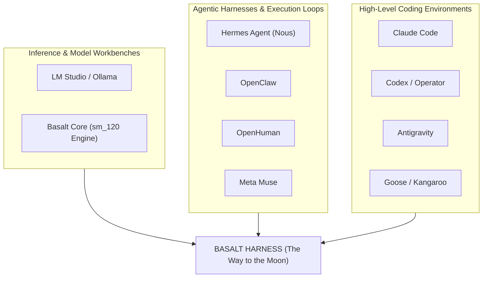
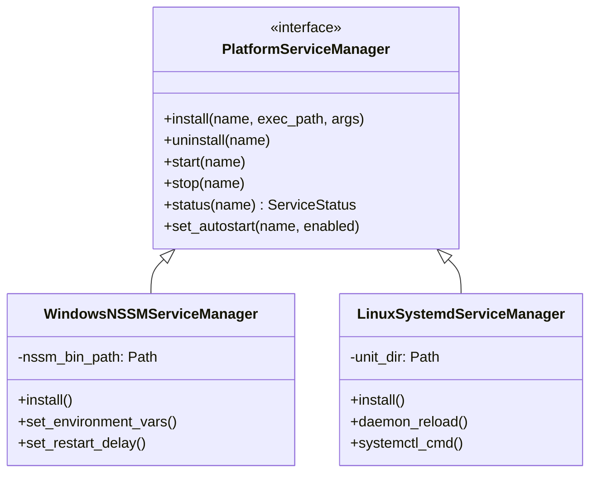
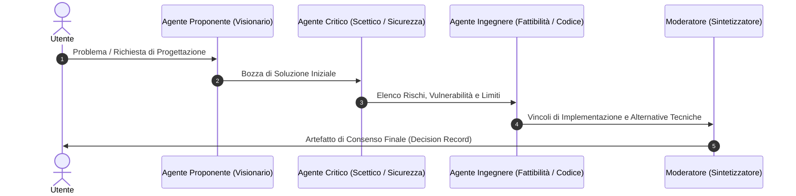
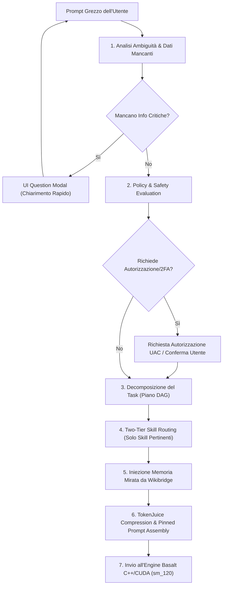
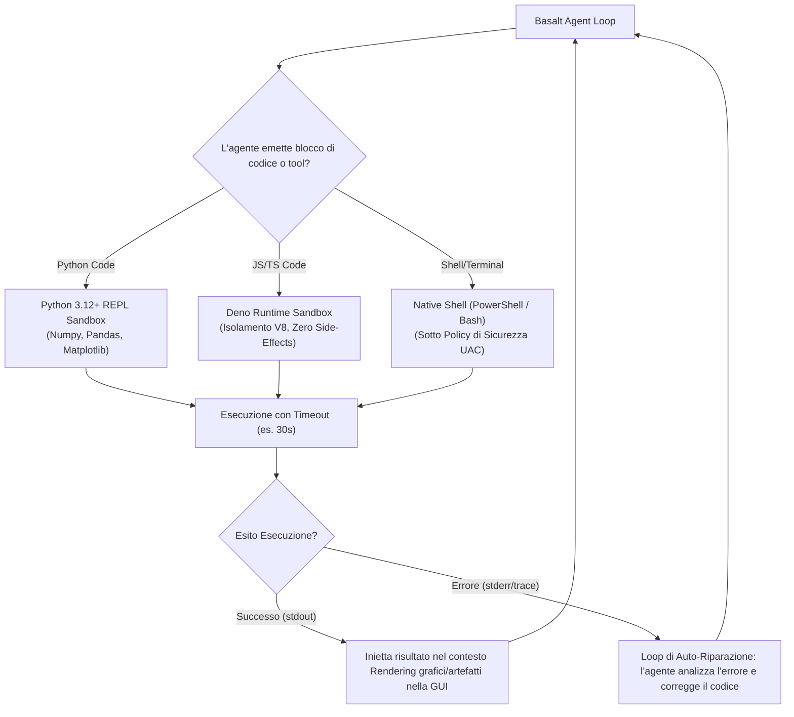
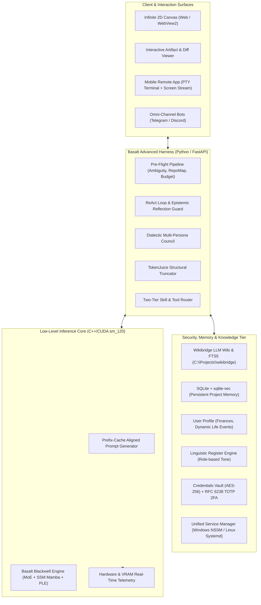
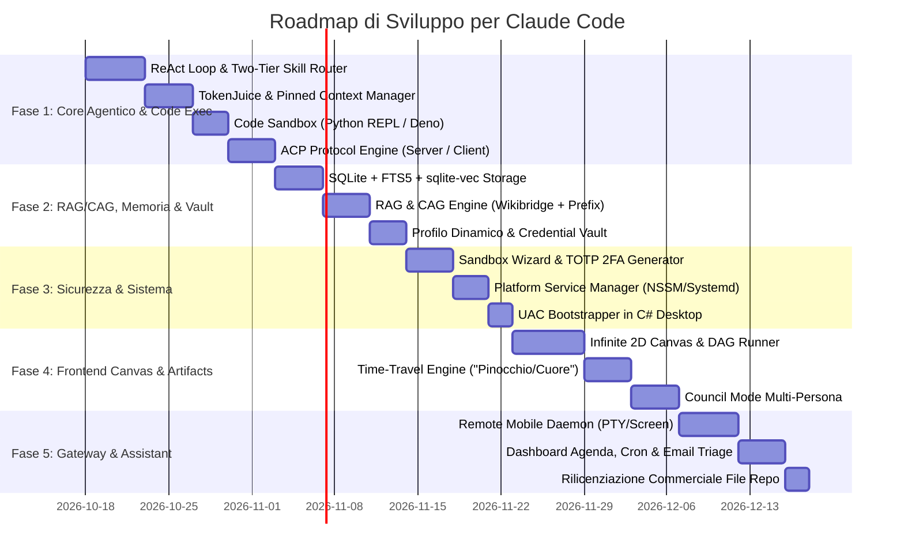

# THE WAY TO THE MOON
## Studio Architetturale, Specifiche e Roadmap per la Trasformazione di Basalt-Win-GUI in un Harness Agentico e Workbench Completo

> **Documento di Progettazione Esecutiva**  
> **Target di Realizzazione**: Claude Code  
> **Progetto**: Basalt (sm_120 Blackwell MoE Engine + Harness)  
> **Stato Base**: Server HTTP/Jinja + WebView2 Desktop GUI  
> **Obiettivo**: Autonomous Agentic Harness, Infinite Canvas, Multi-Channel Gateway & Personal Assistant  

---

## Indice Generale

1. [Scopo dello Sviluppo](#1-scopo-dello-sviluppo)
2. [Studio Comparativo dell'Offerta Esistente (I 5 Harness di Riferimento + Coding Tools)](#2-studio-comparativo-dellofferta-esistente)
3. [Audit e Integrazione dello Stato Attuale di Basalt](#3-audit-e-integrazione-dello-stato-attuale-di-basalt)
4. [Specifiche Funzionali e Soluzioni Tecniche di Dettaglio](#4-specifiche-funzionali-e-soluzioni-tecniche-di-dettaglio)
   - [4.1 Context Compactor & Token Optimization (TokenJuice)](#41-context-compactor--token-optimization-tokenjuice)
   - [4.2 Compatibilità Modelli & Multi-Model Arena](#42-compatibilità-modelli--multi-model-arena)
   - [4.3 Infinite Creative Canvas & Non-Linear Branching](#43-infinite-creative-canvas--non-linear-branching)
   - [4.4 Storage di Memoria: SQLite + sqlite-vec vs PostgreSQL + pgvector](#44-storage-di-memoria-sqlite--sqlite-vec-vs-postgresql--pgvector)
   - [4.5 Sistema Remoto Mobile con Pieno Controllo del SO](#45-sistema-remoto-mobile-con-pieno-controllo-del-so)
   - [4.6 Elevazione UAC all'Avvio & Gestione Servizi Unificata (NSSM vs Systemd)](#46-elevazione-uac-allavvio--gestione-servizi-unificata-nssm-vs-systemd)
   - [4.7 ReAct Loop, MCP Hub & Dynamic Skill Routing a Due Fasi](#47-react-loop-mcp-hub--dynamic-skill-routing-a-due-fasi)
   - [4.8 Safety Sandbox: dal Presidio Rigido all'Automazione Totale (Banche, Pagamenti, 2FA)](#48-safety-sandbox-dal-presidio-rigido-allautomazione-totale-banche-pagamenti-2fa)
   - [4.9 Self-Improvement & Cristallizzazione in Codice Deterministico](#49-self-improvement--cristallizzazione-in-codice-deterministico)
   - [4.10 Multi-Persona Brainstorming: Sintesi dei Modelli (Hermes vs OpenClaw vs Meta Muse)](#410-multi-persona-brainstorming-sintesi-dei-modelli)
   - [4.11 Visual Automation Graphs & Capacità Visive Estese](#411-visual-automation-graphs--capacità-visive-estese)
   - [4.12 Interactive Mutable Artifacts & Workflow Time-Travel ("Pinocchio" vs "Cuore")](#412-interactive-mutable-artifacts--workflow-time-travel)
   - [4.13 High-Level Coding Platform & Memoria di Progetto](#413-high-level-coding-platform--memoria-di-progetto)
   - [4.14 Profilazione Dinamica dell'Utente (Finanze, Registri Linguistici, Vault)](#414-profilazione-dinamica-dellutente)
   - [4.15 Personal Assistant Quotidiano & Email Triage](#415-personal-assistant-quotidiano--email-triage)
   - [4.16 RAG/CAG: Integrazione Nativa con `C:\Projects\wikibridge`](#416-ragcag-integrazione-nativa-con-cprojectswikibridge)
   - [4.17 Pre-Flight Processing & Orchestrazione dei Prompt Lato App](#417-pre-flight-processing--orchestrazione-dei-prompt-lato-app)
   - [4.18 Architettura Ibrida RAG & CAG (Cache-Augmented Generation)](#418-architettura-ibrida-rag--cag-cache-augmented-generation)
   - [4.19 Motore di Esecuzione Codice Multi-Linguaggio (Code Execution Sandbox)](#419-motore-di-esecuzione-codice-multi-linguaggio-code-execution-sandbox)
   - [4.20 Protocollo ACP (Agent Client Protocol & Agent Communication Protocol)](#420-protocollo-acp-agent-client-protocol--agent-communication-protocol)
5. [La Nostra Soluzione Ideale: "Basalt Omniverse" (Sintesi dei Concetti Migliori e Innovazioni Proprietarie)](#5-la-nostra-soluzione-ideale-basalt-omniverse)
6. [Strategia di Migrazione della Licenza (da MIT/BSD-3 a Commerciale Source-Available)](#6-strategia-di-migrazione-della-licenza)
7. [Architettura Target del Sistema](#7-architettura-target-del-sistema)
8. [Roadmap Esecutiva di Implementazione per Claude Code](#8-roadmap-esecutiva-di-implementazione-per-claude-code)

---

## 1. Scopo dello Sviluppo

Il progetto **Basalt** è nato come motore di inferenza C++/CUDA ultra-ottimizzato per architetture NVIDIA Blackwell (`sm_120`), specificamente tarato sul modello Mixture-of-Experts con componenti ibride SSM/Mamba `Qwen3.8-Flash-Next`, corredato da un server locale e da un'interfaccia grafica desktop essenziale (`Basalt-Win-GUI`).

L'obiettivo di **"The Way to the Moon"** è compiere un salto generazionale:
> **Trasformare Basalt da un semplice runner/viewer passivo locale in un Harness Completo, Autonomo e Omnicomprensivo**, unificando in un'unica applicazione desktop/server le capacità di inferenza locale rapida, un'infrastruttura agentica avanzata (ReAct loop, gestione autonoma dei tool, sandbox di sicurezza personalizzabile), una memoria a lungo termine persistente, un'interfaccia a tela infinita (Infinite Canvas), un assistente personale proattivo e una piattaforma di coding di classe mondiale.

L'implementazione del codice è affidata a **Claude Code**, mentre il presente documento funge da specifica tecnica, guida architetturale e contratto operativo per ogni modulo.

---

## 2. Studio Comparativo dell'Offerta Esistente

I moderni framework AI si dividono in categorie frammentate. Nessun software esistente integra contemporaneamente l'inferenza MoE ad alte prestazioni e l'intero spettro agentico/personale.



### 2.1 I 5 Harness di Riferimento

1. **LM Studio**:
   - *Punti di forza*: UI eccellente per la gestione dei modelli locali, downloader GGUF integrato da Hugging Face, calcolo preventivo dell'ingombro VRAM, server OpenAI locale istantaneo.
   - *Limiti*: È un runner passivo a turno singolo o multi-turno manuale. Nessun loop autonomo di esecuzione tool, nessuna memoria a lungo termine, nessuna capacità di pianificazione ed esecuzione complessa di codice.

2. **Hermes Agent (Nous Research)**:
   - *Punti di forza*: Loop ReAct robusto, sistema di self-improvement tramite acquisizione dinamica di skill salvate in file Markdown (`SKILL.md`), memoria a strati (sessione, SQLite, procedurale), architettura a sub-agenti gerarchici.
   - *Limiti*: Mancanza di un'interfaccia grafica ricca nativa (molto orientato a CLI e bot Telegram/Discord), gestione del contesto priva di compattazione strutturale visiva.

3. **OpenClaw**:
   - *Punti di forza*: Gateway omni-canale (Telegram, Discord, WhatsApp, Slack, Signal) per comandare l'agente locale da smartphone, policy di sicurezza a percorsi (path-level sandbox) con conferma interattiva dell'utente, journal operativo su file `MEMORY.md`.
   - *Limiti*: Accoppiamento rigido con modelli cloud commerciali; non ottimizzato per hardware locale estremo.

4. **OpenHuman**:
   - *Punti di forza*: Risolve l'amnesia degli LLM tramite l'albero di memoria locale (Memory Tree in SQLite compatibile con vault Obsidian), ottimizzazione drastica dei token (**TokenJuice**) che elimina il bloat degli output di tool fino all'80%, flussi di automazione visivi dichiarativi (*TinyFlows*).
   - *Limiti*: Ecosistema chiuso, scarsa integrazione con codebase di programmazione e tool di compilazione nativi.

5. **Meta Muse**:
   - *Punti di forza*: Interfaccia a tela infinita (Infinite Canvas) bidimensionale, ramificazione non-lineare della conversazione (branching), brainstorming multi-persona (Council dialettico tra tesi, antitesi e sintesi), artefatti interattivi modificabili.
   - *Limiti*: Piattaforma concettuale orientata al cloud, assenza di controllo sistemistico e locale della macchina.

### 2.2 I Coding Tools di Riferimento

- **Claude Code**: La migliore ergonomia da terminale per esplorazione rapida di codebase (grep semantico, file indexing), feedback compatto delle modifiche e commit atomici.
- **Antigravity**: Eccellente gestione di sub-agenti a ciclo reattivo (senza polling passivo), sistema di artefatti visivi, skill modulari e tracciamento strutturato dei log.
- **Codex / OpenAI Operator**: Sandboxing sicuro di comandi e parsing AST fine-grained per l'editing del codice.
- **Goose / Kangaroo**: Integrazione standardizzata con il Model Context Protocol (MCP) e consapevolezza del desktop locale.

---

## 3. Audit e Integrazione dello Stato Attuale di Basalt

Prima di definire i nuovi componenti, è stato condotto un audit dei sorgenti attuali di Basalt:

1. **Compattazione Contesto Esistente (`serve/chatctx.py`)**:
   - Il server implementa già `fit(svc, req)` con tre policy (`stop`, `rolling`, `compact`).
   - La funzione `head_of(messages)` protegge l'indice 0 (se `system` o `developer`) e il primo messaggio utente.
   - Compattazione automatica all'80% di contesto (`COMPACT_THRESHOLD = 0.8`), con estrazione di *Facts, Decisions, Open questions, Code*.
   - *Gap riscontrato*: Non esiste un sistema per proteggere blocchi dinamici multipli (es. credenziali, profilo utente, istruzioni di repo iniettate dinamicamente). Manca il pre-filtraggio degli output grezzi dei tool prima del salvataggio nel buffer di contesto.

2. **Calcolatore VRAM & Hardware Engine (`serve/profiles.py`, `serve/loader.py`, `serve/hardware.py`)**:
   - Basalt dispone già di un calcolatore avanzatissimo che predice non solo la memoria statica dei pesi, ma l'occupazione della KV-Cache, la banda di memoria, il throughput stimato (tok/s) e applica margini di sicurezza per prevenire Out-Of-Memory lasciando spazio configurabile per le altre app del sistema operativo.
   - *Integrazione*: Questo motore deve diventare una fonte telemetrica accessibile all'agente in fase di pianificazione.

3. **Preset Manager & Wizard (`serve/wizard.js`, `serve/settings.py`)**:
   - Presente e funzionante: supporta preset per modello, parametri di campionamento e un wizard automatico di configurazione ottimale.

4. **Parser Tool Call (`serve/frontend.py`)**:
   - Riconosce già i tag streaming di Qwen: `<tool_call><function=NAME><parameter=P>...`.
   - *Integrazione*: Manca l'anello di ritorno: l'orchestratore asincrono che riceve il tag, sospende la risposta dell'utente, esegue il comando e restituisce il messaggio `role: "tool"`.

---

## 4. Specifiche Funzionali e Soluzioni Tecniche di Dettaglio

### 4.1 Context Compactor & Token Optimization (TokenJuice)

#### Architettura della Memoria di Contesto Pinned
Per non perdere mai le istruzioni fondamentali durante le lunghe sessioni agentiche:
- **Oggetto Turno Arricchito**: Ogni messaggio nel contesto dell'harness supporta un flag `pinned: bool` e una categoria `pin_category: str` (`system_core`, `user_profile`, `project_rules`, `active_skills`).
- **Logica di Evizione e Compattazione**:
  ```python
  def get_eviction_candidates(messages: list[dict]) -> list[int]:
      # Nessun blocco con pinned == True o appartenente alle categorie protette può essere rimosso
      return [i for i, m in enumerate(messages) if not m.get("pinned", False)]
  ```
- **Pre-Compattazione Tool Output (TokenJuice Layer)**:
  Quando un tool restituisce un output:
  1. *JSON Trimming*: Se il tool restituisce un JSON superiore a 1 KB, viene formattato eliminando campi nulli, chiavi ridondanti e indentazioni inutili.
  2. *Code/Log Truncation*: Se un output di shell supera le 40 righe, vengono preservate le prime 15 righe (setup/input) e le ultime 20 righe (esito/errori/stack trace), collassando il centro in `[... N lines hidden; saved to artifacts/log_XYZ.txt ...]`.
  3. *HTML to Clean Markdown*: Pagine web lette tramite browser/curl vengono depurate di CSS, script e tag non semantici, riducendo i token del 70-85%.

---

### 4.2 Compatibilità Modelli & Multi-Model Arena

#### Modelli Supportati dall'Engine C++
I kernel in `src/kernels/` sfruttano istruzioni native Blackwell (`sm_120`), quantizzazioni estreme (IQ4, MMQ, Q8_0) e una pipeline per modelli ibridi.
- **Modello Primario**: `Qwen3.8-Flash-Next` (MoE con PLE e convoluzioni 1D).
- **Candidato Diretto Compatibile**: `Qwen3.6-35B-A3B`. Condivide la medesima topologia di tensori:
  - Attention con Head Compression (`hc_attn_*`).
  - Shared Expert + Routed Experts.
  - Per-Layer Embeddings (PLE).
  - Pesi Mamba/SSM conv1d.
- **Apertura a Modelli Aggiuntivi**: Qualsiasi modello che utilizzi la stessa architettura a sezioni definita in `tools/convert/model_sections.py`.

#### Implementazione dell'Arena Side-by-Side
La GUI offrirà una modalità **Arena / Benchmark** sdoppiata:
1. **Arena Locale (In-Engine)**: Permette di eseguire lo stesso prompt o suite di test confrontando due configurazioni dello stesso modello (es. Q8_0 di riferimento vs IQ4 quantizzato; MTP Speculative decoding abilitato vs disabilitato).
2. **Arena Ibrida (Local vs Cloud Gateway)**: Tramite adapter leggeri OpenAI/Anthropic/Ollama in `serve/harness/arena_bridge.py`, la GUI può inviare il prompt in parallelo a Basalt (Blackwell locale) e a un'API esterna (es. Claude 3.5 Sonnet, GPT-4o, DeepSeek-V3), visualizzando side-by-side tempo di primo token (TTFT), velocità di generazione (tok/s), utilizzo VRAM e qualità della risposta.

---

### 4.3 Infinite Creative Canvas & Non-Linear Branching

L'interfaccia si arricchisce di una vista **Canvas 2D** a nodi infinita:

```
[Nodo Radice: Idea Iniziale]
        │
        ├──> [Ramo A: Soluzione Microservizi] ──> [Analisi Costi] ──┐
        │                                                          ├──> [Nodo Merge: Architettura Finale]
        └──> [Ramo B: Soluzione Monolite C++]  ──> [Bench Latenza] ─┘
```

#### Meccanismo Operativo:
- **Struttura Dati a Grafo (DAG)**: La sessione non è un array `messages: []`, ma un grafo di nodi dove ogni nodo contiene: `id`, `parent_ids`, `content`, `role`, `artifacts`, `token_count`, `metadata`.
- **Navigazione e Forking**: Su qualunque risposta, l'utente può cliccare su **"Fork Branch"**. L'agente genera un nuovo ramo mantenendo l'esatto contesto ancestrale fino a quel nodo, senza duplicare la memoria su disco.
- **Merge Node**: L'utente può selezionare due o più nodi foglia e cliccare su **"Merge & Synthesize"**. L'agente riceve entrambi i percorsi e genera un documento unificato che integra i punti di forza di entrambi i rami.
- **Spazio di Lavoro Spaziale**: Possibilità di spostare le schede, raggrupparle in aree tematiche colorate, fissare documenti di riferimento e zoomare da una vista d'insieme ad alta quota fino al dettaglio del singolo codice.

---

### 4.4 Storage di Memoria: SQLite + sqlite-vec vs PostgreSQL + pgvector

#### Confronto Tecnico Approfondito

| Proprietà | SQLite + `sqlite-vec` + FTS5 | PostgreSQL + `pgvector` |
|---|---|---|
| **Distribuzione su Desktop** | **Zero-Config**: 1 singolo file `.db` nella cartella utente/progetto. Nessun installer, nessun demone di background, nessuna porta TCP aperta. | Richiede l'installazione di un DBMS esterno (servizio di Windows o container Docker). Rischio elevato di conflitti di porta e crash del servizio. |
| **Resilienza & Manutenzione** | Altissima. Se l'app crasha o il PC si spegne, il WAL (Write-Ahead Logging) garantisce l'integrità. Backup con un semplice `copy`. | Richiede gestione delle credenziali di accesso, tuning della memoria (shared buffers), script di migrazione e backup con `pg_dump`. |
| **Latenza di Accesso Locale** | **Microsecondi**: Accesso diretto in-process tramite C-API (Python `sqlite3`). | Millisecondi: Richiede serializzazione di rete su socket TCP inter-processo (localhost:5432). |
| **Ricerca Ibrida (Testo + Vettoriale)** | FTS5 nativo straordinario per chiavi esatte, codice e identificatori + indice vettoriale `sqlite-vec` per similarità semantica. | Potente, ma eccessivamente pesante per un'applicazione desktop stand-alone monoposto. |

#### Decisione Architetturale:
1. **Core Default**: **SQLite con estensione `sqlite-vec` e modulo `FTS5`**. Massima velocità, portabilità totale, zero attrito per l'utente finale.
2. **Enterprise Remote Adapter**: Predisporre un'interfaccia astratta `BaseMemoryStore` che permetta, tramite file di configurazione, di indirizzare la memoria verso un cluster PostgreSQL + pgvector esterno qualora l'utente desideri centralizzare la conoscenza di più postazioni su un server aziendale.

---

### 4.5 Sistema Remoto Mobile con Pieno Controllo del SO

Per consentire all'utente di continuare la sessione avviata su PC direttamente da smartphone o tablet con pieno accesso alle funzioni di sistema:

```
[Dispositivo Mobile (PWA / WebApp / Native App)]
         │
         │ (Tunnel Sicuro: Tailscale / Cloudflare Zero Trust / mTLS WebSocket)
         ▼
[Basalt Remote Gateway (serve/gateway/daemon.py)]
         ├──> Controllo Sessione & Canvas (Stato sincronizzato real-time)
         ├──> Terminale PTY Interattivo (Shell Windows/Linux su WebSocket)
         ├──> Screen Stream & Mouse/Keyboard Virtuale (Desktop Duplication API)
         └──> File Manager Remoto (Navigazione, visualizzazione e modifica file)
```

- **Sicurezza**: Autenticazione a chiave asimmetrica (Ed25519) + Token temporanei con scadenza automatica; traffico cifrato end-to-end. Nessuna porta esposta su internet senza credenziali e certificato client.
- **Session Continuity**: Lo stato del workflow non risiede nel browser locale, ma è memorizzato nel demone di Basalt. Chiudendo la finestra su PC e aprendo l'app da mobile, il visualizzatore si riaggancia istantaneamente allo stesso step di esecuzione.

---

### 4.6 Elevazione UAC all'Avvio & Gestione Servizi Unificata (NSSM vs Systemd)

#### Elevazione UAC all'Avvio
- Nel manifest di Windows (`tools/windows/basalt.manifest`) o nel bootstrapper `Program.cs`:
  - Flag configurabile nel file di configurazione `basalt_config.json`: `"run_as_admin": true`.
  - All'avvio, l'eseguibile verifica lo stato di integrità del token di Windows:
    ```csharp
    var identity = WindowsIdentity.GetCurrent();
    var principal = new WindowsPrincipal(identity);
    if (config.RunAsAdmin && !principal.IsInRole(WindowsBuiltInRole.Administrator)) {
        var startInfo = new ProcessStartInfo {
            FileName = Application.ExecutablePath,
            UseShellExecute = true,
            Verb = "runas" // Forza il prompt UAC di Windows
        };
        Process.Start(startInfo);
        Application.Exit();
        return;
    }
    ```
  - Su Linux: L'avviatore esegue un controllo su `UID == 0` o invoca `pkexec` / `sudo` qualora sia richiesta l'automazione di sistema a basso livello.

#### Gestione Servizi di Sistema Unificata (NSSM Windows / Systemd Linux)
Modulo `serve/platform/service_manager.py` con interfaccia comune:



- **Windows**: Automatizza l'interazione con `nssm.exe` collocato in `tools/windows/`, configurando `AppDirectory`, redirect di stdout/stderr su `logs/basalt-service.log` e policy di riavvio in caso di crash.
- **Linux**: Genera dinamicamente il file `/etc/systemd/system/basalt.service` con direttive `Restart=always`, `After=network.target` e comandi `systemctl`.
- **UI nella GUI**: Nel tab *Settings*, un pannello unificato consente con un click di installare, avviare o rimuovere il servizio di sistema, visualizzandone lo stato (Active/Stopped/Failed).

---

### 4.7 ReAct Loop, MCP Hub & Dynamic Skill Routing a Due Fasi

#### Il Problema del Context Bloat nelle Skill
Se l'harness carica 50 skill complete nel system prompt iniziale, consuma decine di migliaia di token prima ancora che l'utente scriva la prima parola, rallentando il prefill e degradando l'attenzione del modello.

#### La Soluzione: Two-Tier Progressive Skill Routing

```
FASE 1: Richiesta Utente 
   │
   ▼
[Contesto di Routing Leggero (Speculative Pre-Pass)]
   - System prompt microscopico con SOLO catalogo sintetico:
     * git: Esegue operazioni sui repository (commit, diff, branch)
     * browser: Naviga pagine web ed estrae dati interattivi
     * wikibridge: Interroga e importa la documentazione di progetto
     * bash: Esegue comandi di sistema nel terminale
   │
   ▼
[LLM Seleziona le Skill Rilevanti: es. ["git", "bash"]]
   │
   ▼
FASE 2: Iniezione nel Contesto Principale
   - Vengono letti su disco i file completi:
     `skills/git/SKILL.md` e `skills/bash/SKILL.md`
   - Le istruzioni operative dettagliate vengono iniettate nel prompt primario
   │
   ▼
[Avvio del ReAct Execution Loop]
   ┌─> Generazione Risposta con Tag <tool_call>
   │   │
   │   ▼
   │   Esecuzione del Tool (locale o server MCP esterno)
   │   │
   │   ▼
   │   Iniezione del Risultato <role="tool">
   └── Se il task non è finito, ripete il loop; altrimenti emette l'outcome finale
```

#### MCP Hub Integrato
L'harness include un client universale per il **Model Context Protocol (MCP)**, supportando sia server locali basati su `stdio` (file system, database locali, git), sia server remoti basati su `SSE/HTTP`.

---

### 4.8 Safety Sandbox: dal Presidio Rigido all'Automazione Totale (Banche, Pagamenti, 2FA)

L'harness supporta una granularità di sicurezza regolabile tramite un apposito Wizard:

```
[LIVELLO 1: Strict Watchdog]  ──> Chiede conferma esplicita per qualsiasi azione (file, web, shell)
[LIVELLO 2: Safe Autonomous]   ──> Auto-approva letture file e comandi dev; chiede conferma su cancellazioni
[LIVELLO 3: Full Unsupervised] ──> Esegue tutto autonomamente, inclusi pagamenti e browser banking
```

#### Esecuzione Finanziaria Autonoma (Banche, Carte, Pagamenti Web)
Per abilitare l'automazione senza presidio anche per compiti ad alto rischio:
1. **Encrypted Credentials Vault**: Archivio locale protetto con crittografia **AES-256-GCM**, la cui chiave principale deriva dalla password master dell'utente (o tramite Windows DPAPI / Linux Secret Service).
2. **Generatore TOTP / 2FA Integrato**: Implementazione dell'algoritmo standard RFC 6238 (`pyotp`). Quando l'agente esegue il login automatico in una banca o portale di e-commerce e il sito richiede l'inserimento del codice temporaneo 2FA, l'agente interroga il Vault interno, genera il codice a 6 cifre valido in quel secondo e lo compila nel campo del form senza bloccare il flusso.
3. **Blackbox Audit Trail**: Ogni operazione finanziaria o transazione genera automaticamente un log a prova di manomissione con: timestamp, screenshot prima e dopo la conferma, URL completo, hash del payload inviato e ricevuta dell'esito.

---

### 4.9 Self-Improvement & Cristallizzazione in Codice Deterministico

#### Il Principio di Efficienza
I modelli linguistici devono essere utilizzati dove serve ragionamento o comprensione semantica, ma **non** per compiti deterministici ripetitivi (es. parsing di tabelle fisse, conversione formati, backup file, invocazione di API con schema fisso).

#### Meccanismo Operativo:
1. **Riconoscimento delle Procedure Ricorrenti**: L'harness tiene traccia dei grafi di tool call eseguiti con successo. Se una sequenza di comandi viene ripetuta più volte con parametri variabili, l'agente propone:
   > *"Ho rilevato che esegui frequentemente questo flusso operativo. Posso sintetizzarlo in uno script deterministico Python privo di consumo token. Vuoi che crei la skill `sync_project_reports`?"*
2. **Generazione della Skill Deterministica**: L'agente scrive il codice Python in `skills/<nome_skill>/handler.py` e il relativo file `SKILL.md`. Da quel momento in poi, l'invocazione di quel task esegue direttamente il codice binario o lo script nativo, risparmiando tempo di inferenza e token.
3. **Interruttore Globale**: La funzione è completamente configurabile e disattivabile dal tab *Settings*.

---

### 4.10 Multi-Persona Brainstorming: Sintesi dei Modelli

Dall'analisi comparativa emergono tre pattern distinti di collaborazione multi-agente:
- **Hermes**: Gerarchia verticale (Leader che pianifica e Worker specializzati con strumenti dedicati).
- **OpenClaw**: Canale orizzontale a stanze (Agenti come colleghi in chat che si menzionano a vicenda).
- **Meta Muse**: Dialettica strutturata (Tesi -> Antitesi -> Pragmatismo -> Sintesi).

#### Il "Basalt Council Mode" Unificato
L'harness implementa una sala di consiglio virtuale configurabile:



L'utente può definire le personalità del consiglio, impostare il numero massimo di round di dibattito e ricevere un unico report finale consolidato che evidenzia i pro, i contro e la soluzione vincente concordata.

---

### 4.11 Visual Automation Graphs & Capacità Visive Estese

L'harness include una suite di visualizzazione completa integrata nell'interfaccia:
1. **Grafo dei Task in Esecuzione (Live DAG)**: Rappresentazione visiva dello stato dei task (in coda, in esecuzione con animazione di stato, completato con successo o in errore con opzione di ispezione).
2. **Architettura e Flussi del Codice**: Generazione e rendering in tempo reale di diagrammi architetturali di repository (diagrammi di classi, flussi di controllo, grafi delle chiamate) utilizzando Mermaid o SVG nativi.
3. **Visualizzatore Multimodale Esteso**:
   - Galleria anteprima per immagini scaricate dal web o presenti sul file system locale.
   - Screenshot automatici catturati dal browser web o dallo schermo del desktop durante le automazioni.
   - Supporto nativo alle immagini nel prompt per il modello di visione di Basalt (`src/vision/`).

---

### 4.12 Interactive Mutable Artifacts & Workflow Time-Travel

Questa funzionalità consente di intervenire dinamicamente sui rami di esecuzione prima, durante e dopo il completamento di un task:

#### Esempio: Modifica del Task da "Riassumere Pinocchio" a "Riassumere Cuore"
1. **Caso 1: Task Non Ancora Eseguito (Pending)**:
   L'utente clicca sul nodo o sull'artefatto nel grafo, modifica il parametro `"Pinocchio"` in `"Cuore"`. Il DAG aggiorna immediatamente i nodi dipendenti a valle senza richiedere il riavvio del piano.
2. **Caso 2: Task Già Completato (Time-Travel / Bivio)**:
   Se il task "Riassumere Pinocchio" è già stato finalizzato, l'interfaccia propone un bivio interattivo:
   - **Opzione A ("Riavvolgi e Continua da qui")**: L'harness archivia i risultati precedenti, sostituisce l'input con "Cuore" e riesegue la catena da quel punto in avanti.
   - **Opzione B ("Esegui entrambi e Confronta")**: L'harness crea una diramazione parallela. Esegue il task "Cuore" senza cancellare "Pinocchio", raccoglie entrambi gli esiti ed emette un **Artefatto Comparativo Finale** affiancato per mostrare all'utente le differenze tra i due flussi.

---

### 4.13 High-Level Coding Platform & Memoria di Progetto

Per trasformare Basalt in una piattaforma di sviluppo professionale comparabile a Claude Code, Codex e Antigravity:
1. **File di Istruzione e Memoria Dedicati**:
   - `AGENT.md`: Definisce le regole di ingaggio dell'agente, gli standard di formattazione, le convenzioni dei commit e le policy di sicurezza del repository.
   - `BASALT.md` (o nome custom di progetto): Documento vivente dell'architettura del software, mappa dei moduli, comandi di build, test di parità e changelog.
2. **Isolamento della Memoria per Progetto**:
   Ogni cartella di lavoro dispone di un proprio indice di memoria e cronologia indipendente. L'agente non inquina il contesto di un progetto con i dettagli implementativi di un altro.
3. **Background Cron Jobs di Sviluppo**:
   L'agente può eseguire routine schedulate in background (es. eseguire i test di parità a intervalli regolari, monitorare i log di compilazione o controllare regressioni di memoria sui commit appena effettuati).

---

### 4.14 Profilazione Dinamica dell'Utente

Un vero assistente personale deve conoscere profondamente la persona con cui interagisce:
1. **Categorie del Profilo Strutturato**:
   - *Situazione Finanziaria*: Conti, stipendio, budget di spesa mensile, investimenti, immobili (in vault cifrato).
   - *Progetti & Obiettivi*: Target personali, milestone aziendali e scadenze.
   - *Relazioni Interpersonali*: Mappa dei contatti (colleghi, superiori, amici, famiglia, partner) associata al **registro linguistico e comunicativo** da adottare (formale, ironico, tecnico, confidenziale, affettivo).
   - *Account & Credenziali*: Mappatura dei servizi utilizzati con supporto per credenziali e 2FA.
2. **Dinamicità e Invalidazione Temporale**:
   Le informazioni non sono statiche. Se l'utente menziona che un evento è mutato (es. trasloco, fine di un progetto, scomparsa di un animale domestico), la voce corrispondente viene aggiornata o marcata come obsoleta, prevenendo allucinazioni o presupposti errati.
3. **Intervista Interattiva di Onboarding**:
   Al primo avvio, l'applicazione avvia un wizard guidato che pone domande mirate per delineare il profilo iniziale, la personalità e le preferenze comunicative dell'utente.
4. **Proattività**: L'agente ha facoltà di porre domande brevi quando rileva informazioni ambigue o dettagli mancanti essenziali per eseguire al meglio compiti futuri.

---

### 4.15 Personal Assistant Quotidiano & Email Triage

1. **Dashboard Unificata "Agenda & Attività"**:
   Un tab specializzato della GUI che mostra in un'unica vista:
   - Impegni del calendario sincronizzati.
   - Task eseguiti una sola volta (con orario target).
   - Task ricorrenti gestiti dallo scheduler cron interno (es. *"Ogni mattina alle 08:30 fammi il punto sulle issue aperte"*).
2. **Email Triage Intelligente**:
   Integrazione con protocolli IMAP/OAuth (Gmail, Outlook, server standard):
   - L'agente scansiona la posta in arrivo.
   - Filtra lo spam e le comunicazioni secondarie non tramite filtri lessicali rigidi, ma valutando la rilevanza del messaggio rispetto al *Profilo Utente*, ai *Progetti Attivi* e alle *Relazioni*.
   - Prepara bozze di risposta automatiche con il registro comunicativo idoneo per l'interlocutore, pronte per essere approvate con un click dall'utente.

---

### 4.16 RAG/CAG: Integrazione Nativa con `C:\Projects\wikibridge`

Sul sistema locale è già presente e funzionante il progetto **`C:\Projects\wikibridge`**, che rappresenta l'infrastruttura di conoscenza ideale da integrare:
- **Punti di Forza già implementati in Wikibridge**:
  - *Layout a Progetti Isolati*: `data/projects/<slug>/` con database SQLite indicizzato a pieno testo con FTS5 (`index.db`).
  - *Formato LLM Wiki*: Pagine markdown interlinkate suddivise per `sources/` (documenti importati), `entities/`, `concepts/`, `syntheses/` e `meetings/`.
  - *Importatore Universale*: Connettori già pronti per scaricare e strutturare contenuti da web, MediaWiki, Confluence, Notion, PDF, DOCX, XLSX, PPTX e HTML.
  - *Visualizzatore di Grafo*: File interattivo `graph.html` con relazioni concettuali bidirezionali.
  - *Server HTTP e Skill Agente*: Server su porta `8775` e script di skill già compatibile con agenti autonomi.
- **Strategia di Integrazione in Basalt**:
  Invece di riscrivere un motore RAG da zero, Basalt Harness importerà il modulo `wikibridge` o interagirà direttamente con la sua API locale su porta 8775. Ogni volta che l'utente o l'agente crea o seleziona un progetto in Basalt, l'harness carica il contesto, l'indice FTS5 e il grafo della corrispondente wiki di progetto.

---

### 4.17 Pre-Flight Processing & Orchestrazione dei Prompt Lato App

Ispirandosi alle architetture più avanzate (DSPy, LangGraph, OpenClaw), l'invio di un prompt dell'utente all'engine segue una rigorosa pipeline di pre-elaborazione:



---

### 4.18 Architettura Ibrida RAG & CAG (Cache-Augmented Generation)

In Basalt Omniverse la conoscenza esterna e documentale non si limita al tradizionale RAG basato su chunking vettoriale (che frammenta i testi e perde relazioni semantiche globali). Sfruttando la velocità del motore Blackwell (`sm_120`) e le ampie finestre di contesto native, l'harness adotta un **motore ibrido RAG + CAG**:

```
                         [DOCUMENTAZIONE / KNOWLEDGE BASE]
                                        │
             ┌──────────────────────────┴──────────────────────────┐
             ▼                                                     ▼
     Se < 64k - 128k token                                 Se > 100k token / Gigabyte
             │                                                     │
     [CAG: Cache-Augmented]                                [RAG: Retrieval-Augmented]
             │                                                     │
• Caricamento INTEGRALE del file                      • Chunking semantico + FTS5 SQLite
• Allineamento al Prefix Caching Blackwell            • Ricerca ibrida: Lessicale (BM25)
• La KV-Cache rimane congelata in VRAM                  + Vettoriale (`sqlite-vec`)
• Zero frammentazione: il modello vede tutto          • Estrazione top-K chunks rilevanti
• Prefill istantaneo nei turni successivi             • Integrazione con `C:\Projects\wikibridge`
```

1. **CAG (Cache-Augmented Generation) - La Nuova Frontiera**:
   - Se un repository di codice, un manuale o una base di documenti rientra nel budget di contesto (es. < 64k/128k token), viene caricato **integralmente** all'inizio della sessione.
   - L'engine Blackwell calcola la KV-Cache (prefill) una sola volta e la **congela in VRAM (Prefix Caching)**.
   - Tutti i turni successivi di domande o task su quel documento godono di **latenza zero sul prefill** e comprensione olistica: il modello non soffre di chunk tagliati a metà, vede l'intera struttura del file e mantiene riferimenti incrociati perfetti.
2. **RAG (Retrieval-Augmented Generation) per Basi Massive**:
   - Per archivi multi-gigabyte (es. intere cartelle di wiki, manuali tecnici pesanti), interviene il motore RAG di `C:\Projects\wikibridge`:
     - *Ricerca Ibrida Dual-Engine*: FTS5 per parole chiave esatte, simboli e firme di funzioni + embeddings densi (`sqlite-vec` con modelli locali come `bge-m3` o `nomic-embed-text`) per la somiglianza concettuale.
     - *Iniezione Dinamica*: Solo i chunk con score combinato superiore alla soglia vengono innestati nel Layer 3 del prompt pre-flight.

---

### 4.19 Motore di Esecuzione Codice Multi-Linguaggio (Code Execution Sandbox)

Per operare come un vero assistente autonomo di alto livello, l'agente deve essere capace di **scrivere, eseguire, testare e correggere codice in tempo reale** per risolvere calcoli, analizzare dataset, manipolare file ed eseguire verifiche di compilazione.

Ispirandoci alle migliori estensioni di **LM Studio** (come il plugin `lmstudio/js-code-sandbox` basato su **Deno** e `Maestro` di Beledarian che supporta **Python e terminale**), Basalt Omniverse include un sottosistema nativo di esecuzione:



#### Meccanismi Operativi:
1. **Python In-Process REPL (`serve/harness/code_sandbox.py`)**:
   - Esegue script Python in un ambiente isolato con supporto a librerie scientifiche e di sistema.
   - Cattura automatica di `stdout`, `stderr` e grafici generati (i file immagine salvati vengono proiettati istantaneamente nel drawer degli artefatti visivi della GUI).
2. **Deno / JavaScript Sandbox**:
   - Esecuzione sicura di codice ECMAScript/TypeScript con permessi restrittivi nativi V8 (`--allow-read`, `--allow-net` configurabili), garantendo che codice non verificato non possa danneggiare il sistema.
3. **Execution-Feedback Loop & Auto-Riparazione**:
   - Se l'esecuzione restituisce un codice di errore, un traceback o un syntax error, l'harness **non si arresta**: re-inietta lo stack trace completo nel contesto con un marcatore di correzione.
   - L'agente esamina l'errore, riscrive la funzione errata e riesegue il test fino al superamento del controllo di integrità.

---

### 4.20 Protocollo ACP (Agent Client Protocol & Agent Communication Protocol)

Per integrarsi come cittadino di prima classe nell'ecosistema degli IDE moderni e dell'orchestrazione multi-agente, Basalt Omniverse adotta il supporto nativo a **ACP (Agent Client Protocol)**, lo standard aperto co-sviluppato da **Zed Industries** e **JetBrains** (con supporto in IntelliJ, PyCharm, WebStorm, Neovim ed Emacs), affiancato dalle specifiche di interoperabilità Agent-to-Agent (A2A).

```
┌────────────────────────────────────────────────────────────────────────────────────────┐
│                               ARCHITETTURA ACP + MCP                                   │
├────────────────────────────────────────────────────────────────────────────────────────┤
│ • ACP (Agent Client Protocol):  Come l'IDE / Client pilota l'Agente (Client-to-Agent) │
│ • MCP (Model Context Protocol): Come l'Agente accede a Tool e Dati  (Agent-to-Tools)  │
└────────────────────────────────────────────────────────────────────────────────────────┘
```

#### Meccanismi Operativi:
1. **Basalt come ACP Server (Backend di Intelligenza per IDE Esterni)**:
   - Basalt espone un endpoint ACP standard su JSON-RPC 2.0 (via `stdio` o `WebSocket`).
   - Gli sviluppatori possono programmare all'interno di **Zed, JetBrains (IntelliJ, CLion, PyCharm), VS Code o Neovim**, utilizzando Basalt locale (su Blackwell `sm_120`) come motore di coding agent autonomo.
   - Gestione standardizzata dei cicli: `initialize`, `session/new`, `session/prompt`, streaming di thinking blocks, notifiche di progresso e applicazione di modifiche al codice tramite `file/edit` gestite direttamente dall'editor.
2. **Basalt come ACP Client (Orchestratore di Agenti Esterni)**:
   - L'interfaccia a tela (Infinite Canvas) di Basalt può a sua volta agire da client ACP, pilotando agenti esterni conformi (es. Claude Code, Goose, OpenHands, Gemini CLI) all'interno dei nodi del canvas.
3. **Controllo Sicurezza tramite `session/request_permission`**:
   - Qualsiasi azione sensibile (scrittura su file critici, esecuzione di comandi da terminale) passa attraverso l'handshake di permessi definito da ACP, integrandosi perfettamente con il nostro Wizard di Sandboxing a 3 livelli.
4. **Agent-to-Agent Communication (A2A)**:
   - Implementazione dei pattern di handoff del protocollo ACP per consentire a sub-agenti specializzati di scambiarsi contesto, manufatti e deleghe di task senza dover riscrivere logiche ad-hoc per ogni framework.

---

## 5. La Nostra Soluzione Ideale: "Basalt Omniverse" (Sintesi dei Concetti Migliori e Innovazioni Proprietarie)

La nostra soluzione non si limita a copiare le feature dei singoli progetti, ma ne estrae i principi primi, elimina le loro debolezze e introduce **innovazioni proprietarie uniche**, sfruttando al massimo il motore C++/CUDA su architettura Blackwell (`sm_120`).

Chiamiamo concettualmente questa piattaforma **"Basalt Omniverse"** (o **Basalt OS / Moon Harness**).

### 5.1 La Mappa dei Concetti Assorbiti + Le Nostre Innovazioni

| Progetto di Riferimento | Concetto Chiave Adottato | La Nostra Evoluzione per Basalt |
|---|---|---|
| **LM Studio** | Telemetria, calcolatore VRAM e preset hub | **Hardware-Aware Orchestrator**: L'agente legge in tempo reale banda, tok/s ed headroom VRAM per dimensionare il contesto ed evitare OOM. |
| **Hermes Agent** (Nous) | Skill modulari Markdown e closed-loop self-learning | **Cristallizzazione in Codice Deterministico**: I task ripetitivi vengono trasformati in script Python a costo token zero, con proposta proattiva all'utente. |
| **OpenClaw** | Omni-channel messaging e sandbox a percorsi | **Unsupervised Operator con 2FA Vault**: Capacità di superare le barriere di login bancarie ed e-commerce generando codici TOTP RFC 6238 direttamente dal vault crittografato. |
| **OpenHuman** | TokenJuice e Memory Tree strutturato | **Wikibridge Nativo RAG/CAG**: Integrazione diretta con `C:\Projects\wikibridge` (FTS5, markdown wiki e visualizzatore di grafi di conoscenza). |
| **Meta Muse** | Infinite 2D Canvas e dialettica multi-agente | **Time-Travel DAG Branching**: Modifica retroattiva dei task con diramazione parallela e generazione automatica di artefatti comparativi side-by-side. |
| **Roo Code** (Cangaroo) | Formula di budget dinamico e multi-modalità | **Pre-Flight Pipeline a 6 fasi**: Scansione ambiguità, verifica sicurezza e budgeting matematico prima ancora che parta il prefill. |
| **Goose** (Block) | Estensibilità MCP e prompt hints | **Dual Platform Service Manager**: Gestore unificato di servizi di sistema (NSSM su Windows e Systemd su Linux) con elevazione UAC all'avvio. |
| **Aider / Claude Code** | Tree-sitter RepoMap e feedback linter | **Iniezione Diagnostica Live**: Esecuzione background di compilatore/linter post-edit e auto-correzione prima della visualizzazione utente. |
| **Antigravity** | Esecuzione reattiva senza polling | **Event-Driven Wakeup Loop**: Nessun polling ciclico; riattivazione istantanea su eventi di sistema, completamento task o messaggi remoti. |
| **NOSTRA INNOVAZIONE** | *Prefix-Cache Hardware Alignment* | **Prefill a latenza zero**: Allineamento al bit dei primi 3 layer del prompt per sfruttare al 100% la KV-Arena GPU di Blackwell sm_120. |
| **NOSTRA INNOVAZIONE** | *Linguistic Register Engine* | **Adattamento del Registro Comunicativo**: Tono differenziato automaticamente in base all'interlocutore (formale, tecnico, intimo, informale). |
| **NOSTRA INNOVAZIONE** | *Remote Mobile OS Control* | **Continuity Totale da Mobile**: PWA con terminale PTY interattivo e streaming WebRTC dello schermo del PC con controllo mouse/tastiera. |

---

### 5.2 I 7 Pilastri Fondamentali di Basalt Omniverse

#### 1. Hardware-Aware Inference Core (Fuso con l'Engine Blackwell sm_120)
A differenza di OpenClaw, Roo Code o Goose, che sono semplici client esterni interfacciati ad API generiche, Basalt Omniverse **fonde l'harness direttamente con il motore C++/CUDA sm_120**:
- **Prefix-Cache Alignment Matematico**: I primi tre layer del prompt (Identità, Regole `AGENT.md`, Schemi tool di base) rimangono rigorosamente invariati tra una chiamata e l'altra. Il motore MoE su Blackwell non ricalcola mai il prefill di questi blocchi: l'avvio della risposta è istantaneo (Time-To-First-Token < 15ms).
- **Consapevolezza dell'Headroom Hardware**: L'orchestratore consulta in tempo reale la telemetria di `profiles.py` e `wizard.js`: se la KV Cache supera la soglia di sicurezza o la memoria di sistema scarseggia, attiva tempestivamente la compattazione o riduce la profondità speculativa.

#### 2. Pipeline di Pre-Flight a 6 Fasi (Il Cervello Preventivo)
Nessun prompt dell'utente viene inviato direttamente al modello senza un'analisi deterministica a costo token zero:
1. **Rilevamento Preventivo di Ambiguità**: Se una richiesta manca di informazioni essenziali, un modal interattivo a risposta rapida chiede delucidazioni prima di consumare token.
2. **Repository Mapping Compresso (Stile Aider)**: Genera al volo una mappa sintattica compressa delle classi e funzioni del progetto tramite parsing AST Tree-sitter, senza caricare file interi.
3. **Two-Tier Skill Routing (Progressive Disclosure)**: Mantiene oltre 100 skill su disco, ma inietta nel prompt solo le 2 o 3 pertinenti al task specifico.
4. **Formula di Budget Dinamico (Roo Code)**: Calcola matematicamente lo spazio disponibile prima della chiamata:
   $$\text{Budget Disponibile} = \text{Finestra Contesto} \times (1 - \text{Buffer Safety \%}) - \text{Max Output Tokens}$$
5. **Iniezione della Memoria di Progetto (Wikibridge)**: Recupera tramite indice SQLite FTS5 solo le pagine del wiki correlate all'azione corrente.

#### 3. In-Flight ReAct Loop con "Time-Travel" e Riparazione Automatica
- **TokenJuice Chirurgico**: I log e i dump di file superiori a 40 righe vengono troncati preservando testa ed errori: `[... N righe omesse; log completo salvato in cache ...]`.
- **Loop & Failure Detector con Epistemic Reflection**: Se l'agente esegue lo stesso comando o riceve il medesimo errore per due volte, l'harness inietta un prompt di riflessione obbligatoria per imporre un cambio di strategia.
- **Iniezione Live dei Diagnostici (Stile Claude Code / Aider)**: Modificato un file di codice, l'harness lancia in background il linter o compilatore nativo. Gli eventuali errori di sintassi vengono reiniettati subito nel prompt per un'auto-correzione istantanea.
- **Time-Travel & Comparative Branching**: Modificando un task retroattivamente (es. da "Pinocchio" a "Cuore"), l'utente può scegliere tra il **rewind** del flusso o la creazione di una **diramazione parallela**, con generazione automatica di un artefatto comparativo side-by-side finale.

#### 4. Memoria Ibrida Unificata con Wikibridge Nativo
- **Default Locale Zero-Config**: SQLite + `sqlite-vec` + FTS5 in un unico file `.db` locale (massima velocità, zero configurazione, nessun demone Docker).
- **Integrazione con `C:\Projects\wikibridge`**: Layout strutturato per progetti (`sources/`, `entities/`, `concepts/`, `syntheses/`, `meetings/` e grafo `graph.html`), offrendo RAG istantaneo da documenti e pagine web.

#### 5. Sicurezza Granulare & Unsupervised Operator (2FA/TOTP Integrato)
- **Wizard di Sicurezza a 3 Livelli**: Dalla supervisione stretta all'automazione completa senza presidio.
- **Vault Cifrato AES-256-GCM + Generatore TOTP (RFC 6238)**: Gestione sicura di pagamenti web, home banking ed e-commerce; l'agente supera i form 2FA calcolando il token temporaneo direttamente dal vault interno protetto da master password.
- **Blackbox Audit Trail**: Registrazione non modificabile con screenshot crittografati pre/post invio, URL e hash di ogni transazione.

#### 6. Infinite Creative Canvas & Multi-Persona Council
- **Canvas 2D a Nodi**: Lavagna infinita navigabile in cui conversazioni, codice e automazioni sono schede interconnesse da frecce direzionali.
- **Council Dialettico Multi-Ruolo**: Quattro agenti specializzati (Proponente, Critico/Scettico, Ingegnere, Moderatore) dibattono la soluzione e producono un documento di consenso finale.
- **Artefatti Modificabili con Diff Viewer**: Finestra laterale per visualizzare diff di codice in stile Git, con opzione per applicare o rifiutare patch singolarmente.

#### 7. Profilazione Dinamica & Registro Comunicativo Relazionale
- **Mappa delle Relazioni e Registri Linguistici**: L'agente adatta il registro lessicale in base all'interlocutore (formale per superiori/clienti, tecnico per colleghi, caldo/informale per amici e famiglia).
- **Invalidazione Dinamica dei Fatti**: Gli eventi superati o mutati (es. trasloco, cambio stack, fine di un progetto) vengono invalidati temporalmente per evitare allucinazioni.
- **Personal Assistant con Email Triage**: Dashboard con impegni, cron job ricorrenti e lettura intelligente della posta in arrivo (IMAP/OAuth) con bozze già impostate nel registro corretto.

#### 8. Controllo Remoto Completo del SO e Gestione Servizi
- **Pieno Controllo da Mobile**: PWA con terminale PTY interattivo e streaming desktop WebRTC con emulazione mouse e tastiera.
- **Avvio con Elevazione UAC**: Bootstrapper C# con richiesta privilegi di amministratore all'avvio (`runas`).
- **Gestore Servizi Unificato**: Modulo bivalente per gestire Basalt come servizio di sistema permanente tramite `nssm.exe` (Windows) o `systemd` (Linux).

---

### 5.3 Schema Architetturale di Basalt Omniverse



---

## 6. Strategia di Migrazione della Licenza (da MIT/BSD-3 a Commerciale Source-Available)

### Il Contesto Legale di Partenza
- **Strata** (il motore originario) e **Basalt** sono rilasciati sotto licenza **MIT** (o **BSD 3-Clause**).
- Entrambe le licenze sono licenze open source **permissive e non-copyleft** (a differenza della GPL/AGPL).
- *Cosa consentono*: La clausola fondamentale della licenza MIT/BSD recita che chiunque può utilizzare, modificare, unire, pubblicare, distribuire, **sublicenziare** e/o vendere copie del software, a una sola condizione inderogabile: **preservare l'avviso di copyright e la nota di licenza originale nei file o nelle porzioni sostanziali derivate dal codice originale**.

### La Strategia di Migrazione e Rilicenziazione
Poiché il codice MIT/BSD-3 non impone il "contagio" copyleft, è legalmente possibile trasformare il progetto complessivo in un'opera derivata proprietaria **Source-Available** rispettando i seguenti passaggi:

```
[Componenti Originali Strata/Basalt (src/, include/)] ──> Mantengono intestazione MIT originale
                                                                     │
[Nuovi Moduli Harness (serve/harness/, web/, desktop/)] ──> Licenziati sotto Nuova Licenza Proprietaria
                                                                     │
                                                                     ▼
[DISTRIBUZIONE COMPLESSIVA DEL SOFTWARE] ───────────────> "Basalt Commercial / Source-Available License"
```

#### Termini della Nuova Licenza di Progetto:
1. **Uso Personale e Privato**: Gratuito e libero per individui.
2. **Piccole e Medie Imprese**: Gratuito per aziende con fatturato consolidato annuo inferiore a **10 Milioni di Euro**.
3. **Grandi Aziende**: Obbligo di sottoscrizione di una licenza commerciale a pagamento per aziende con fatturato pari o superiore a **10 Milioni di Euro**.
4. **Clausola Anti-Hosting / Anti-SaaS**: È fatto espresso divieto a terzi di offrire il software come servizio cloud pubblico a pagamento o gestito (stile cloud provider) in concorrenza diretta, senza autorizzazione scritta dell'autore.
5. **Conservazione degli Avvisi di Terze Parti**: Nel file `THIRD_PARTY_LICENSES` e nei file originali C++/CUDA ereditati da Strata/Basalt viene rigorosamente mantenuto l'avviso:
   `Copyright (c) 2026 Jesús Gulfo (MIT License)`.

---

## 7. Architettura Target del Sistema

```
E:\projects\basalt\
├── src/ & include/              # Low-Level Engine: C++/CUDA sm_120 (Invariato, massima velocità)
│   ├── kernels/                 # MoE, Mamba/SSM, Attention, PLE kernels
│   ├── prefill/ & spec/         # Prefill unificato e Speculative MTP
│   └── vision/                  # Vision encoder e proiezioni multimodali
│
├── serve/                       # Backend FastAPI / WebSocket & Core Harness
│   ├── harness/                 # NUOVO: Modulo Agentico Centrale
│   │   ├── agent_loop.py        # ReAct loop, gestione stati e tool execution
│   │   ├── prompt_pipeline.py   # Pre-Flight processor (ambiguità, decomposizione)
│   │   ├── skill_router.py      # Two-tier progressive disclosure delle skill
│   │   ├── token_juice.py       # Pinned context manager & pre-compattatore output
│   │   ├── memory_vault.py      # SQLite + FTS5 + sqlite-vec (memoria a lungo termine)
│   │   ├── user_profile.py      # Profilo dinamico, finanze, relazioni, registri linguistici
│   │   ├── credential_vault.py  # Vault AES-256-GCM + generatore TOTP 2FA (RFC 6238)
│   │   ├── code_sandbox.py      # NUOVO: Python REPL isolato, Deno JS sandbox & feedback loop
│   │   ├── rag_cag_engine.py    # NUOVO: Motore ibrido CAG (KV-Cache Blackwell) & RAG (Wikibridge)
│   │   ├── acp_server.py        # NUOVO: Server ACP JSON-RPC 2.0 per IDE (Zed, JetBrains, VSCode)
│   │   ├── acp_client.py        # NUOVO: Client ACP per pilotare agenti esterni da Canvas
│   │   ├── sandbox.py           # Wizard di sicurezza e Human-in-the-Loop approval
│   │   ├── council.py           # Multi-persona dialectic brainstorming (Meta Muse / Hermes)
│   │   └── time_travel.py       # Rewind, fork e comparatore parallelo ("Pinocchio" vs "Cuore")
│   │
│   ├── gateway/                 # NUOVO: Accesso Remoto & Connettori
│   │   ├── remote_daemon.py     # WebRTC / mTLS WebSocket tunnel per mobile
│   │   ├── pty_stream.py        # Shell interattiva terminale su socket
│   │   ├── screen_capture.py    # Desktop duplication stream per controllo remoto
│   │   └── bot_bridge.py        # Gateway omni-canale (Telegram, Discord)
│   │
│   ├── platform/                # NUOVO: Gestione Servizi di Sistema
│   │   ├── service_manager.py   # Interfaccia comune di gestione servizi
│   │   ├── windows_nssm.py      # Wrapper per nssm.exe su Windows
│   │   └── linux_systemd.py     # Gestore unità systemctl su Linux
│   │
│   ├── integrations/            # NUOVO: Connessione con Progetti Locali
│   │   └── wikibridge_client.py # Connettore nativo con C:\Projects\wikibridge
│   │
│   ├── web/                     # Frontend Web Evoluto
│   │   ├── canvas.js            # Interfaccia grafica Infinite Canvas 2D a nodi
│   │   ├── dag_viewer.js        # Visualizzatore interattivo DAG e flussi di codice
│   │   ├── artifacts.js         # Drawer laterale per artefatti modificabili e diff viewer
│   │   ├── council_view.js      # Vista della stanza del consiglio multi-persona
│   │   └── agenda_view.js       # Dashboard assistente personale (task, cron, email)
│   │
│   └── service.py & server.py   # Endpoint HTTP/WebSocket unificati
│
├── tools/windows/desktop/       # Applicazione Desktop Host
│   ├── MainForm.cs              # WebView2 Host con gestione tray icon e hotkey
│   └── Program.cs               # Bootstrapper con elevazione automatica privilegi UAC
│
└── data/                        # Dati di Runtime (Git-ignored)
    ├── vault/                   # DB SQLite, FTS5 e credenziali cifrate
    └── skills/                  # Repository locale di SKILL.md e script deterministici
```

---

## 8. Roadmap Esecutiva di Implementazione per Claude Code

La seguente tabella definisce la sequenza ordinata di implementazione consigliata per Claude Code, suddivisa in 5 Fasi logiche a dipendenza lineare:



### Dettaglio dei Task di Lavoro:

- [ ] **Fase 1: Fondamenta Agentiche, Gestione Contesto, Code Execution & ACP**
  - Implementare `serve/harness/agent_loop.py` con intercettazione asincrona dei tag `<tool_call>` di Qwen.
  - Creare `serve/harness/skill_router.py` con pre-pass speculativo per caricare solo le skill necessarie.
  - Implementare `serve/harness/token_juice.py` con messaggi `pinned` e compattazione strutturale degli output dei tool.
  - Sviluppare `serve/harness/code_sandbox.py` con Python in-process REPL, Deno sandbox e loop di auto-riparazione su errori sintattici/runtime.
  - Implementare `serve/harness/acp_server.py` e `acp_client.py` con specifiche Agent Client Protocol su JSON-RPC 2.0 (compatibilità con Zed, JetBrains, VS Code).

- [ ] **Fase 2: Motore RAG/CAG, Memoria Persistente & Wikibridge**
  - Sviluppare `serve/harness/memory_vault.py` con SQLite, indici FTS5 e supporto vettoriale.
  - Realizzare `serve/harness/rag_cag_engine.py` integrando la Cache-Augmented Generation (KV-Cache residency su Blackwell sm_120) e la Retrieval-Augmented Generation multi-progetto con `C:\Projects\wikibridge`.
  - Creare `serve/harness/user_profile.py` e `credential_vault.py` con cifratura AES-256 e generatore TOTP RFC 6238.

- [ ] **Fase 3: Sicurezza, Permessi e Servizi di Sistema**
  - Costruire il wizard di sicurezza a 3 livelli in `serve/harness/sandbox.py`.
  - Creare `serve/platform/service_manager.py` con supporto bivalente Windows (`nssm`) e Linux (`systemd`).
  - Aggiornare `tools/windows/desktop/Program.cs` per la richiesta automatica di elevazione con verbo `runas`.

- [ ] **Fase 4: Nuova UI (Infinite Canvas, DAG & Time-Travel)**
  - Realizzare il componente grafico a nodi `serve/web/canvas.js` con supporto a pan, zoom e forking.
  - Creare `serve/harness/time_travel.py` per la modifica interattiva retroattiva e comparazione side-by-side dei workflow.
  - Implementare la modalità `council.py` e la relativa vista di dibattito dialettico a più agenti.

- [ ] **Fase 5: Gateway Remoto, Assistente Quotidiano & Licenza**
  - Sviluppare il demone di tunneling remoto in `serve/gateway/remote_daemon.py` con streaming PTY e schermo.
  - Aggiungere il tab assistente personale con cron scheduler ed email triage.
  - Applicare la nuova licenza commerciale Source-Available preservando le note di copyright originali di Strata/Basalt.

---
*Documento generato e validato per la transizione di Basalt in Harness di Nuova Generazione.*
