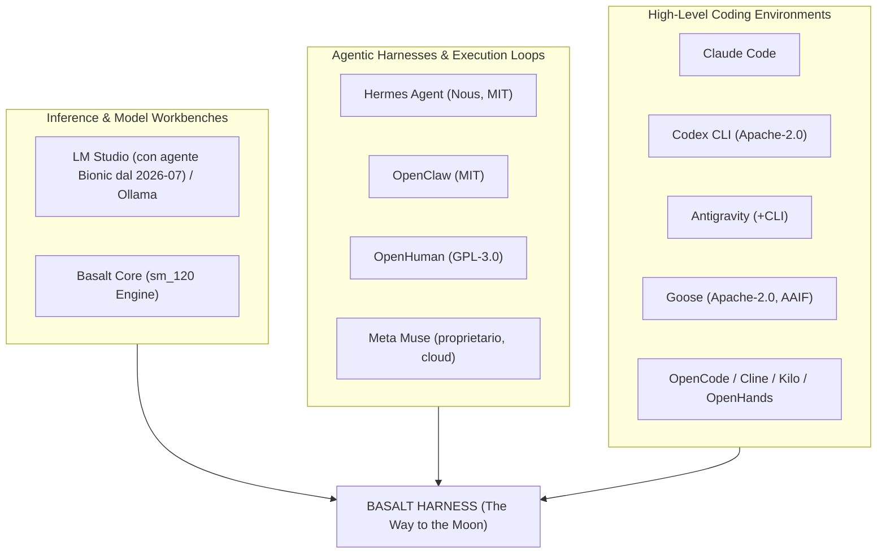
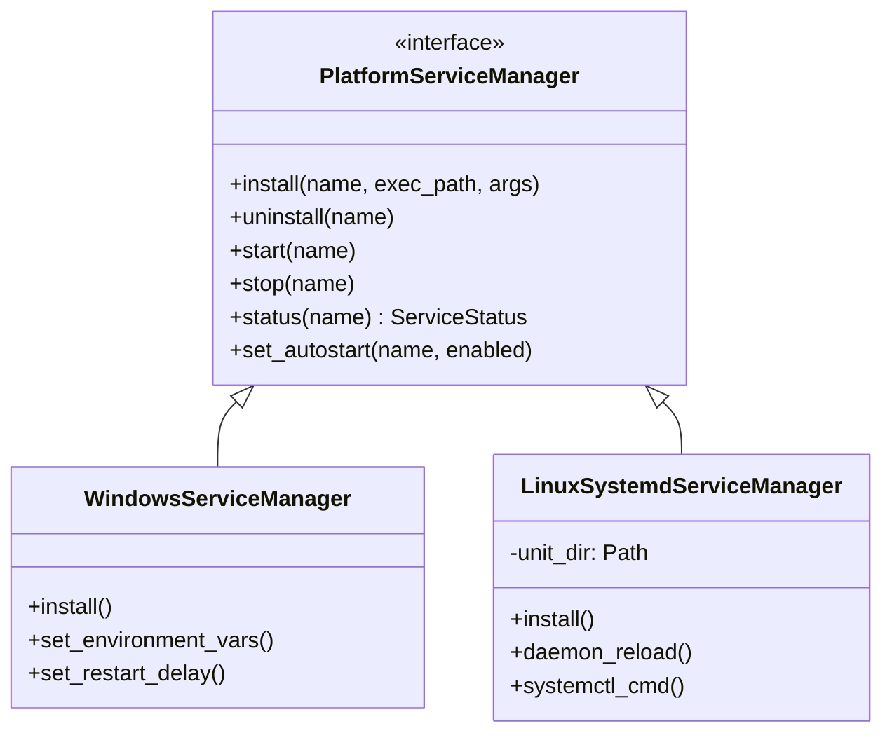
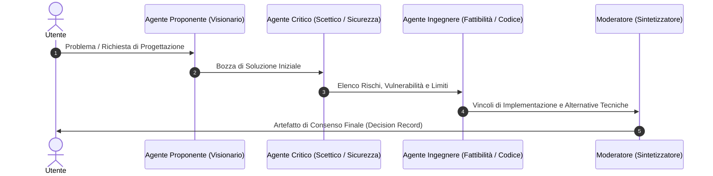
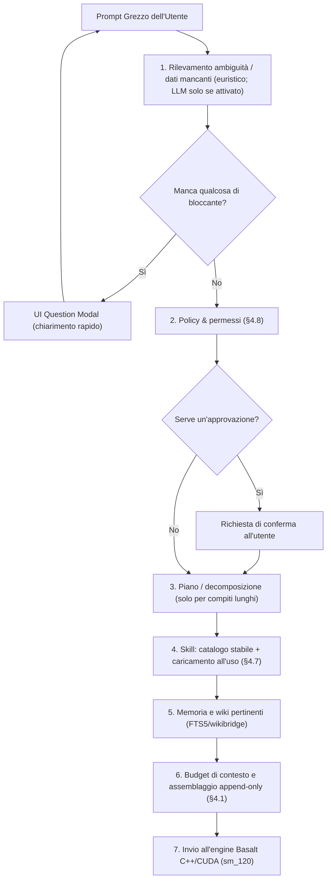
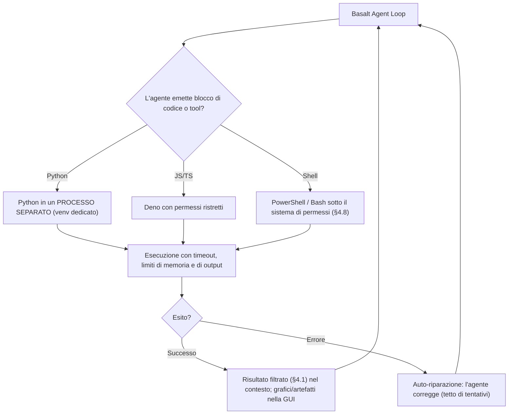
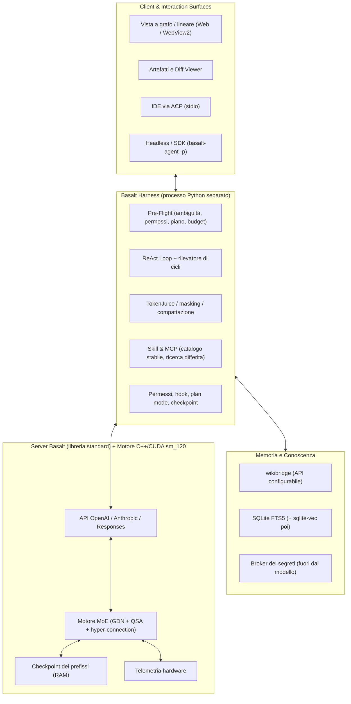
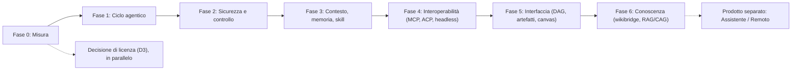

# THE WAY TO THE MOON
## Studio Architetturale, Specifiche e Roadmap per la Trasformazione di Basalt-Win-GUI in un Harness Agentico e Workbench Completo

> **Documento di Progettazione Esecutiva — versione rivista il 2026-10-18**  
> **Target di Realizzazione**: Claude Code  
> **Progetto**: Basalt (sm_120 Blackwell MoE Engine + Harness)  
> **Stato Base**: motore C++/CUDA + server HTTP Python (libreria standard) + GUI web e desktop WebView2 (vedi §3, verificato sul codice)  
> **Obiettivo**: Autonomous Agentic Harness, Infinite Canvas, Multi-Channel Gateway & Personal Assistant  
> **Revisione**: ogni correzione è segnata **[REV]** e rimanda alla sua prova (codice del repo o fonte letta il 2026-10-18, elenco in Appendice C). Il testo originale è conservato dove era corretto. L'originale integrale è in `the_way_to_the_moon.ORIGINALE.md`.

---

## Indice Generale

- [0. Esito della revisione (nuovo)](#0-esito-della-revisione-nuovo)
   - [0.1 Giudizio](#01-giudizio)
   - [0.2 Le correzioni che cambiano le decisioni](#02-le-correzioni-che-cambiano-le-decisioni)
   - [0.3 Cosa è stato aggiunto](#03-cosa-è-stato-aggiunto)
   - [0.4 Decisioni ancora aperte (Appendice B)](#04-decisioni-ancora-aperte-appendice-b)
   - [0.5 Decisioni prese dall'utente (2026-10-18)](#05-decisioni-prese-dallutente-2026-10-18)
- [1. Scopo dello Sviluppo](#1-scopo-dello-sviluppo)
- [2. Studio Comparativo dell'Offerta Esistente](#2-studio-comparativo-dellofferta-esistente)
   - [2.1 I Harness di Riferimento (verificati)](#21-i-harness-di-riferimento-verificati)
   - [2.2 I Coding Tool di Riferimento (verificati)](#22-i-coding-tool-di-riferimento-verificati)
   - [2.3 Cosa dicono le misure sul peso dell'harness (nuovo)](#23-cosa-dicono-le-misure-sul-peso-dellharness-nuovo)
- [3. Audit e Integrazione dello Stato Attuale di Basalt](#3-audit-e-integrazione-dello-stato-attuale-di-basalt)
   - [3.1 Ciò che esiste già](#31-ciò-che-esiste-già)
   - [3.2 Ciò che manca davvero (i gap veri)](#32-ciò-che-manca-davvero-i-gap-veri)
   - [3.3 Vincoli che il motore impone all'harness (nuovo)](#33-vincoli-che-il-motore-impone-allharness-nuovo)
- [4. Specifiche Funzionali e Soluzioni Tecniche di Dettaglio](#4-specifiche-funzionali-e-soluzioni-tecniche-di-dettaglio)
   - [4.1 Context Compactor & Token Optimization (TokenJuice)](#41-context-compactor--token-optimization-tokenjuice)
   - [4.2 Compatibilità Modelli & Multi-Model Arena](#42-compatibilità-modelli--multi-model-arena)
   - [4.3 Infinite Creative Canvas & Non-Linear Branching](#43-infinite-creative-canvas--non-linear-branching)
   - [4.4 Storage di Memoria: SQLite + sqlite-vec vs PostgreSQL + pgvector](#44-storage-di-memoria-sqlite--sqlite-vec-vs-postgresql--pgvector)
   - [4.5 Sistema Remoto Mobile con Pieno Controllo del SO](#45-sistema-remoto-mobile-con-pieno-controllo-del-so)
   - [4.6 Elevazione UAC all'Avvio & Gestione Servizi Unificata (NSSM vs Systemd)](#46-elevazione-uac-allavvio--gestione-servizi-unificata-nssm-vs-systemd)
   - [4.7 ReAct Loop, MCP Hub & Dynamic Skill Routing a Due Fasi](#47-react-loop-mcp-hub--dynamic-skill-routing-a-due-fasi)
   - [4.8 Safety Sandbox: modello di minaccia, livelli di autonomia e denaro](#48-safety-sandbox-modello-di-minaccia-livelli-di-autonomia-e-denaro)
   - [4.9 Self-Improvement & Cristallizzazione in Codice Deterministico](#49-self-improvement--cristallizzazione-in-codice-deterministico)
   - [4.10 Multi-Persona Brainstorming: Sintesi dei Modelli](#410-multi-persona-brainstorming-sintesi-dei-modelli)
   - [4.11 Visual Automation Graphs & Capacità Visive Estese](#411-visual-automation-graphs--capacità-visive-estese)
   - [4.12 Interactive Mutable Artifacts & Workflow Time-Travel](#412-interactive-mutable-artifacts--workflow-time-travel)
   - [4.13 High-Level Coding Platform & Memoria di Progetto](#413-high-level-coding-platform--memoria-di-progetto)
   - [4.14 Profilazione Dinamica dell'Utente](#414-profilazione-dinamica-dellutente)
   - [4.15 Personal Assistant Quotidiano & Email Triage](#415-personal-assistant-quotidiano--email-triage)
   - [4.16 RAG/CAG: Integrazione Nativa con wikibridge](#416-ragcag-integrazione-nativa-con-wikibridge)
   - [4.17 Pre-Flight Processing & Orchestrazione dei Prompt Lato App](#417-pre-flight-processing--orchestrazione-dei-prompt-lato-app)
   - [4.18 Architettura Ibrida RAG & CAG (Cache-Augmented Generation)](#418-architettura-ibrida-rag--cag-cache-augmented-generation)
   - [4.19 Motore di Esecuzione Codice Multi-Linguaggio (Code Execution Sandbox)](#419-motore-di-esecuzione-codice-multi-linguaggio-code-execution-sandbox)
   - [4.20 Protocolli ACP e A2A (Agent Client Protocol, Agent2Agent)](#420-protocolli-acp-e-a2a-agent-client-protocol-agent2agent)
   - [4.21 Valutazione e Misure (nuovo)](#421-valutazione-e-misure-nuovo)
   - [4.22 Funzioni di Base dei Migliori Harness che Mancano al Documento (nuovo)](#422-funzioni-di-base-dei-migliori-harness-che-mancano-al-documento-nuovo)
   - [4.23 Concorrenza e Risorse su una Sola GPU (nuovo)](#423-concorrenza-e-risorse-su-una-sola-gpu-nuovo)
   - [4.24 Osservabilità e Trasparenza (nuovo)](#424-osservabilità-e-trasparenza-nuovo)
- [5. La Nostra Soluzione Ideale: "Basalt Omniverse"](#5-la-nostra-soluzione-ideale-basalt-omniverse)
   - [5.1 La Mappa dei Concetti Assorbiti (corretta) + Cosa Aggiungiamo](#51-la-mappa-dei-concetti-assorbiti-corretta--cosa-aggiungiamo)
   - [5.2 I Pilastri di Basalt Omniverse (riscritti)](#52-i-pilastri-di-basalt-omniverse-riscritti)
   - [5.3 Schema Architetturale (corretto)](#53-schema-architetturale-corretto)
   - [5.4 Cosa Distingue Davvero Basalt (e Cosa è Ancora un'Ipotesi) (nuovo)](#54-cosa-distingue-davvero-basalt-e-cosa-è-ancora-unipotesi-nuovo)
- [6. Strategia di Migrazione della Licenza](#6-strategia-di-migrazione-della-licenza)
   - [6.1 Il Contesto Legale di Partenza](#61-il-contesto-legale-di-partenza)
   - [6.2 I termini della nuova licenza (bozza di lavoro per l'avvocato, non testo legale)](#62-i-termini-della-nuova-licenza-bozza-di-lavoro-per-lavvocato-non-testo-legale)
   - [6.3 Che cosa si può e che cosa non si può fare (limiti)](#63-che-cosa-si-può-e-che-cosa-non-si-può-fare-limiti)
   - [6.4 Piano di attuazione (da fare solo dopo il via dell'utente; nulla è stato eseguito)](#64-piano-di-attuazione-da-fare-solo-dopo-il-via-dellutente-nulla-è-stato-eseguito)
- [7. Architettura Target del Sistema](#7-architettura-target-del-sistema)
   - [7.1 Perché l'harness come processo separato](#71-perché-lharness-come-processo-separato)
   - [7.2 Albero dei moduli (proposto)](#72-albero-dei-moduli-proposto)
- [8. Roadmap Esecutiva di Implementazione per Claude Code](#8-roadmap-esecutiva-di-implementazione-per-claude-code)
   - [Dettaglio dei Task di Lavoro](#dettaglio-dei-task-di-lavoro)
   - [Da non fare (o da rimandare)](#da-non-fare-o-da-rimandare)
- [Appendice A — Registro delle correzioni](#appendice-a--registro-delle-correzioni)
- [Appendice B — Decisioni richieste (non prese da questo documento)](#appendice-b--decisioni-richieste-non-prese-da-questo-documento)
- [Appendice C — Fonti (lette il 2026-10-18)](#appendice-c--fonti-lette-il-2026-10-18)
- [Appendice D — Guida per la sessione di implementazione (contesto nuovo)](#appendice-d--guida-per-la-sessione-di-implementazione-contesto-nuovo)
   - [D.1 Come leggere questo documento](#d1-come-leggere-questo-documento)
   - [D.2 Stato del repository [verificato 2026-10-18]](#d2-stato-del-repository-verificato-2026-10-18)
   - [D.3 Regole di lavoro (dell'utente e di AGENTS.md) [verificato]](#d3-regole-di-lavoro-dellutente-e-di-agentsmd-verificato)
   - [D.4 Risorse condivise [verificato 2026-10-18]](#d4-risorse-condivise-verificato-2026-10-18)
   - [D.5 Ordine di partenza consigliato (sabato)](#d5-ordine-di-partenza-consigliato-sabato)
   - [D.6 Punti del documento ancora non verificati (da controllare prima di usarli)](#d6-punti-del-documento-ancora-non-verificati-da-controllare-prima-di-usarli)
   - [D.7 Decisioni ancora aperte (da chiedere all'utente, una alla volta quando servono)](#d7-decisioni-ancora-aperte-da-chiedere-allutente-una-alla-volta-quando-servono)
   - [D.8 Documenti correlati nel repository, non rivisti in questa revisione](#d8-documenti-correlati-nel-repository-non-rivisti-in-questa-revisione)
   - [D.9 Release 1.0 (stato) [verificato]](#d9-release-10-stato-verificato)

---

## 0. Esito della revisione (nuovo)

### 0.1 Giudizio

L'ambizione è giusta e la direzione tecnica è in gran parte sensata: un ciclo agentico lato server, contesto gestito in modo deterministico, memoria locale, protocolli standard (MCP, ACP), esecuzione di codice con auto-riparazione, interfaccia a grafo. Basalt ha inoltre un vantaggio reale e raro: **il motore e l'harness possono essere progettati insieme** (cache dei prefissi, telemetria hardware, slot paralleli, richieste tracciate).

Il documento però, così com'era, **non era pronto per essere eseguito**: conteneva errori sul nostro codice, sul mercato e sui protocolli che avrebbero prodotto lavoro sbagliato; una promessa di prestazioni non dimostrata (cache "congelata in VRAM", TTFT < 15 ms); una scelta di sicurezza (§4.8, livello 3) che le evidenze sconsigliano; una sezione sulla licenza che descriveva male cosa si può fare con codice di terzi (e che, al momento della revisione, contraddiceva la decisione MIT del 2026-10-17: l'utente ha poi deciso di adottarla, vedi §0.5); e **nessun modo di misurare** se l'harness sia "il migliore". Mescolava inoltre tre prodotti diversi (harness di coding, assistente personale, controllo remoto del PC), che per essere il migliore in uno vanno separati.

> **Verdetto**: il progetto è fattibile e promettente **se** si parte dalle misure (§4.21), dalle funzioni di base che i migliori harness hanno già (§4.22) e da un modello di sicurezza che non contiene il caso peggiore per costruzione (§4.8). Le funzioni "da assistente personale" e "controllo del PC da telefono" vanno trattate come un secondo prodotto, dopo.

### 0.2 Le correzioni che cambiano le decisioni

| # | Dove | Errore o lacuna | Correzione |
|---|---|---|---|
| 1 | §4.2 | «Qwen3.6-35B-A3B condivide la medesima topologia» | **Falso**: 40 strati, hidden 2048, 256 esperti, niente hyper-connection/PLE/n-gram; il motore lo rifiuta (`serve/models.py:809`). Nemmeno esiste un «Qwen3.8-35B-A3B» ufficiale. |
| 2 | §1, §4.2, §5 | «ibrido SSM/Mamba», «Head Compression (`hc_attn_*`)» | Il modello è **36 strati GDN (DeltaNet) + 12 QSA**, con **hyper-connection** (`hc`), non Mamba né head compression (`docs/precision.md:31,44`). |
| 3 | §3, §5.3, §7 | «Backend FastAPI / WebSocket» | Il server è `http.server` della libreria standard (`serve/handler.py:11,1213`); **non c'è alcun WebSocket**. Aggiungerli è una decisione (D6), non uno stato di fatto. |
| 4 | §4.18, §5.2 | «KV-Cache congelata in VRAM», «allineamento dei primi 3 layer», «TTFT < 15 ms» | Il motore tiene **checkpoint di stato in RAM** (~118 MB l'uno, 6 di default, **una sola catena**): funziona solo se la sequenza di token del prefisso è identica. Il TTFT non è misurato: va tolto o misurato. |
| 5 | §4.20 | ACP: `file/edit`, trasporto WebSocket, A2A come parte di ACP | `file/edit` **non esiste** (si usano `fs/*`, `terminal/*` e tool call di tipo `diff`); stabile è solo **stdio**; **A2A è un altro protocollo**; l'«Agent Communication Protocol» IBM è fuso in A2A e archiviato. |
| 6 | §4.7 | MCP «stdio e SSE/HTTP» | **Obsoleto**: oggi stdio + **Streamable HTTP**; HTTP+SSE è deprecato; la spec corrente (2026-07-28) è senza stato e deprecata Sampling/Roots. |
| 7 | §2 | Giudizi su LM Studio, Hermes, OpenClaw, OpenHuman, Muse, «Roo Code (Cangaroo)», Operator | Cinque su cinque hanno almeno un'affermazione sbagliata o superata (dettaglio in §2). «Cangaroo/Kangaroo» non esiste: è **Roo Code, archiviato il 2026-05-15**. |
| 8 | §4.8 | Livello 3: vault con password **e** segreto TOTP letti dall'agente, pagamenti senza presidio | Riunisce dati sensibili, contenuto non fidato ed effetti esterni (le tre condizioni che le fonti dicono di non combinare) e, in UE, rischia di far considerare l'utente in «colpa grave» (PSD2). Sostituito da un modello a **broker** con conferma su secondo dispositivo; **per decisione dell'utente (2026-10-18)** si aggiunge un **livello 4 opt-in con rinuncia esplicita alla protezione** (§4.8.4, D2 deciso). |
| 9 | §4.19 | «Python in-process isolato» | **Non è una sandbox**. Quattro livelli reali di isolamento su Windows, con i loro limiti. |
| 10 | §6 | «MIT o BSD-3»; «si può rilicenziare il progetto complessivo» | **BSD-3 non c'è nel repo** (era del progetto TUM, estraneo). Si possono licenziare diversamente **solo i propri contributi**; il resto resta MIT con gli avvisi (cinque, non uno). **Decisione dell'utente (2026-10-18): adottare la licenza commerciale del documento** (soglia US$ 10 milioni); piano di attuazione e limiti in §6 (D3 deciso). |
| 11 | assente | Mancano le funzioni di base dei migliori harness | Aggiunte in §4.22: hook, permessi a livelli, plan mode, checkpoint/rewind dei file, AGENTS.md, modalità headless/SDK, worktree, difese da prompt injection, LSP. |
| 12 | assente | Nessuna misura di «miglior harness» | Aggiunta §4.21: metriche, benchmark attuali (SWE-bench Verified è superato), confronto a modello fisso. |

### 0.3 Cosa è stato aggiunto

§0.5 Decisioni dell'utente del 2026-10-18 · §4.8.4-4.8.5 Livello 4 e broker dei pagamenti · §4.21 Valutazione e misure · §4.22 Funzioni di base mancanti · §4.23 Concorrenza e risorse su una sola GPU · §4.24 Osservabilità · §5.4 Cosa distingue davvero Basalt (e cosa è ancora un'ipotesi) · §7 architettura riscritta (l'harness come processo separato che parla con l'API pubblica) · §8 roadmap riordinata per rischio e con criteri di accettazione · Appendice A (registro delle correzioni) · B (decisioni richieste) · C (fonti).

### 0.4 Decisioni ancora aperte (Appendice B)

D1 trasporto ACP · D4 versione MCP · D5 isolamento del codice su Windows · D6 server: libreria standard o FastAPI/WebSocket · D8 modello di embedding per la memoria vettoriale · D9 quali concorrenti usare come riferimento. **Decise dall'utente il 2026-10-18** (§0.5): D2 (sicurezza finanziaria: livello 4), D3 (licenza), D7 (prodotti separati).

### 0.5 Decisioni prese dall'utente (2026-10-18)

| # | Decisione (parole dell'utente, riassunte) | Dove è recepita | Punti ancora da definire |
|---|---|---|---|
| **D3** | «Passiamo alla licenza del documento, commerciale per aziende sopra 10 milioni di **dollari**» | §6 | Valuta (il testo originale diceva euro); definizione di fatturato; testo legale (avvocato); quali file; prezzi e modalità |
| **D2** | Aggiungere il **livello 4**: l'utente rinuncia esplicitamente alla protezione scrivendo una frase in un dialog; raccolta di prove; doppia conferma di scarico e di accettazione di responsabilità; procedura per ogni sistema di pagamento | §4.8.4 | Il massimale è per pagamento o cumulativo? Significato di «per utente»; scadenza; valore giuridico delle prove |
| **D7** | Prodotti **separati**; il remoto ha **funzioni minime di controllo e iniziazione**, da individuare al momento | §4.5, §8 | L'elenco delle funzioni minime del remoto |

---

## 1. Scopo dello Sviluppo

Il progetto **Basalt** è nato come motore di inferenza C++/CUDA ultra-ottimizzato per architetture NVIDIA Blackwell (`sm_120`), specificamente tarato sul modello Mixture-of-Experts `Qwen3.8-Flash-Next` (**[REV]** strati a ricorrenza GDN/DeltaNet e attenzione sparsa QSA, hyper-connection, esperti instradati), corredato da un server locale e da un'interfaccia grafica desktop e web (`Basalt-Win-GUI`).

L'obiettivo di **"The Way to the Moon"** è compiere un salto generazionale:
> **Trasformare Basalt da un runner/viewer locale in un Harness Completo, Autonomo e Omnicomprensivo**, unificando in un'unica applicazione desktop/server le capacità di inferenza locale rapida, un'infrastruttura agentica avanzata (ReAct loop, gestione autonoma dei tool, sandbox di sicurezza personalizzabile), una memoria a lungo termine persistente, un'interfaccia a tela infinita (Infinite Canvas), un assistente personale proattivo e una piattaforma di coding di classe mondiale.

**[REV] Criterio di successo (nuovo).** «Il miglior harness» non è verificabile finché non si dice su quale asse e rispetto a chi. Questo documento lo definisce così (dettaglio in §4.21):

1. **A modello fisso** (Qwen3.8-Flash-Next su Basalt), l'harness di Basalt ottiene un punteggio più alto, con ripetizioni, degli altri harness puntati sullo **stesso endpoint** (Claude Code, OpenCode, Goose, Cline…) su un insieme di compiti pubblici e privati.
2. Il costo per compito (token, secondi, energia) è misurato e dichiarato; il tasso di *cache hit* del prefisso è una metrica di prima classe.
3. Nessuna funzione per cui non esiste una misura viene presentata come "migliore": resta un'ipotesi (§5.4).

L'implementazione del codice è affidata a **Claude Code**, mentre il presente documento funge da specifica tecnica, guida architetturale e contratto operativo per ogni modulo.

---

## 2. Studio Comparativo dell'Offerta Esistente

> **[REV]** Questa sezione è stata riscritta: le affermazioni originali sono state verificate su fonti primarie il 2026-10-18 (repo, spec, documentazione, annunci ufficiali). Dove una fonte non esiste lo si dice. Le cifre di stelle e versioni sono quelle del giorno di lettura.

I moderni framework AI si dividono in categorie che si sovrappongono sempre di più. **[REV]** Il testo originale sosteneva che «nessun software esistente integra inferenza locale e spettro agentico»: oggi non è più vero (LM Studio ha un agente proprio, Hermes e OpenClaw funzionano con modelli locali). Quello che nessuno ha è **un motore di inferenza e un harness progettati insieme, per una GPU consumer, in modo nativo su Windows**.



### 2.1 I Harness di Riferimento (verificati)

1. **LM Studio**
   - *Fatti*: app desktop + CLI `lms` + modalità headless + SDK; server compatibile OpenAI e (dal 2026-01) Anthropic; **host MCP dal 0.3.17 (2025-06)**; **agente proprio "Bionic" dal 2026-07-16** (progetti, skill, Auto Review dei comandi shell).
   - *[REV] Il limite scritto era sbagliato*: non è un «runner passivo senza loop agentico né memoria»; oggi è il concorrente locale più diretto. Va tolto «nessun loop autonomo» e aggiunto Bionic come riferimento.
2. **Hermes Agent (Nous Research, MIT, ~255k stelle)**
   - *Fatti*: loop di apprendimento chiuso con skill `SKILL.md` (standard agentskills.io), memoria curata dall'agente (`MEMORY.md`, `USER.md`) + ricerca FTS5 sulle sessioni, subagenti isolati, scheduler cron, gateway Telegram/Discord/Slack/WhatsApp/Signal, 7 backend di esecuzione, Windows nativo.
   - *[REV] Limiti sbagliati*: esiste **Hermes Desktop** (non è solo CLI/bot) e il comando `/compress` (la compattazione c'è). «Gerarchici» è nostra aggiunta: la fonte dice «subagenti isolati».
3. **OpenClaw (MIT, ~392k stelle, fondazione 501(c)(3))**
   - *Fatti*: gateway omni-canale (20+ canali), app native, Canvas, memoria `MEMORY.md` / `memory/AAAA-MM-GG.md` / `USER.md` / `DREAMS.md`.
   - *[REV]* «Accoppiamento rigido a modelli cloud» è **falso** (i modelli e gli harness sono plugin, anche locali). «Sandbox a percorsi con conferma interattiva»: **parziale** — la sandbox è **disattivata di default** e le policy sono allow/deny dei tool. Casi di sicurezza 2026 (skill malevole nel registro, istanze esposte) sono riportati solo da fonti secondarie ma sono un monito per §4.9.
4. **OpenHuman (TinyHumans AI, GPL-3.0, beta)**
   - *Fatti*: **TokenJuice** esiste (compressione degli output dei tool, originale recuperabile; «fino all'80%» è un'affermazione del produttore, non una misura indipendente); **TinyFlows** esiste (motore di workflow a grafo, crate Rust).
   - *[REV]* «Ecosistema chiuso» è **falso** (GPL-3.0, supporta Ollama/LM Studio). Il **Memory Tree SQLite/Obsidian è stato rimosso** nelle versioni attuali (ora CortexDB): il documento descriveva una versione superata.
5. **Meta Muse (annunciato 2026-09-08, proprietario, solo USA)**
   - *Fatti*: agente personale su VM cloud sicura, agente separato che approva le azioni verso internet, *side chats* (ramificazione), *Artifacts*, carte virtuali monouso, *Muse Code* (terminale, multi-agente).
   - *[REV]* **«Infinite canvas» e «council dialettico» non compaiono in nessuna fonte ufficiale.** Restano proposte di Basalt, non feature di Muse: vanno riattribuite.

> **[REV]** Il numero «5 harness» era un conteggio del documento: LM Studio era un runtime, non un harness, fino a Bionic.

### 2.2 I Coding Tool di Riferimento (verificati)

| Strumento | Stato verificato (2026-10-18) | Correzioni al testo originale |
|---|---|---|
| **Claude Code** | Anthropic, proprietario; v2.1.x; hook, subagenti, skill, plan mode, checkpoint/rewind, compattazione, modalità headless e SDK, worktree, `CLAUDE.md` | «grep semantico, file indexing»: **non documentato** (ricerca per pattern e regex); «commit atomici» non è una sua peculiarità |
| **Antigravity** | Google; 2.0 (2026-05-19) app per agenti paralleli; **Antigravity CLI ha sostituito Gemini CLI** per i consumer dal 2026-06-18 | «subagenti reattivi senza polling»: **non verificabile** |
| **Codex CLI** | OpenAI, Apache-2.0, Rust; sandbox/approvazioni, subagenti, skill, `AGENTS.md`, MCP, `codex exec` | «parsing AST fine-grained»: **non trovato** nelle docs |
| **~~OpenAI Operator~~** | **Errore di categoria**: è un agente-browser, **ritirato** (assorbito in ChatGPT agent nel 2025) | Va tolto dall'elenco dei coding tool |
| **Goose** | Creato da Block, ora sotto la Agentic AI Foundation (Linux Foundation), Apache-2.0; MCP, ACP, subagenti | «Goose / Kangaroo» era un accoppiamento errato |
| **~~Roo Code («Cangaroo/Kangaroo»)~~** | Il nome giusto è **Roo Code**; **repository archiviato il 2026-05-15** | Non assorbire un progetto chiuso; la «formula di budget dinamico» **non è sua** (Roo riserva il 30%: 20% output + 10% buffer) |
| **Aider** | Apache-2.0; **RepoMap a grafo con tree-sitter**: vero; sviluppo quasi fermo (ultima release 2025-08) | Il riferimento giusto per la mappa del repo, ma non per la vitalità |
| **OpenCode, Cline, Kilo Code, OpenHands, agente di Zed** | Tutti attivi; plan/act, checkpoint o undo, MCP, ACP (o client ACP), SDK | Da aggiungere come riferimenti (D9) |

### 2.3 Cosa dicono le misure sul peso dell'harness (nuovo)

A modello fisso, la scelta dell'harness e persino le risorse di esecuzione spostano il risultato quanto un cambio di modello: lo mostrano un articolo del maggio 2026 sulla necessità di dichiarare l'harness nei confronti e un'analisi di Anthropic (febbraio 2026) in cui le sole risorse hanno spostato di circa 6 punti il risultato su Terminal-Bench. È il motivo per cui §4.21 è la prima cosa da costruire, e perché non ha senso dichiarare «il migliore» senza un confronto a modello fisso.

---

## 3. Audit e Integrazione dello Stato Attuale di Basalt

> **[REV]** Ogni riga è stata controllata sul codice del repo il 2026-10-18 (`file:riga` dove utile). L'audit originale era corretto sui punti 1-3 ma ignorava gran parte di ciò che già esiste.

### 3.1 Ciò che esiste già

| Area | Stato verificato | Riferimento |
|---|---|---|
| **Server HTTP** | `ThreadingHTTPServer` della libreria standard; **nessun FastAPI, nessun WebSocket**; dipendenze minime (numpy, jinja2, regex, pyyaml, tqdm, pillow, psutil) | `serve/handler.py:11,1213`, `requirements.txt` |
| **API pubbliche** | `/v1/chat/completions` (OpenAI), `/v1/messages` + `/v1/messages/count_tokens` (Anthropic), `/v1/responses` (OpenAI Responses), `/v1/status`, `/metrics`, `/slots`, `/props` | `serve/handler.py` |
| **Tool calling** | Parser dei tag Qwen `<tool_call><function=…><parameter=…>` in streaming; `tool_choice` (auto, nessuno, obbligato, nominato); **ordine stabile degli strumenti** (prefisso stabile); campo `parallel_tool_calls` | `serve/frontend.py:575` (`parse_tool_call`), `:527` (`tool_choice_of`), `:281` (`stable_tool_order`), `serve/api/responses.py:345` |
| **Output strutturato** | `response_format` JSON / JSON Schema validato, con **nuovi tentativi guidati** dall'errore (`structured_retries`, messaggio di riparazione, ragionamento che scorre) | `serve/api/openai.py`, `serve/api/repair.py` |
| **Compattazione del contesto** | `fit(svc, req)` con policy `stop`, `rolling`, `compact`; `head_of(messages)` protegge il primo messaggio di sistema/sviluppatore e il primo utente; soglia `COMPACT_THRESHOLD = 0.8` | `serve/chatctx.py:12,15,36,122` |
| **Cache dei prefissi** | **Checkpoint di conversazione** in RAM (non KV in VRAM): `prompt-cache` = 6 (≈118 MB ciascuno), `prompt-cache-root` = 2048 token (checkpoint a fine system prompt), `prompt-cache-every` = 16384; **una sola catena** (ogni checkpoint è prefisso del successivo) | `docs/configuration.md:174-176`, `include/basalt/program/conv_cache.hpp:4-24` |
| **Decodifica speculativa (MTP)**, **slot paralleli 1..8** (contesto diviso tra gli slot), **visione**, **ragionamento a budget** | Presenti; il contesto massimo è condiviso: ogni slot ne ha `max-context / N` | `docs/configuration.md:104,166` |
| **Osservabilità** | Registro delle richieste (tab LOGS): corpo ricevuto, ragionamento e risposta, tentativi strutturati, tempi, motivo di fine; log del server e del motore | `serve/util/reqlog.py`, `serve/web/reqlog.js` |
| **Hardware e piani** | Piano di memoria (VRAM, RAM, commit), previsione di velocità, calibrazione, profili, configurazione guidata, **Machine Default** | `serve/loader.py`, `serve/profiles.py`, `serve/hardware.py`, `serve/web/wizard.js` (**non** `serve/wizard.js`) |
| **Modelli** | Libreria di modelli, conversione e verifica, **catalogo scaricabile** da Hugging Face con piano, ripresa e SHA-256 | `serve/models.py`, `serve/catalog.py`, `serve/downloads.py` |
| **Windows** | Porting nativo del motore, app desktop WebView2, script di avvio, job object con chiusura automatica | `docs/WINDOWS.md` |

### 3.2 Ciò che manca davvero (i gap veri)

1. **Un ciclo agentico lato server** che riceva il tag `<tool_call>`, esegua lo strumento, rimandi il messaggio `role: "tool"` e ripeta: oggi il parser c'è, il ciclo no (lo fa il client).
2. **Pre-filtraggio degli output dei tool** prima che entrino nel contesto (mascheramento, troncamento recuperabile).
3. Un **client MCP**, le **skill**, la **memoria persistente**, un **modello di permessi/sandbox**, **ACP**, **hook**, **checkpoint dei file**, **AGENTS.md**, la modalità **headless/SDK**.
4. Un **insieme di valutazione** che dica se una modifica all'harness migliora o peggiora (§4.21).
5. **Blocchi pinned multipli** nel contesto (profilo utente, regole di progetto…): `head_of` protegge solo l'indice 0 e il primo messaggio utente.

### 3.3 Vincoli che il motore impone all'harness (nuovo)

- **Il prefisso conta, non il «layer»**: la cache riparte solo se la sequenza di token è identica fino a quel punto. Un timestamp, un id di sessione o uno strumento che cambia ordine nel prefisso azzera il riuso. L'harness deve produrre prefissi **byte-stabili** e **append-only** (cfr. §4.1, §4.18).
- **Una catena, sei checkpoint**: conversazioni diverse che non condividono il prefisso si sfrattano a vicenda; modificare un messaggio nel mezzo costringe a rileggere tutto da lì.
- **Contesto condiviso tra gli slot**: più subagenti in parallelo riducono il contesto di ciascuno (§4.23).
- **Un solo motore MoE per GPU**: embeddings e modelli ausiliari competono per VRAM/RAM (§4.4).

## 4. Specifiche Funzionali e Soluzioni Tecniche di Dettaglio

> **[REV] Principio guida (nuovo).** Ogni funzione di questa sezione ha: *a)* un'ipotesi di beneficio, *b)* una misura che la conferma (§4.21), *c)* un modello di minaccia se tocca file, rete, credenziali o denaro (§4.8). Una funzione senza (b) è un'ipotesi, non un requisito.

### 4.1 Context Compactor & Token Optimization (TokenJuice)

#### Architettura della Memoria di Contesto Pinned
Per non perdere mai le istruzioni fondamentali durante le lunghe sessioni agentiche:
- **Oggetto Turno Arricchito**: Ogni messaggio nel contesto dell'harness supporta un flag `pinned: bool` e una categoria `pin_category: str` (`system_core`, `user_profile`, `project_rules`, `active_skills`).
- **Logica di Evizione e Compattazione**:
  ```python
  def get_eviction_candidates(messages: list[dict]) -> list[int]:
      # Nessun blocco con pinned == True o appartenente alle categorie protette può essere rimosso
      return [i for i, m in enumerate(messages) if not m.get("pinned", False)]
  ```
  **[REV]** Estende `chatctx.head_of()` (oggi protegge solo l'indice 0 e il primo messaggio utente, `serve/chatctx.py:36`) a più blocchi. I blocchi pinned devono stare **all'inizio e in ordine fisso**: è lì che il motore riusa i checkpoint (§3.3).

#### Ordine di intervento sul contesto (nuovo, basato su evidenze)
Le evidenze disponibili indicano che **non si deve partire dal riassunto fatto dal modello**:

1. **Mascheramento / azzeramento deterministico delle vecchie osservazioni** (sostituire un vecchio risultato di tool con un segnaposto recuperabile). Uno studio JetBrains/TUM (arXiv 2508.21433) lo trova **equivalente alla sintesi con LLM a metà costo** (con Qwen3-Coder 480B: 53,8% → 54,8%); l'ibrido riduce il costo di un altro 7-11%. La generalizzazione ad altri harness è «evidenza iniziale».
2. **Offload su file con riferimento leggero**: l'output completo va in `artifacts/`, nel contesto resta il riferimento (compressione «sempre ripristinabile»).
3. **Compattazione strutturata fatta dal modello** (*Facts, Decisions, Open questions, Code*, come già fa `chatctx`) solo come ultima leva e al punto in cui il prefisso si ferma comunque.

**[REV] Costo nascosto, specifico di Basalt.** Modificare o togliere un messaggio **nel mezzo** del contesto invalida il checkpoint da quel punto e forza una nuova lettura (prefill) di tutto ciò che segue (§3.3). Quindi: contesto **append-only**, serializzazione deterministica, nessun timestamp o id variabile nel prefisso, strumenti sempre nello stesso ordine (già garantito da `stable_tool_order`). La compattazione va fatta **a confini che coincidono con i checkpoint** (`prompt-cache-root`, `prompt-cache-every`).

#### Pre-Compattazione Tool Output (TokenJuice Layer)
Quando un tool restituisce un output:
1. *JSON Trimming*: Se il tool restituisce un JSON superiore a 1 KB, viene formattato eliminando campi nulli, chiavi ridondanti e indentazioni inutili.
2. *Code/Log Truncation*: Se un output di shell supera le 40 righe, vengono preservate le prime 15 righe (setup/input) e le ultime 20 righe (esito/errori/stack trace), collassando il centro in `[... N lines hidden; saved to artifacts/log_XYZ.txt ...]`.
3. *HTML to Clean Markdown*: Pagine web lette tramite browser/curl vengono depurate di CSS, script e tag non semantici.

**[REV]** Le soglie (1 KB, 40 righe, 15+20) sono **scelte di progetto, non valori ottimali dimostrati**: vanno rese configurabili per tipo di strumento e tarate con le misure di §4.21. La cifra «riduce i token del 70-85%» **non ha una fonte** (TokenJuice di OpenHuman dichiara «fino all'80%» come affermazione del produttore) e va tolta finché non è misurata sui nostri casi. Le righe degli errori e degli stack trace non si troncano mai; gli errori **restano** nel contesto (aiutano il modello a non ripeterli).

---

### 4.2 Compatibilità Modelli & Multi-Model Arena

#### Modelli Supportati dall'Engine C++
I kernel in `src/kernels/` sfruttano istruzioni native Blackwell (`sm_120`), quantizzazioni estreme (IQ3/IQ4, MMQ, Q8_0, NVFP4 lato upstream) e una pipeline per un modello ibrido a ricorrenza.
- **Modello Primario ed Unico Supportato**: `Qwen3.8-Flash-Next` (**[REV]** 48 strati: 36 GDN + 12 QSA; hyper-connection `hc`; 512 esperti, 10 attivi per token; PLE; tabella n-gram).

> **[REV] Correzione di un errore sostanziale.** Il testo originale indicava `Qwen3.6-35B-A3B` come «candidato diretto compatibile» con «la medesima topologia di tensori (Head Compression, PLE, Mamba conv1d)». **È falso:**
> - `Qwen3.6-35B-A3B` ha architettura `qwen35moe`: **40 strati** (30 GDN + 10 attenzione densa), hidden size **2048**, **256 esperti** (8 attivi), **nessuna** hyper-connection, **nessun** PLE, **nessuna** tabella n-gram, **nessun** indicizzatore QSA. Un «Qwen3.8-35B-A3B» **ufficiale non esiste** (esistono distillazioni di terzi su quell'architettura).
> - Il motore ha le forme di Flash-Next scritte nel codice (hidden 2560, 48 strati, 512 esperti, decine di kernel specializzati) e **rifiuta** qualunque GGUF diverso (`serve/models.py:809`, `include/.../gguf_reader.hpp`). Il contenitore `.basalt` è generico, il vincolo è nel motore e nel convertitore.
> - Supportare un secondo modello significa **un secondo motore** (residuo senza hyper-connection, attenzione densa, kernel parametrizzati), non «piccole modifiche».
> - «hc» significa **hyper-connection**, non «head compression».

- **Apertura a modelli aggiuntivi**: **[REV]** solo con lavoro di motore esplicito; il documento non deve darla per scontata. L'harness, invece, deve restare **indipendente dal modello** parlando con un endpoint OpenAI/Anthropic compatibile (§7): così può usare anche modelli cloud e altri backend.

#### Implementazione dell'Arena Side-by-Side
La GUI offrirà una modalità **Arena / Benchmark** sdoppiata:
1. **Arena Locale (In-Engine)**: confronta due configurazioni dello stesso modello (es. Q8_0 di riferimento vs IQ3 quantizzato; MTP abilitato vs disabilitato). **[REV]** Su una sola GPU le due configurazioni **non girano insieme** se la memoria non basta: l'arena è di norma *sequenziale* (ricarica del motore tra un lato e l'altro, già supportata dal Loader) o parallela solo quando i due piani di memoria stanno insieme.
2. **Arena Ibrida (Local vs Cloud Gateway)**: tramite adapter leggeri OpenAI/Anthropic/Ollama in `serve/harness/arena_bridge.py`, la GUI può inviare il prompt in parallelo a Basalt e a un'API esterna, visualizzando tempo di primo token (TTFT), velocità (tok/s), memoria e qualità. **[REV]** La «qualità della risposta» richiede un criterio (suite di test eseguibili, rubrica, o giudice automatico dichiarato come tale); senza criterio l'arena misura solo velocità. Con chiavi API esterne si applicano le regole di §4.8 (mai nel contesto del modello).

---

### 4.3 Infinite Creative Canvas & Non-Linear Branching

L'interfaccia si arricchisce di una vista **Canvas 2D** a nodi infinita:

```
[Nodo Radice: Idea Iniziale]
        │
        ├──> [Ramo A: Soluzione Microservizi] ──> [Analisi Costi] ──┐
        │                                                          ├──> [Nodo Merge: Architettura Finale]
        └──> [Ramo B: Soluzione Monolite C++]  ──> [Bench Latenza] ─┘
```

> **[REV] Attribuzione.** Né l'«infinite canvas» né il «council» risultano nelle fonti ufficiali di Meta Muse (esistono *side chats* e *Artifacts*). Il canvas è una **proposta propria di Basalt**; OpenClaw ha un Canvas, ma di altro tipo.

#### Meccanismo Operativo:
- **Struttura Dati a Grafo (DAG)**: La sessione non è un array `messages: []`, ma un grafo di nodi dove ogni nodo contiene: `id`, `parent_ids`, `content`, `role`, `artifacts`, `token_count`, `metadata`. **[REV]** I nodi sono **immutabili e indirizzati per contenuto** (event sourcing append-only): permette fork economici, replay e confronti, ed è la base di §4.12.
- **Navigazione e Forking**: Su qualunque risposta, l'utente può cliccare su **"Fork Branch"**. L'agente genera un nuovo ramo mantenendo l'esatto contesto ancestrale fino a quel nodo, senza duplicare la memoria su disco. **[REV]** Sul motore, però, **solo un ramo alla volta beneficia dei checkpoint** (catena unica): cambiare ramo può costare una nuova lettura del prefisso. È accettabile ma va mostrato (stima del costo di prefill prima del cambio) e misurato.
- **Merge Node**: L'utente può selezionare due o più nodi foglia e cliccare su **"Merge & Synthesize"**. L'agente riceve entrambi i percorsi e genera un documento unificato.
- **Spazio di Lavoro Spaziale**: spostare le schede, raggrupparle in aree tematiche colorate, fissare documenti di riferimento, zoom.

**[REV] Priorità: bassa.** Il canvas è una superficie di interazione, non un moltiplicatore di capacità dell'agente; va dopo il ciclo, i permessi, il contesto e le misure (§8). **Accessibilità**: una vista a nodi deve avere un'alternativa lineare navigabile da tastiera e da lettore di schermo, e funzionare a 360×640 con tocco (regola permanente del progetto).

---

### 4.4 Storage di Memoria: SQLite + sqlite-vec vs PostgreSQL + pgvector

#### Confronto Tecnico Approfondito

| Proprietà | SQLite + `sqlite-vec` + FTS5 | PostgreSQL + `pgvector` |
|---|---|---|
| **Distribuzione su Desktop** | **Zero-Config**: 1 singolo file `.db` nella cartella utente/progetto. Nessun installer, nessun demone di background, nessuna porta TCP aperta. | Richiede l'installazione di un DBMS esterno (servizio di Windows o container Docker). Rischio di conflitti di porta e crash del servizio. |
| **Resilienza & Manutenzione** | Alta. Il WAL garantisce l'integrità dopo un crash. Backup con un semplice `copy`. | Richiede gestione delle credenziali, tuning della memoria, script di migrazione e backup con `pg_dump`. |
| **Latenza di Accesso Locale** | Accesso diretto in-process tramite C-API (Python `sqlite3`). | Richiede serializzazione di rete su socket TCP (localhost:5432). |
| **Ricerca Ibrida (Testo + Vettoriale)** | FTS5 nativo per chiavi esatte, codice e identificatori + `sqlite-vec` per similarità semantica. | Potente, ma pesante per un'applicazione desktop stand-alone monoposto. |

#### Decisione Architetturale (confermata, con precisazioni):
1. **Core Default**: **SQLite con FTS5** subito; **`sqlite-vec` come passo successivo**. **[REV]** Il vettoriale richiede un **modello di embedding** (es. bge-m3, nomic-embed-text): il motore Basalt esegue un solo modello MoE, quindi gli embedding girano **altrove** (CPU, o un secondo processo) e **competono per RAM/VRAM** con il modello principale (D8). La disponibilità e il caricamento di `sqlite-vec` su Python/Windows vanno **verificati** prima di promettere la funzione. Hermes usa già FTS5 sulle sessioni: per la maggior parte dei casi d'uso (codice, identificatori, wiki) FTS5 da solo è un ottimo inizio.
2. **Enterprise Remote Adapter**: interfaccia astratta `BaseMemoryStore` che permetta di indirizzare la memoria verso PostgreSQL + pgvector. **[REV]** Priorità bassa: non scrivere l'adapter finché non c'è un secondo utente reale.
3. **Dove vivono i dati**: **[REV]** nella cartella dati dell'utente già usata da Basalt (`serve/userdata.py`, `%APPDATA%`), **non** in `data/` dentro il repo. Cifrati a riposo i dati personali (§4.14); permessi di file restrittivi.

---

### 4.5 Sistema Remoto Mobile con Pieno Controllo del SO

> **[DECISIONE dell'utente, 2026-10-18] Prodotti separati; il remoto avrà «funzioni minime di controllo e iniziazione», da individuare al momento.** L'elenco delle funzioni minime **non è ancora definito**: quando lo sarà, va confrontato con i livelli qui sotto (la proposta di partenza è il livello 1: vedere lo stato, **iniziare** un compito, approvare/rifiutare, interrompere).
>
> **[REV] Perché separare.** Controllo remoto del PC da telefono è un prodotto a sé, con un modello di minaccia tutto suo (una shell remota è per costruzione esecuzione di codice a distanza). Per un harness di coding *migliore* non è prioritario. Si propone di dividerlo in livelli, da fare in quest'ordine e **solo se richiesti**:
> 1. **Visualizzatore di sessione + approvazioni da remoto** (vedere lo stato, approvare/rifiutare le richieste di permesso, interrompere). È il 90% del valore e il 5% del rischio.
> 2. **Terminale PTY interattivo** sullo stesso canale.
> 3. **Streaming dello schermo e controllo mouse/tastiera**: sconsigliato come funzione nativa; esistono strumenti dedicati (es. RustDesk, Sunshine/Moonlight, o il desktop remoto di Windows) da **affiancare** invece di riscrivere.

Per consentire all'utente di continuare la sessione avviata su PC direttamente da smartphone o tablet:

```
[Dispositivo Mobile (PWA / WebApp / Native App)]
         │
         │ (Tunnel Sicuro: Tailscale / Cloudflare Zero Trust / mTLS)
         ▼
[Basalt Remote Gateway (serve/gateway/daemon.py)]
         ├──> Controllo Sessione & Canvas (Stato sincronizzato)
         ├──> Terminale PTY Interattivo (livello 2)
         └──> File Manager Remoto (sola lettura di default)
```

- **Sicurezza**: autenticazione a chiave asimmetrica (Ed25519) per dispositivo + token temporanei con scadenza; traffico cifrato end-to-end; **disattivato di default**; allowlist di dispositivi; registro di audit append-only; interruttore di arresto immediato. **[REV]** Riutilizzare la rete privata già presente (Tailscale con ACL) invece di esporre porte; nessuna porta su internet senza credenziali e certificato client.
- **Session Continuity**: lo stato del workflow risiede nel demone di Basalt, non nel browser. **[REV]** Con la libreria standard il canale in tempo reale si fa con **SSE + richieste POST** (già usato per lo streaming delle risposte); un WebSocket vero richiede una dipendenza in più (D6).

---

### 4.6 Elevazione UAC all'Avvio & Gestione Servizi Unificata (NSSM vs Systemd)

#### Elevazione UAC all'Avvio
- **[REV] Principio del minimo privilegio.** Un'app che gira **sempre** come amministratore moltiplica il danno di qualunque errore o prompt injection (§4.8). Raccomandazione: **default `run_as_admin: false`**; l'app resta non elevata e ricorre a un **piccolo helper elevato** solo per operazioni puntuali (installare/rimuovere il servizio, regole del firewall). L'elevazione completa resta un'opzione esplicita.
- Nel manifest di Windows (`tools/windows/basalt.manifest`) o nel bootstrapper `Program.cs`, flag in `basalt_config.json`: `"run_as_admin": false`. Con il flag attivo, all'avvio:
  ```csharp
  var identity = WindowsIdentity.GetCurrent();
  var principal = new WindowsPrincipal(identity);
  if (config.RunAsAdmin && !principal.IsInRole(WindowsBuiltInRole.Administrator)) {
      var startInfo = new ProcessStartInfo {
          FileName = Application.ExecutablePath,
          UseShellExecute = true,
          Verb = "runas" // Forza il prompt UAC di Windows
      };
      Process.Start(startInfo);
      Application.Exit();
      return;
  }
  ```
- Su Linux: controllo su `UID == 0` o `pkexec`/`sudo` solo per le operazioni di sistema richieste.

#### Gestione Servizi di Sistema Unificata (NSSM Windows / Systemd Linux)
Modulo `serve/platform/service_manager.py` con interfaccia comune:



- **Windows**: **[REV]** NSSM è una scelta valida ma è un binario di terzi da distribuire e mantenere (non è oggi in `tools/windows/`); alternative: servizio nativo (`sc`/pywin32) o WinSW. Qualunque sia la scelta: `AppDirectory`, redirect di stdout/stderr su `logs/basalt-service.log`, riavvio dopo crash. **Attenzione**: un servizio gira in sessione 0 (nessuna finestra, nessun WebView2): il **server** può essere servizio, la **GUI** resta un processo utente che vi si collega. Va verificato che l'arresto del servizio liberi la memoria GPU come il job object con chiusura automatica già usato oggi.
- **Linux**: genera `basalt.service` con `Restart=always`, `After=network.target`.
- **UI nella GUI**: nel tab *Settings*, un pannello per installare, avviare o rimuovere il servizio, con lo stato (Active/Stopped/Failed).

---

### 4.7 ReAct Loop, MCP Hub & Dynamic Skill Routing a Due Fasi

#### Il Problema del Context Bloat nelle Skill
Se l'harness carica 50 skill complete nel system prompt iniziale, consuma decine di migliaia di token prima che l'utente scriva la prima parola, rallentando il prefill e degradando l'attenzione del modello.

#### La Soluzione: Two-Tier Progressive Skill Routing

```
FASE 1: Richiesta Utente
   │
   ▼
[Catalogo sintetico stabile nel prefisso: nome + una riga per ogni skill]
     * git: Esegue operazioni sui repository (commit, diff, branch)
     * browser: Naviga pagine web ed estrae dati interattivi
     * wikibridge: Interroga e importa la documentazione di progetto
     * bash: Esegue comandi di sistema nel terminale
   │
   ▼
[Il modello (o un pre-filtro lessicale) seleziona le skill rilevanti: es. ["git", "bash"]]
   │
   ▼
FASE 2: Iniezione nel Contesto Principale
   - Letti da disco i file completi: `skills/git/SKILL.md`, `skills/bash/SKILL.md`
   - Istruzioni dettagliate aggiunte **in coda** al contesto (append-only)
   │
   ▼
[Avvio del ReAct Execution Loop]
   ┌─> Generazione Risposta con Tag <tool_call>
   │   │
   │   ▼
   │   Validazione contro lo schema dello strumento → (se errata) messaggio di riparazione al modello
   │   │
   │   ▼
   │   Esecuzione del Tool (locale o server MCP esterno) sotto il sistema di permessi (§4.8)
   │   │
   │   ▼
   │   Pre-filtro dell'output (§4.1) → Iniezione del Risultato <role="tool">
   └── Se il task non è finito e il budget non è esaurito, ripete; altrimenti emette l'outcome finale
```

**[REV] Precisazioni.**
- Il «pre-pass speculativo» con un modello costa un prefill e latenza in più. Lo schema standard (agentskills.io, usato da Hermes, Claude Code, Codex) è più economico: **nome + descrizione di tutte le skill nel prefisso** (circa un centinaio di token ciascuna), corpo completo caricato solo all'uso. Un pre-pass dedicato conviene solo oltre ~100 skill; fino ad allora è un'ottimizzazione prematura. Il catalogo deve essere **ordinato e stabile**, o azzera il riuso della cache.
- **Il parser dei tag c'è già** (`serve/frontend.py:575`) e il formato Qwen supporta più `<tool_call>` nello stesso turno (chiamate parallele). Mancano: la validazione degli argomenti contro lo schema con **messaggio di riparazione** (il meccanismo esiste già per l'output strutturato, `serve/api/repair.py`), il **rilevatore di cicli** (stesso comando o stesso errore due volte → riflessione obbligatoria), i limiti di iterazioni e di budget, i timeout per strumento, l'annullamento, la gestione dei blocchi di ragionamento tra un turno e l'altro. Non esiste una misura primaria dell'affidabilità del tool calling di Qwen3.8-Flash-Next: **va misurata** (§4.21), senza promettere percentuali.
- Vincolare la *forma* della chiamata (nome + chiavi) è sensato; vincolare anche il testo di ragionamento può peggiorare il ragionamento (risultato contestato in letteratura).

#### MCP Hub Integrato
L'harness include un client universale per il **Model Context Protocol (MCP)**.
- **[REV] Trasporti**: **stdio** e **Streamable HTTP**. Il vecchio trasporto «HTTP+SSE» è **deprecato** (dal 2025-03-26) e non va implementato come ingresso nuovo. La specifica corrente (**2026-07-28**) è **senza stato** (niente handshake `initialize`; versione e capacità in ogni richiesta; `server/discover`); molti server in giro parlano ancora la 2025-11-25. **Sampling, Roots e Logging sono deprecati**: non investirci. Restano OAuth, elicitation (ora via *Multi Round-Trip Requests*) e l'estensione *tasks*. Raccomandazione: un client che supporti **entrambe** le revisioni con rilevamento (D4).
- **[REV] Ricerca differita degli strumenti**: non iniettare nel contesto le definizioni di tutti gli strumenti MCP; esporre un solo «cerca strumento» e caricare la definizione quando serve (come fanno i migliori harness). Meno strumenti nel prompt = prefisso più corto e più stabile.
- **[REV] Fiducia**: le descrizioni e le annotazioni degli strumenti MCP sono **non fidate** (secondo la stessa specifica); un server MCP è codice di terzi con i permessi che gli si danno (§4.8).

---

### 4.8 Safety Sandbox: modello di minaccia, livelli di autonomia e denaro

> **[REV] Sezione riscritta.** Il testo originale proponeva un «Livello 3: Full Unsupervised» che esegue «tutto autonomamente, inclusi pagamenti e browser banking», con un vault che contiene password e generatore TOTP **interrogato dall'agente**. Le evidenze raccolte dicono che questo è il punto più pericoloso del documento, per ragioni tecniche e legali. Di seguito il modello proposto; le scelte di business restano a chi decide (D2, D5).

#### Il problema di fondo
- **La «lethal trifecta»** (Willison, 2025) e la **«Rule of Two»** (Meta, 2025) dicono la stessa cosa: un agente non dovrebbe **mai** avere insieme **[A]** input non fidato (pagine web, email, file, risposte di strumenti), **[B]** accesso a dati o sistemi sensibili (credenziali, banca) e **[C]** la capacità di cambiare stato o comunicare all'esterno (pagare, inviare, cancellare). Al massimo due su tre per sessione; con tutte e tre serve un essere umano nel ciclo.
- **Le difese contro la prompt injection non sono dimostrate**: uno studio con autori di OpenAI, Anthropic e Google DeepMind (arXiv 2510.09023) ha aggirato 12 difese con attacchi adattivi (successo >90% sulla maggior parte); OpenAI ha scritto che il problema «è improbabile che venga mai risolto del tutto» e Anthropic che nessun agente-browser è immune. Quindi **non si progetta contando su un filtro che «riconosce» l'attacco**, ma su una struttura in cui il caso peggiore non è possibile.
- Il «Livello 3» originale ha A (browser), B (credenziali, banca) e C (pagamenti) **tutti insieme**.

#### Livelli di autonomia proposti (a scelta dell'utente, con Wizard)
```
[LIVELLO 1: Strict Watchdog]    ──> conferma esplicita per qualsiasi azione con effetti (file, rete, shell)
[LIVELLO 2: Safe Autonomous]    ──> auto-approva letture e comandi di sviluppo nella cartella di lavoro; conferma su cancellazioni, rete e uscite dal perimetro
[LIVELLO 3: Autonomous in a Box]──> autonomia piena SOLO dentro un perimetro in cui manca almeno una delle tre condizioni
                                    (nessun segreto, oppure nessuna rete/effetto esterno, oppure nessun input non fidato)
[LIVELLO 4: Rinuncia esplicita] ──> [DECISIONE dell'utente] pagamenti automatici SENZA conferma, fino a un massimale scelto dall'utente,
                                    solo dopo la procedura di rinuncia di §4.8.4, per un sistema di pagamento alla volta
```
I livelli 1-3 **non** includono pagamenti senza conferma, banche, invio di messaggi a nome dell'utente né segreti. **Il livello 4 è l'unico che consente pagamenti senza conferma**, ed è sempre un **opt-in esplicito, personale e revocabile**.

#### Permessi, sandbox, plan mode (nuovo; vedi anche §4.22)
- **Modalità di permesso**: *plan* (sola lettura), *default* (chiede), *accept edits*, *auto-con-regole*; **regole allow/deny per comando e per percorso**, con conferma ricordata per sessione; richiesta tramite il canale dell'interfaccia (e, con ACP, `session/request_permission`).
- **Isolamento dell'esecuzione su Windows** (D5): un *Job Object* limita **solo le risorse** (memoria, tempo, kill-on-close), non file né rete; *AppContainer* è un vero confine ma poco adatto ai flussi da sviluppatore; *Windows Sandbox* è una VM usa-e-getta (non su Windows Home); *WSL2* di default monta `C:` e consente l'interoperabilità con i programmi Windows, quindi **non è un confine di sicurezza** senza configurazione restrittiva. La soluzione descritta da OpenAI per Codex su Windows (maggio 2026) è: **utente locale dedicato + regole di Windows Firewall + token con restrizione in scrittura** (richiede un'elevazione una tantum); il blocco di rete solo tramite variabili d'ambiente è «consultivo» e aggirabile. Raccomandazione: **utente dedicato + firewall + token ristretto** come base; una **VM** per codice davvero non fidato.

#### Denaro e credenziali (D2 — deciso dall'utente il 2026-10-18)
**Decisione**: i livelli 1-3 usano il modello **(b)** (l'agente prepara, l'umano conferma); **in più** si introduce il **livello 4** (§4.8.4), un opt-in con rinuncia esplicita che toglie la sola conferma di Basalt, fino a un massimale. L'opzione **(c)** (vault con password **e** TOTP letti dall'agente) **non** è stata scelta e **non** è coperta dal livello 4. Le tre opzioni originali, per memoria:
- **(a)** Nessuna funzione bancaria o di pagamento nel prodotto.
- **(b) Raccomandata — l'agente *prepara*, l'umano *conferma* su un altro dispositivo.** L'agente costruisce il pagamento (importo, beneficiario, motivo); l'approvazione avviene su un **secondo dispositivo** (notifica push / app della banca / 3-D Secure). Strumenti complementari: **carte virtuali con plafond**, **allowlist di beneficiari**, **limiti di spesa**, accesso ai conti in **sola lettura** tramite export/estratti o un aggregatore autorizzato. È la direzione dell'industria: Google AP2 (mandati firmati, in standardizzazione FIDO) e Visa «Agentic Ready» usano **token delegati con limiti e conferma umana**, non codici TOTP in mano all'agente.
- **(c) Come nel documento originale** (vault con password + TOTP letti dall'agente): **sconsigliata.** Motivi, in sintesi: (1) tecnicamente riunisce in un solo punto due fattori pensati per essere indipendenti (RTS 2018/389, art. 9) e, con il modello nello stesso processo, una prompt injection può usarli; (2) in UE (PSD2, D.Lgs. 11/2010, art. 7 e art. 12) l'utente deve proteggere le credenziali e la «colpa grave» comporta che **tutta** la perdita è a suo carico, non solo i 50 euro; (3) le banche dichiarano di non chiedere mai codici OTP e l'accesso di terzi è previsto solo tramite fornitori autorizzati (PISP/AISP) con certificati eIDAS. **[AVVOCATO]**: questa è una lettura tecnica, non un parere legale; e la riforma PSD3/PSR è in corso (stato non confermato).
- **Segreti in generale (qualunque opzione)**: il **modello non vede mai un segreto**. Il pattern consigliato è un **broker fuori dal processo del modello**: l'agente usa un segnaposto (`{{secret:github_token}}`), il broker inietta il valore sulla rete solo verso host in allowlist e per una sessione a tempo. DPAPI **non** protegge dall'agente: se l'agente gira come l'utente, può chiamarla. Cifratura a riposo con **AES-256-GCM** va bene per il file, ma non è la difesa dal caso d'uso.
- **TOTP (RFC 6238)**: chi legge il segreto produce codici validi. Non va dato a un processo esposto a contenuto non fidato.

#### Registro di audit
Ogni azione con effetto (e ogni richiesta di permesso e la risposta) genera una riga **append-only con catena di hash** (a prova di manomissione *rilevabile*, non impossibile), con data, azione, URL/percorso, hash del contenuto e esito. Gli screenshot pre/post sono sensibili: cifrarli e dare scadenza. **[REV]** L'espressione «a prova di manomissione» del testo originale va intesa come *tamper-evident*.

#### 4.8.4 Livello 4 — Rinuncia esplicita alla protezione (specifica richiesta dall'utente, 2026-10-18)

> **Origine.** Specifica dettata dall'utente: il livello 4 consente al sistema di eseguire **pagamenti automatici senza conferma** fino a un **massimale**, solo se l'utente ne fa **esplicita richiesta** all'applicazione, **rinunciando alla protezione**, con raccolta di prove e doppia conferma di responsabilità, **sistema di pagamento per sistema di pagamento**. Sotto il massimale l'app **non filtra**. Quanto segue traduce quella specifica in requisiti; i punti non definiti dall'utente sono segnati **[DA CONFERMARE]**, le aggiunte di sicurezza proposte dal revisore sono segnate **[AGGIUNTA]** e sono, per ora, proposte non decise.

##### A. Che cosa il livello 4 toglie e che cosa non toglie
- **Toglie**: la conferma per ogni pagamento che Basalt richiederebbe ai livelli 1-3, **per quel solo sistema di pagamento e fino al massimale**. Sotto il massimale Basalt non applica filtri di importo o di beneficiario.
- **Non toglie, e non aggira**: l'autenticazione e i limiti del **fornitore di pagamento** (banca, carta, wallet). Il livello 4 non dà all'agente password né segreti TOTP: l'agente opera con **credenziali delegate** (es. carta virtuale con plafond, token o mandato del fornitore). **[AGGIUNTA]** Un sistema di pagamento utilizzabile *solo* con login e codice TOTP non è idoneo al livello 4 (resterebbe l'opzione (c) di cui sopra, non scelta).
- **Il massimale è un limite rigido**: oltre, **nessun pagamento parte mai**, qualunque cosa dica il modello o la pagina visitata. Va applicato **fuori dal modello** (§4.8.5), non con un'istruzione nel prompt.

##### B. Procedura di rinuncia (per ogni sistema di pagamento, separatamente)
1. **Scheda del sistema di pagamento** (vedi D): nome, tipo, protezioni di Basalt che verranno disattivate, protezioni del fornitore che restano, come revocare.
2. **Dialog 1 — Rinuncia alla protezione.** Una finestra spiega, in linguaggio semplice, *cosa sta per succedere e che cosa deve fare l'utente*, e mostra il **testo da scrivere**, **selezionabile e copiabile** (Ctrl+C / Ctrl+V; l'utente può anche digitarlo). L'utente indica **nome e cognome** (come nel documento d'identità) e il **valore massimo**. La frase richiesta, nel testo dettato dall'utente:
   > *«Io `<nome e cognome>` hackero la applicazione sotto la mia responsabilità di quanto accade, autorizzando il pagamento automatico senza mia conferma fino a `<valore>` massimo.»*

   Versione per l'interfaccia in inglese: *«I `<full name>` hack the application under my own responsibility for whatever happens, authorizing automatic payment without my confirmation up to `<amount>` maximum.»* **[AVVOCATO]** Il verbo «hackero» non è un termine giuridico: il testo esatto va fatto rivedere, perché è la dichiarazione che costituisce la prova.
   - L'app **confronta** ciò che è scritto con il testo atteso (spazi e maiuscole normalizzati), **estrae il valore** e lo verifica con il campo del massimale: se non coincidono, rifiuta. Se l'utente ha incollato il testo invece di digitarlo, l'app lo **registra** (non lo vieta: è una scelta dell'utente).
   - **[DA CONFERMARE]** Il testo dettato contiene **un solo valore**: va deciso se è il massimale **per singolo pagamento**, **cumulativo**, o **per periodo**. **[AGGIUNTA]** Si consiglia di chiedere sempre **entrambi** (per pagamento e cumulativo mensile), dichiarati nel dialog.
3. **Raccolta delle prove** (§C) in questo momento.
4. **Dialog 2 — Scarico di responsabilità.** L'utente dichiara di sapere che gli autori e i distributori di Basalt non rispondono delle conseguenze dei pagamenti eseguiti in autonomia dall'applicazione, **nei limiti consentiti dalla legge**. **[DA CONFERMARE]** Interpretazione della specifica: «scarico delle responsabilità mie verso gli utenti» è stato inteso come lo **scarico di responsabilità dello sviluppatore verso chi usa l'app**, sottoscritto dall'utente.
5. **Dialog 3 — Accettazione integrale delle responsabilità.** L'utente accetta **in toto** le responsabilità dell'uso del livello 4. **[DA CONFERMARE]** «per utente» è stato inteso così: la rinuncia è **personale**, legata all'utente del sistema operativo e al profilo Basalt, **non trasferibile**; su un PC condiviso ogni utente fa la propria.
   - Per evitare che i due dialog diventino un clic automatico: lettura fino in fondo prima di abilitare il pulsante, e una **seconda digitazione** (es. il nome) in ciascuno. **[AGGIUNTA]**
6. **Attivazione**, con un eventuale pagamento di prova di importo minimo (a scelta).
7. **Indicatore permanente**: finché un livello 4 è attivo, banner visibile in ogni schermata e nell'icona dell'area di notifica con *sistema, massimale, scadenza*.
8. **Revoca** in un clic, in qualunque momento, con istruzioni per revocare anche lato fornitore (es. bloccare la carta virtuale). **[AGGIUNTA]** Scadenza predefinita (es. 30 giorni, rinnovabile con una nuova rinuncia): decisione dell'utente.

##### C. Raccolta delle prove (forensi) al momento della rinuncia
L'app crea un **fascicolo di prova** cifrato, locale, in sola scrittura, con:
- **Identità del sistema**: utente del sistema operativo (nome e SID), sessione di login, nome della macchina e identificatori hardware **in forma di hash**, versione di Windows, versione di Basalt e **hash dei file dell'applicazione**.
- **Tempo**: data/ora locale e UTC, scarto rispetto a un'ora di rete se disponibile; **[AGGIUNTA, facoltativa]** una **marca temporale di una autorità riconosciuta** (RFC 3161: si invia solo un hash) per fissare l'istante.
- **Contenuto**: il testo scritto, il valore estratto, se incollato o digitato (con la cadenza dei tasti), il **testo esatto** mostrato nei tre dialog, **screenshot** di ciascun dialog con la dichiarazione visibile.
- **Integrità**: voce nel registro a **catena di hash** (§4.8) e firma con una chiave del dispositivo (non esportabile, se il sistema lo permette).
- **Privacy**: il fascicolo contiene dati personali e resta **sul PC**, cifrato; **non viene inviato a nessuno** per default; l'utente può esportarlo e cancellarlo secondo le regole sui dati personali. **[AVVOCATO]** per le basi giuridiche se l'app è distribuita.
- **Valore probatorio (avvertenza onesta)**: prove raccolte da un'applicazione sul PC dell'utente **dimostrano poco** se contestate: chi controlla il PC può alterarle. Il modo di rafforzarle è **firmare la rinuncia con una firma elettronica qualificata** dell'utente (es. SPID/CIE o altra firma qualificata) e usare una **marca temporale qualificata** (eIDAS). **[AVVOCATO]** per valutare cosa serve davvero.

##### D. Procedura per ogni sistema di pagamento (scheda e checklist)
Per **ogni** sistema a cui si toglie la protezione si compila una scheda e si segue la stessa procedura; una rinuncia vale **solo per quella scheda**.

| Campo della scheda | Contenuto |
|---|---|
| Nome e tipo | es. carta virtuale con plafond, wallet, bonifico tramite fornitore autorizzato, account di un marketplace (l'elenco dei connettori supportati **non è ancora definito**) |
| Credenziale usata da Basalt | delegata (carta virtuale, token, mandato) — mai password né TOTP |
| Protezioni di Basalt disattivate | conferma per pagamento (sotto il massimale) |
| Protezioni che restano | autenticazione e limiti del fornitore; massimale rigido; registro d'audit; interruttore di arresto |
| Massimale | per pagamento e/o cumulativo (**[DA CONFERMARE]**), valuta, scadenza |
| Condizioni del fornitore | **da verificare dall'utente prima di attivare** (l'uso di un agente automatico può essere vietato dalle condizioni del fornitore): link e data di verifica registrati nel fascicolo |
| Come si revoca | pulsante in Basalt + passo lato fornitore |
| Collaudo | pagamento di importo minimo con esito registrato |
| Esito | attivato il …, scade il …, fascicolo n. … |

##### E. Rischio residuo e requisiti minimi (aggiunte del revisore, da confermare)
- **Il massimale è l'unica difesa strutturale.** Con il livello 4 un agente che legge un sito o un'email manipolata può spendere **fino al massimale** senza che nessuno lo fermi: è esattamente il caso che la «Rule of Two» (§4.8) descrive, accettato qui *per scelta dell'utente*. Va scritto nel Dialog 1 con parole chiare: **«scegli una cifra che sei disposto a perdere»**.
- **[AGGIUNTA] Sessione di pagamento dedicata**: i pagamenti si eseguono in una sessione che **non legge contenuti non fidati** oltre a quanto serve al pagamento (non mescolare con navigazione libera o con la lettura della posta).
- **[AGGIUNTA] Notifica dopo ogni pagamento** (non una conferma preventiva: informa soltanto) sul telefono o sul PC, con importo e destinatario, e **interruttore di arresto** a un clic.
- **[AGGIUNTA, opzionali e spente perché la specifica dell'utente dice «non filtrare sotto la cifra»]**: lista dei beneficiari consentiti, limite giornaliero, pausa per importi anomali. Rendono il caso peggiore molto meno costoso; scegliere se offrirle spetta all'utente.

##### F. Limiti di legge (non aggirabili dal dialog)
Un dialog di rinuncia **non cambia la legge**: la responsabilità tra utente e banca/fornitore resta quella di legge e di contratto (**PSD2**, **D.Lgs. 11/2010**); in Italia e nell'UE non si può escludere in anticipo la responsabilità per dolo o colpa grave né vincolare un consumatore con clausole vessatorie (**art. 1229 c.c.; direttiva 93/13/CEE**) e la rinuncia non vincola i terzi. Lo scarico è quindi utile come **prova del consenso informato**, non come scudo assoluto. **[AVVOCATO]**: il testo dei tre dialog, la loro validità per un'app distribuita a terzi e la compatibilità con la licenza di §6 vanno rivisti da un legale prima della distribuzione.

##### 4.8.5 Dove si applica il massimale (requisito di architettura)
Il massimale e lo stato del livello 4 sono applicati da un **broker dei pagamenti fuori dal processo del modello** (lo stesso principio del broker dei segreti): il modello può solo *chiedere* un pagamento; il broker lo esegue se rientra nella rinuncia attiva (sistema, importo, cumulativo, scadenza) e lo registra; altrimenti lo rifiuta o lo mette in coda per la conferma dei livelli 1-3. Nessun controllo di importo vive nel prompt.

---

### 4.9 Self-Improvement & Cristallizzazione in Codice Deterministico

#### Il Principio di Efficienza
I modelli linguistici devono essere usati dove serve ragionamento o comprensione semantica, ma **non** per compiti deterministici ripetitivi (parsing di tabelle fisse, conversione formati, backup, API con schema fisso).

#### Meccanismo Operativo:
1. **Riconoscimento delle Procedure Ricorrenti**: l'harness traccia i grafi di tool call riusciti. Se una sequenza si ripete con parametri variabili, l'agente propone: *«Posso sintetizzarlo in uno script deterministico. Vuoi che crei la skill `sync_project_reports`?»*
2. **Generazione della Skill Deterministica**: scrive `skills/<nome>/handler.py` e `SKILL.md` (formato agentskills.io). Da lì l'invocazione esegue direttamente lo script, risparmiando inferenza e token.
3. **Interruttore Globale** nel tab *Settings*.

**[REV] Sicurezza (nuovo).** Una skill scritta dall'agente è **codice non fidato** che poi viene eseguito con i permessi dell'utente (e un registro di skill è una superficie d'attacco: nel 2026 sono stati riportati casi di skill malevole in un registro pubblico di un altro progetto, da fonti secondarie). Quindi: *a)* **revisione umana alla prima esecuzione** (diff mostrato, approvazione); *b)* **hash** della skill approvata, riapprovazione se cambia; *c)* esecuzione nello stesso isolamento di §4.19; *d)* **test** generati insieme alla skill; *e)* il risparmio di token va **misurato** (§4.21), non assunto.

---

### 4.10 Multi-Persona Brainstorming: Sintesi dei Modelli

Dall'analisi comparativa emergono tre pattern di collaborazione multi-agente:
- **Hermes**: gerarchia verticale (**[REV]** «subagenti isolati per flussi paralleli» secondo la fonte; «gerarchici» è una nostra lettura).
- **OpenClaw**: canale orizzontale a stanze con agenti che si menzionano.
- **Dialettica strutturata** (Tesi → Antitesi → Pragmatismo → Sintesi). **[REV]** Non attribuibile a Meta Muse (§2.1): è un'idea di Basalt.

#### Il "Basalt Council Mode" Unificato



L'utente può definire le personalità, il numero massimo di round e ricevere un unico report consolidato.

**[REV] Condizioni.** Quattro agenti per più round moltiplicano token e tempo; su una sola GPU gli slot paralleli **dividono il contesto** (§4.23) e il guadagno di qualità rispetto a una singola «autocritica» dello stesso modello **non è dimostrato**. Quindi: *opzionale, spento di default*, con budget di token dichiarato e con una **misura A/B** (§4.21) prima di renderlo una funzione di punta.

---

### 4.11 Visual Automation Graphs & Capacità Visive Estese

L'harness include una suite di visualizzazione integrata:
1. **Grafo dei Task in Esecuzione (Live DAG)**: stato dei task (in coda, in esecuzione, completato, in errore con ispezione).
2. **Architettura e Flussi del Codice**: diagrammi di repository (classi, flussi di controllo, grafi delle chiamate) con Mermaid o SVG nativi. **[REV]** La libreria di rendering va **inclusa nell'app** (niente CDN): funziona offline e non invia nulla all'esterno.
3. **Visualizzatore Multimodale Esteso**: galleria di immagini, screenshot automatici durante le automazioni, immagini nel prompt per il modello di visione di Basalt (`src/vision/`). **[REV]** Gli screenshot possono contenere dati sensibili: scadenza e cifratura (§4.8).

**[REV]** Il DAG dei task e il grafo di sessione di §4.3 sono lo **stesso modello dati**: costruirli una volta sola.

---

### 4.12 Interactive Mutable Artifacts & Workflow Time-Travel

Questa funzionalità consente di intervenire dinamicamente sui rami di esecuzione prima, durante e dopo il completamento di un task.

#### Esempio: da "Riassumere Pinocchio" a "Riassumere Cuore"
1. **Caso 1: Task Non Ancora Eseguito (Pending)**: l'utente modifica il parametro `"Pinocchio"` in `"Cuore"`; il DAG aggiorna i nodi a valle senza riavviare il piano.
2. **Caso 2: Task Già Completato (Time-Travel / Bivio)**:
   - **Opzione A ("Riavvolgi e Continua da qui")**: archivia i risultati precedenti, sostituisce l'input e riesegue la catena da quel punto.
   - **Opzione B ("Esegui entrambi e Confronta")**: diramazione parallela, entrambi gli esiti, **Artefatto Comparativo** affiancato.

**[REV] Distinguere due cose che il testo originale unisce.**
- *Riavvolgere la conversazione/il piano* (economico: i nodi sono immutabili, si riparte da un nodo) **non** riavvolge il mondo. Se un passo ha avuto **effetti esterni** (file scritti, email inviate, comandi eseguiti, pagamenti), il rewind non li annulla.
- Quindi ogni strumento dichiara una **classe di effetto** (`puro`, `reversibile`, `irreversibile`); i passi `reversibili` hanno un **checkpoint** (snapshot dei file, o un `git worktree`); i passi `irreversibili` richiedono conferma prima del rewind e non vengono rieseguiti da soli. I migliori harness separano già «rewind della sessione» e «checkpoint dei file»; qui serve lo stesso.
- Sul motore, un rewind che cambia il prefisso costa una nuova lettura (§3.3): mostrare la stima.

---

### 4.13 High-Level Coding Platform & Memoria di Progetto

Per trasformare Basalt in una piattaforma di sviluppo professionale comparabile a Claude Code, Codex e Antigravity:
1. **File di Istruzione e Memoria Dedicati**:
   - **[REV] `AGENTS.md`** (standard aperto, letto da Codex, OpenCode e altri): regole di ingaggio, standard di formattazione, convenzioni dei commit, policy di sicurezza. Basalt lo legge **per primo**; legge anche `CLAUDE.md` e `GEMINI.md` come ripiego, così un repository già configurato funziona subito. (Il testo originale proponeva `AGENT.md`: il nome standard è `AGENTS.md`.)
   - `BASALT.md` (o nome custom): documento vivo dell'architettura, mappa dei moduli, comandi di build, test di parità, changelog. **[REV]** Facoltativo: può essere una sezione di `AGENTS.md`.
2. **Isolamento della Memoria per Progetto**: ogni cartella di lavoro ha un indice di memoria e una cronologia propri; l'agente non inquina un progetto con i dettagli di un altro.
3. **Background Cron Jobs di Sviluppo**: routine schedulate (test di parità a intervalli, log di compilazione, regressioni di memoria sui commit). **[REV]** Girano con un **profilo di permessi ridotto e dichiarato** (di norma sola lettura + esecuzione dei test), mai con quelli della sessione interattiva.
4. **[REV] Mappa del repository stile Aider**: grafo di simboli e dipendenze con tree-sitter e un **budget di token** (Aider: `--map-tokens`), per orientarsi senza caricare file interi. Verificato come tecnica reale; non è una funzione di Claude Code.
5. **[REV] Diagnostica live**: dopo una modifica, compilatore/linter/test in background e reiniezione degli errori; con **LSP** dove disponibile (nessuna menzione nel testo originale).
6. **[REV] Git worktree** per sessioni parallele isolate e checkpoint dei file (§4.12, §4.22).

---

### 4.14 Profilazione Dinamica dell'Utente

Un vero assistente personale deve conoscere la persona con cui interagisce:
1. **Categorie del Profilo Strutturato**:
   - *Situazione Finanziaria* (conti, stipendio, budget, investimenti, immobili — **in vault cifrato**).
   - *Progetti & Obiettivi*.
   - *Relazioni Interpersonali*: mappa dei contatti associata al **registro linguistico e comunicativo** da adottare (formale, ironico, tecnico, confidenziale, affettivo).
   - *Account & Credenziali*: elenco dei servizi **senza** segreti nel profilo (i segreti stanno nel broker di §4.8).
2. **Dinamicità e Invalidazione Temporale**: se l'utente dice che un fatto è cambiato (trasloco, fine di un progetto), la voce viene aggiornata o marcata obsoleta, con data.
3. **Intervista Interattiva di Onboarding**: al primo avvio, un wizard guidato.
4. **Proattività**: l'agente può porre domande brevi quando un dettaglio mancante è essenziale.

**[REV] Vincoli di privacy e di contesto (nuovi).**
- Il profilo **non** si mette per intero nel prompt: si recupera **solo ciò che serve alla richiesta** (altrimenti gonfia il contesto, azzera la cache del prefisso e aumenta ciò che una prompt injection può esfiltrare).
- Tutto resta **locale e cifrato a riposo**, visibile e modificabile dall'utente, con scadenza dei dati; nulla del profilo va nelle richieste verso modelli cloud (Arena ibrida, §4.2) senza consenso esplicito per richiesta.
- La mappa dei contatti contiene **dati di terzi**: per uso strettamente personale è un caso diverso rispetto a un uso professionale (clienti, colleghi), dove possono applicarsi obblighi di protezione dei dati. **[AVVOCATO]** se il prodotto sarà distribuito.
- Categorie sensibili (salute, finanze) sono opt-in e separate.

---

### 4.15 Personal Assistant Quotidiano & Email Triage

> **[REV] Prodotto separato (D7).** Questa sezione appartiene a un secondo prodotto («Basalt Assistant») che riusa il ciclo, i permessi e la memoria dell'harness ma ha priorità, rischi e utenti diversi.

1. **Dashboard Unificata "Agenda & Attività"**: calendario sincronizzato, task una tantum con orario, task ricorrenti dello scheduler interno (*«Ogni mattina alle 08:30 il punto sulle issue aperte»*).
2. **Email Triage Intelligente** (IMAP/OAuth): scansione, filtro per rilevanza rispetto al *Profilo*, *Progetti Attivi* e *Relazioni*, bozze di risposta nel registro adatto, pronte per l'approvazione con un clic.

**[REV] Sicurezza (nuovo, importante).** **Le email sono input non fidato** per definizione: sono il canale classico della prompt injection indiretta. Con la regola di §4.8: l'agente che legge la posta (**A**) e conosce il profilo (**B**) **non deve poter inviare** (**C**). Quindi: l'agente di triage ha solo gli strumenti *leggi* e *prepara bozza*; **l'invio è sempre un'azione umana**; scope OAuth minimi (prima sola lettura); credenziali nel broker; nessun allegato aperto o eseguito da sé.

---

### 4.16 RAG/CAG: Integrazione Nativa con wikibridge

Sul sistema locale è presente il progetto **wikibridge** dell'utente (verificato: esiste, con `README.md`, `wikibridge/`, `skill/`, `data/projects/<slug>/`, indice FTS5 `index.db` per progetto e un server HTTP sulla **porta 8775**), che fornisce una buona infrastruttura di conoscenza:
- **Punti di Forza**: progetti isolati (`data/projects/<slug>/`, SQLite FTS5); formato *LLM Wiki* (`sources/`, `entities/`, `concepts/`, `syntheses/`, `meetings/`); importatore da web, MediaWiki, Confluence, Notion, PDF, DOCX, XLSX, PPTX, HTML; visualizzatore di grafo; skill per agenti.
- **Strategia di Integrazione**: invece di riscrivere un motore RAG, Basalt usa wikibridge tramite la sua **API HTTP locale** (o, in alternativa, importandone il pacchetto). Quando l'utente o l'agente seleziona un progetto, l'harness carica il contesto e l'indice della wiki corrispondente.

**[REV] Precisazioni.**
- **Niente percorsi fissi**: `C:\Projects\wikibridge` non va scritto nel codice. L'indirizzo (e il percorso, se si usa il pacchetto) sono **configurazione**; Basalt funziona anche senza wikibridge (la funzione si disattiva con un messaggio chiaro).
- Va scritto un **contratto d'interfaccia** (endpoint usati, formato delle risposte, versione) in `serve/integrations/wikibridge_client.py`, con test che girano anche con un wikibridge finto. Non sono state verificate qui le specifiche dell'API oltre alla porta e alla presenza del server.
- Il contenuto delle pagine wiki è **dato non fidato** quando proviene da fonti importate dal web (§4.8): va trattato come tale nel prompt.

---

### 4.17 Pre-Flight Processing & Orchestrazione dei Prompt Lato App

**[REV]** Il testo originale parlava di «pipeline a 6 fasi», ne elencava 5 e il diagramma ne mostrava 7. La pipeline coerente è la seguente; ogni fase è *opzionale e misurabile* (§4.21):



**[REV] Correzioni.**
- «A costo token zero» non è vero per la fase 1: il rilevamento di un'ambiguità *semantica* richiede il modello. Le euristiche gratuite (percorso inesistente, parametro obbligatorio mancante) sono a costo zero; il resto è una chiamata in più, da attivare solo dove la misura mostra un guadagno. **Si chiede solo quando il dato è bloccante.**
- **DSPy** non è un'architettura di pre-flight (è un framework di moduli/firme e ottimizzatori di prompt): non va citato come ispirazione di questa pipeline.
- **Formula del budget** (ragionevole, ma **non è di Roo Code**: Roo riserva il 30% della finestra, 20% output + 10% buffer):
  $$\text{Budget disponibile} = \text{Finestra} \times (1 - \text{Buffer\%}) - \text{Max Output Tokens}$$
- L'assemblaggio del prompt (fasi 4-6) deve restare **deterministico e append-only** per massimizzare il riuso dei checkpoint (§3.3).

---

### 4.18 Architettura Ibrida RAG & CAG (Cache-Augmented Generation)

La conoscenza esterna non si limita al RAG con chunking vettoriale. Sfruttando la velocità del motore e le ampie finestre di contesto, l'harness adotta un **motore ibrido RAG + CAG**.

```
                         [DOCUMENTAZIONE / KNOWLEDGE BASE]
                                        │
             ┌──────────────────────────┴──────────────────────────┐
             ▼                                                     ▼
   Se rientra nel budget (soglia da MISURARE)             Se è grande o cambia spesso
             │                                                     │
     [CAG: prefisso fisso]                                [RAG: retrieval]
• Caricamento INTEGRALE a inizio contesto             • Chunking + FTS5 (BM25)
• Il motore riusa il checkpoint del prefisso          • (poi) vettori sqlite-vec
• Turni successivi: prefill solo della parte nuova    • Top-K sopra soglia, in coda al contesto
• Costo: se il prefisso cambia, si rilegge tutto      • Integrazione con wikibridge
```

> **[REV] Correzione di ciò che il motore fa davvero.** Il testo originale parlava di KV-Cache «**congelata in VRAM**» e di «**latenza zero sul prefill**». **Non è così**: il motore salva **checkpoint dello stato corrente** (ricorrenza GDN, storia PLE, code dell'indicizzatore) **in RAM**, circa 118 MB l'uno, 6 di default, in **una sola catena**; riparte da un checkpoint solo se la sequenza di token fino a lì è **identica**. Conseguenze:
> 1. Il CAG funziona come **prefisso fisso all'inizio del contesto**: tutto ciò che viene dopo si legge comunque, e ogni modifica del documento (o di ciò che lo precede) obbliga a rileggerlo.
> 2. Il turno successivo non ha «latenza zero»: ha **meno prefill**. Quanto meno va **misurato** (§4.21). La dimensione e il costo di un checkpoint con prefissi molto lunghi non sono stati misurati qui.
> 3. Altre conversazioni che non condividono il prefisso sfrattano i checkpoint (budget 6): un harness con più sessioni attive deve **standardizzare** il prefisso (identità, regole, schemi degli strumenti) e tenerlo identico tra le sessioni.
> 4. «Zero frammentazione, riferimenti incrociati perfetti» è un'**opinione non supportata**: la letteratura sul *context rot* (Chroma 2025, RULER, *Lost in the Middle*) mostra che più contesto non significa più accuratezza. La soglia (es. 64k/128k) è una **scelta da tarare con le misure**, non un fatto. Lo studio sul CAG (arXiv 2412.15605) lo indica per basi di «dimensione limitata e gestibile», non come sostituto generale del RAG.
> 5. Il CAG è efficace solo se i documenti sono **stabili** durante la sessione.

1. **CAG (Cache-Augmented Generation)**: se un repository, un manuale o una base rientra nel budget, viene caricato **integralmente** all'inizio della sessione; i turni successivi sullo stesso documento riusano il checkpoint del prefisso.
2. **RAG per Basi Massive**: per archivi grandi, interviene il motore di wikibridge:
   - *Ricerca ibrida*: FTS5 per parole chiave, simboli e firme + (poi) embeddings densi con `sqlite-vec` (D8).
   - *Iniezione dinamica*: solo i chunk con punteggio sopra soglia, **in coda** al contesto (append-only) e marcati come dati non fidati.

---

### 4.19 Motore di Esecuzione Codice Multi-Linguaggio (Code Execution Sandbox)

L'agente deve poter **scrivere, eseguire, testare e correggere codice** per risolvere calcoli, analizzare dati, manipolare file, verificare compilazioni. Si prende ispirazione dalle estensioni di LM Studio (**[REV]** il plugin `lmstudio/js-code-sandbox` esiste ed usa **Deno** con permessi ristretti — `--allow-read=. --allow-write=.` e `--deny-net/env/sys/run/ffi`, timeout predefinito 5 s; «Maestro di Beledarian» **non è stato trovato**: il plugin reale si chiama «Beledarian's LM Studio Tools» e avverte che con la shell il modello può «evadere la sandbox»).



#### Meccanismi Operativi (corretti):
1. **Python**: **[REV] «REPL in-process» non è una sandbox**: il codice eseguito dentro il processo del server può leggere la memoria del server, i suoi segreti e i file. Va eseguito in un **processo separato** (venv dedicato: numpy/pandas/matplotlib **non** sono nelle dipendenze del server e non vanno aggiunte lì; Python 3.10+ come il resto del progetto, non «3.12+»), nello stesso isolamento delle altre esecuzioni, con `stdout`, `stderr` e immagini salvate in una cartella di artefatti.
2. **Deno / JavaScript**: permessi predefiniti nega-tutto, con `--allow-read`/`--allow-write` limitati alla cartella di lavoro, **nessuna rete di default**. **[REV]** «Isolamento V8, zero side-effects» è impreciso: Deno stesso avverte che `--allow-run` e `--allow-ffi` equivalgono a `--allow-all` e che non protegge da codice allo stesso livello di privilegio; si consigliano più livelli (sandbox del sistema operativo, VM).
3. **Livelli reali di isolamento su Windows** (vedi §4.8, D5): *Job Object* = solo risorse; *utente dedicato + Firewall + token ristretto* = file e rete; *VM / Windows Sandbox* = forte. **[REV]** Il testo originale mescolava questi livelli.
4. **Ciclo di feedback e auto-riparazione**: se l'esecuzione dà errore, l'harness reinietta lo stack trace (filtrato) con un marcatore di correzione. **[REV]** Con un **tetto di tentativi** e con il rilevatore di cicli di §4.7: «non si arresta» non deve diventare «non si ferma mai».
5. **Limiti**: timeout (configurabile; il valore dell'esempio originale, 30 s, è una scelta, non uno standard), memoria, dimensione dell'output, processi figli.

---

### 4.20 Protocolli ACP e A2A (Agent Client Protocol, Agent2Agent)

> **[REV] Sezione corretta.** Il titolo e il testo originali mescolavano due protocolli che hanno la stessa sigla e uno è morto. Stato verificato il 2026-10-18:
> - **ACP = Agent Client Protocol** (Zed + JetBrains; Apache-2.0; protocollo **v1 stabile**): come un **editor/IDE (Client)** pilota un **Agente**. Attivo.
> - **ACP = Agent Communication Protocol** (IBM/BeeAI, REST agente↔agente): **fuso in A2A** nell'agosto 2025, repository archiviato. Non va implementato.
> - **A2A = Agent2Agent** (Google → Linux Foundation → Agentic AI Foundation dal 2026-08-17; v1.0 stabile): comunicazione **agente↔agente** (Agent Card, SendMessage…). È il posto giusto per gli *handoff* tra agenti, **non** ACP.
> - **MCP** resta il canale agente↔strumenti.

```
┌────────────────────────────────────────────────────────────────────────────────────────┐
│ • ACP (Agent Client Protocol): come l'IDE / Client pilota l'Agente (Client↔Agent)     │
│ • MCP (Model Context Protocol): come l'Agente accede a Tool e Dati (Agent↔Tools)      │
│ • A2A (Agent2Agent):            come agenti diversi si parlano (Agent↔Agent)           │
└────────────────────────────────────────────────────────────────────────────────────────┘
```

#### Meccanismi Operativi (corretti):
1. **Basalt come *Agente* ACP** (**[REV]** in ACP il ruolo si chiama *Agent*, non «server»; l'editor è il *Client*). Metodi lato agente: `initialize`, `authenticate`, `session/new`, `session/load`, `session/prompt`, `session/cancel`, `session/set_mode`…; l'agente invia `session/update` (testo, ragionamento come `agent_thought_chunk`, tool call, piani).
   - **Trasporto: stabile solo `stdio`** (il client lancia Basalt come sottoprocesso). **WebSocket e Streamable HTTP sono solo in una proposta (RFD)**: un endpoint WebSocket oggi **non è standard** (D1).
   - **Le modifiche ai file**: **`file/edit` non esiste.** Si usano i metodi del *client* `fs/read_text_file` e `fs/write_text_file`, oppure l'agente riporta la modifica come **tool call con contenuto di tipo `diff`** che l'editor mostra e applica. Il terminale è `terminal/create|output|wait_for_exit|kill`.
   - **Client supportati**: Zed, JetBrains, Neovim, Emacs, Visual Studio, Sublime Text… **VS Code solo tramite estensioni di terzi.**
2. **Basalt come *Client* ACP (orchestratore)**: l'interfaccia a tela può pilotare agenti esterni conformi (Goose, Gemini CLI, OpenCode, Cline, OpenHands, Hermes Agent; Claude Code e Codex tramite adattatori). Fattibile, ma **secondario** rispetto a fare bene il proprio agente.
3. **Permessi**: `session/request_permission` (opzioni tipo `allow_once`, `reject_once`) si integra con il Wizard a 3 livelli di §4.8: una sola fonte di verità per i permessi.
4. **Sub-agenti** in ACP sono solo una proposta (RFD *Subagent Sessions*): non contarci come standard.
5. **A2A** (opzionale, dopo): se serve far parlare Basalt con agenti di altri produttori, A2A è lo standard; non c'è motivo di inventare un formato di handoff.

---

### 4.21 Valutazione e Misure (nuovo)

Senza misure non si può dire che una modifica migliori l'harness, né che sia «il migliore». È **la prima cosa da costruire** (§8, Fase 0).

#### Cosa si misura
| Metrica | Perché | Come |
|---|---|---|
| **Successo del compito** con **pass^k** (tutte le k prove riuscite), non solo pass@k | Un agente al 75% per prova arriva a ~42% su tre prove consecutive: l'affidabilità è ciò che conta | k ≥ 5 ripetizioni, prove isolate |
| **Tasso di parsing/validazione dei tool call** e tasso di riparazione | Il formato XML di Qwen e i parser sono un punto debole noto negli harness con modelli locali (segnalazioni di terzi, non misure primarie) | contatori nel ciclo; standard esterno per il solo tool calling: BFCL |
| **Passi, token, secondi, energia per compito** | Costo reale | log per run |
| **Hit-rate della cache del prefisso** e **tempo di prefill** | È la metrica n.1 negli harness di produzione e il nostro vantaggio potenziale | dai dati del motore (`cache_n`/`reused`) |
| **TTFT e tok/s** | Prestazioni percepite | `serve/util/reqlog.py` già li registra |
| **Rifiuti e falsi allarmi dei permessi** | Un sistema di permessi che chiede troppo non viene usato | contatore per sessione |

#### Con quali compiti
- **SWE-bench Verified non è più lo standard**: OpenAI ha smesso di riportarlo (2026-02-23) dopo un audit che ha trovato test difettosi nel 59,4% dei 138 problemi esaminati e contaminazione; raccomanda **SWE-bench Pro**. Per compiti da terminale esiste **Terminal-Bench** (ora «4.0»; la classifica indica per ogni riga **l'harness**). Per il tool calling isolato, **BFCL**; per agenti con utente, **tau-bench / tau2-bench**. Qwen3.8-Flash-Next **non compare** nella classifica di Terminal-Bench: non esiste un punto di partenza pubblicato.
- Un **insieme privato** di compiti reali (repo e task dell'utente) per non ottimizzare su set pubblici contaminati.

#### Il confronto che conta: **a modello fisso, harness variabile**
- Puntare **gli altri harness sullo stesso endpoint Basalt** (Basalt espone API compatibili OpenAI e Anthropic; LM Studio dichiara lo stesso uso con Claude Code — la compatibilità degli altri harness con l'endpoint di Basalt **va verificata** caso per caso) e confrontare con il ciclo di Basalt. È l'unico confronto equo: a parità di modello l'harness sposta il risultato quanto un cambio di modello (articolo del maggio 2026; Anthropic, febbraio 2026: +6 punti dalle sole risorse).
- **Dichiarare l'harness e le risorse** (hardware, potenza della GPU, limiti di tempo e di turni) in ogni risultato; trattare con scetticismo differenze sotto i ~3 punti.
- **Leggere i transcript**: uno 0% su molte prove è di solito un compito rotto, non un modello debole.

#### Aspettative realistiche
Qwen3.8-Flash-Next è un modello da **~6 miliardi di parametri attivi**: un harness eccellente aiuta molto, ma non annulla la differenza di capacità con i modelli di frontiera (nelle classifiche pubbliche i modelli Qwen3.8 più grandi con un harness commerciale restano ben sotto i modelli di frontiera). L'Arena ibrida (§4.2) con modelli cloud è la risposta onesta quando il compito supera il modello locale.

---

### 4.22 Funzioni di Base dei Migliori Harness che Mancano al Documento (nuovo)

Nel testo originale ricorrono **zero volte**: hook, checkpoint/rewind, plan mode, `AGENTS.md`, modalità headless/SDK, worktree, difese dalla prompt injection, LSP. Sono la base su cui gli harness attuali si confrontano. Proposta per Basalt:

| Funzione | Cosa fanno i migliori (verificato) | Proposta per Basalt | Priorità |
|---|---|---|---|
| **Hook su eventi** (prima/dopo uno strumento, fine turno, avvio sessione) | Claude Code (documentati); plugin in OpenCode | Hook configurabili per automazione deterministica **e per applicare le policy** (es. blocca `rm -rf` fuori dal perimetro) | Alta |
| **Modalità di permesso a livelli + regole** | Claude Code (plan/default/accept edits/auto, regole per comando e percorso); Codex (`/permissions`); Bionic (Auto Review dei comandi) | §4.8: livelli 1-3 + regole allow/deny + classificatore di rischio **opzionale** (mai l'unica difesa) | Alta |
| **Plan mode** (sola lettura) | Claude Code, OpenCode, Cline | Piano prima dell'esecuzione, approvabile | Alta |
| **Checkpoint dei file / rewind** | Claude Code, Cline, Zed, OpenCode (undo/redo), Gemini CLI | Snapshot a ogni passo con effetti; rewind della sessione **distinto** dal rewind dei file (§4.12) | Alta |
| **`AGENTS.md`** (+ lettura di `CLAUDE.md`/`GEMINI.md`) | Standard aperto | §4.13 | Alta |
| **Skill (agentskills.io)** | Hermes, Claude Code, Codex | §4.7/§4.9 | Alta |
| **Subagenti** | Claude Code, Codex, Goose, Hermes | Su una GPU i subagenti competono per gli slot e dividono il contesto: **prima misurare** (§4.23) | Media |
| **Modalità headless / SDK** | `claude -p` e SDK, `codex exec`, `gemini -p`, SDK OpenCode | `basalt-agent -p "..."` con uscita JSON, codici di uscita, per CI e per essere pilotato da altri: **è anche la base per ACP e per i test di §4.21** | Alta |
| **Worktree paralleli** | Claude Code | Sessioni parallele su copie isolate del repo | Media |
| **Sessioni: riprendi / fork** | Claude Code, OpenCode | Già implicito nel DAG di §4.3 | Media |
| **Ricerca differita degli strumenti MCP** | Claude Code | §4.7 | Media |
| **Notifiche / approvazioni da remoto** | Claude Code (Remote Control), OpenClaw | §4.5 livello 1 | Media |
| **LSP / diagnostica** | OpenCode, plugin di Claude Code | §4.13 | Media |
| **Difese dalla prompt injection** | Rule of Two, separazione fra dati e istruzioni, contenuto non fidato marcato | §4.8: **struttura**, non filtro | **Altissima** |
| **Compattazione e masking** | Claude Code (`/compact`), Hermes (`/compress`) | §4.1: masking prima della sintesi | Alta |

---

### 4.23 Concorrenza e Risorse su una Sola GPU (nuovo)

Su una GPU, **la concorrenza non è gratuita** e cambia ciò che ha senso progettare:
- **Slot paralleli (1..8) con contesto condiviso**: `max-context` è diviso tra gli slot (`docs/configuration.md:104,166`). Quattro subagenti in parallelo hanno ciascuno **un quarto** del contesto. La **decodifica speculativa**/alcune ottimizzazioni sono documentate come *single-stream* in certi modi (es. il *relaxed drafting*): l'effetto della concorrenza sulla velocità di ogni flusso va **misurato**, non assunto.
- **Un solo modello**: embeddings, un modello giudice, un modello di visione separato o un secondo agente di altro modello competono per VRAM/RAM e sono **caricamenti** (non gratuiti).
- **Checkpoint della cache**: sei checkpoint in una catena; molte sessioni attive si sfrattano a vicenda (§3.3).

**Conseguenze di progetto.** *a)* Uno **scheduler** con priorità e budget (interattivo > subagenti > routine in background); *b)* per default i subagenti sono **sequenziali** finché la misura non dimostra un guadagno in parallelo; *c)* l'orchestratore consulta la telemetria hardware già presente (`serve/loader.py`, `serve/hardware.py`) per dimensionare gli slot e ridurre la profondità speculativa quando la memoria scarseggia — questo, sì, è un vantaggio reale e raro di Basalt (§5.4).

---

### 4.24 Osservabilità e Trasparenza (nuovo)

Il registro delle richieste (tab LOGS) mostra già ciò che il modello ha visto e scritto, con tempi e motivo di fine. Per l'harness va esteso a **tracce di sessione**:
- Ogni passo: richiesta del modello, tool call (nome, argomenti validati), esito, tempo, token, **hit-rate della cache**, decisione di permesso; navigabili come il DAG di §4.3 e **riproducibili** (replay con un modello finto per i test).
- **Esportazione** (testo, JSONL) con **mascheratura** dei segreti prima della scrittura; nessun segreto nei log (principio OWASP).
- **Nessuna telemetria verso l'esterno** per default.
- Ogni risultato di valutazione (§4.21) riporta **versione dell'harness, configurazione e hardware**: la trasparenza che la letteratura recente chiede per confrontare gli harness.

---

## 5. La Nostra Soluzione Ideale: "Basalt Omniverse"

> **[REV]** Questa sezione sintetizzava «i concetti migliori e le innovazioni proprietarie». Dopo la verifica: alcune attribuzioni erano sbagliate, alcune «innovazioni» erano promesse non dimostrate. È stata riscritta separando ciò che è **già vero**, ciò che è **da costruire** e ciò che è **un'ipotesi da dimostrare con le misure di §4.21**.

La piattaforma si chiama concettualmente **"Basalt Omniverse"** (o **Basalt OS / Moon Harness**). Il suo punto di forza non è avere più funzioni degli altri, ma essere **l'unico harness progettato insieme al motore** su una GPU consumer, in modo nativo su Windows, con tutto in locale.

### 5.1 La Mappa dei Concetti Assorbiti (corretta) + Cosa Aggiungiamo

| Riferimento | Concetto adottato (verificato) | Evoluzione per Basalt |
|---|---|---|
| **LM Studio** | Downloader, gestione modelli, server compatibile, agente Bionic | **Hardware-Aware Orchestrator**: l'agente legge banda, tok/s e margine di memoria (già presenti in `loader.py`/`hardware.py`) per dimensionare contesto, slot e profondità speculativa. *[REV]* «calcolo preventivo VRAM» di LM Studio non verificato; quello di Basalt è verificato sul codice. |
| **Hermes Agent** (MIT) | Skill `SKILL.md` (agentskills.io), memoria curata, FTS5 sulle sessioni, cron, gateway | **Cristallizzazione in codice deterministico** con revisione umana alla prima esecuzione (§4.9) |
| **OpenClaw** (MIT) | Gateway omni-canale, `MEMORY.md`/`USER.md`, policy dei tool | Permessi a livelli e regole (§4.8). *[REV]* la sandbox di OpenClaw è spenta di default: non è un modello da copiare. |
| **OpenHuman** (GPL-3.0) | TokenJuice (compressione recuperabile degli output), workflow a grafo (TinyFlows) | Pre-filtro degli output (§4.1). *[REV]* «Memory Tree SQLite/Obsidian» è una versione superata; **GPL-3.0**: non si può incorporare codice in un progetto con altra licenza (§6) — si imitano le idee, non si copia. |
| **Meta Muse** | *Side chats* (ramificazione), *Artifacts* | **DAG di sessione e artefatti** (§4.3, §4.12). *[REV]* canvas infinito e council **non sono di Muse**: sono proposte di Basalt. |
| **Cline / OpenCode / Kilo / OpenHands** | Plan/Act, checkpoint, ACP, SDK, undo/redo | Funzioni di base di §4.22. *[REV]* sostituiscono il riferimento a **Roo Code (archiviato) e «Cangaroo»**. |
| **Goose** | Estensioni MCP, ACP, subagenti | Client MCP moderno (§4.7); agente ACP (§4.20) |
| **Aider** | RepoMap con tree-sitter e budget di token; lint/test dopo l'edit | Mappa del repo e **diagnostica live** (§4.13) |
| **Claude Code** | Hook, subagenti, plan mode, checkpoint, headless/SDK, compattazione, ricerca differita degli strumenti MCP | §4.22 |
| **Antigravity** | App per agenti paralleli, artefatti | Dashboard dei task (§4.11). *[REV]* «esecuzione reattiva senza polling» **non verificabile**: la riattivazione basata su eventi (invece di un polling ciclico) resta una buona scelta progettuale, ma non la si attribuisce ad Antigravity. |

### 5.2 I Pilastri di Basalt Omniverse (riscritti)

#### 0. Misura prima di tutto (nuovo)
Insieme di valutazione, confronto a modello fisso con altri harness sullo stesso endpoint, metriche di costo e di cache (§4.21). Nessuna affermazione di superiorità senza una misura.

#### 1. Hardware-Aware e Cache-Aware Inference Core
A differenza dei client generici, l'harness **conosce il motore**:
- **Assemblaggio del prompt consapevole della cache**: prefisso (identità, regole `AGENTS.md`, schemi degli strumenti in ordine stabile, catalogo delle skill) **byte-identico e append-only**; il motore riusa il checkpoint del prefisso (§3.3). **[REV]** Il testo originale parlava di «allineamento matematico dei primi tre layer» e di «TTFT < 15 ms»: **concetto errato** (conta l'identità dei token del prefisso, non i layer) e **cifra non misurata**. L'obiettivo è dichiarato come *hit-rate del prefisso* e *tempo di prefill*, con valori da rilevare.
- **Consapevolezza del margine hardware**: l'orchestratore consulta la telemetria (VRAM, RAM, commit, velocità) e, se la memoria scarseggia, compatta prima o riduce gli slot e la profondità speculativa (§4.23).

#### 2. Pipeline di Pre-Flight (§4.17)
Rilevamento di ambiguità bloccanti, permessi, piano per i compiti lunghi, skill pertinenti, memoria pertinente, budget e assemblaggio append-only. **[REV]** Una sola pipeline coerente (il testo originale ne descriveva tre versioni diverse); ogni fase è opzionale e misurata.

#### 3. In-Flight ReAct Loop con Riparazione e Rewind
- **TokenJuice chirurgico**: output filtrati, originale recuperabile (§4.1).
- **Rilevatore di cicli con riflessione obbligatoria**: stesso comando o stesso errore due volte → l'harness impone un cambio di strategia.
- **Diagnostica live** dopo ogni modifica (compilatore/linter/LSP).
- **Rewind e diramazione** con classi di effetto e checkpoint dei file (§4.12).

#### 4. Memoria Ibrida con wikibridge (§4.4, §4.16, §4.18)
SQLite + FTS5 subito, vettori dopo; wikibridge tramite API configurabile; CAG come **prefisso fisso** dove la misura lo giustifica.

#### 5. Sicurezza per Costruzione (§4.8)
Wizard a **4 livelli**, **Rule of Two**, broker dei segreti e **broker dei pagamenti** fuori dal modello, isolamento reale dell'esecuzione, conferma su secondo dispositivo per il denaro ai livelli 1-3 e, **per scelta dell'utente**, un **livello 4 con rinuncia esplicita, massimale rigido e fascicolo di prova** (§4.8.4), registro d'audit append-only. **[REV]** Sostituisce «Unsupervised Operator con 2FA Vault»: il livello 4 toglie la sola conferma di Basalt, non l'autenticazione del fornitore e non dà all'agente segreti TOTP.

#### 6. Canvas e Council (opzionali, §4.3, §4.10)
Canvas a nodi con alternativa lineare accessibile; council opzionale e misurato.

#### 7. Prodotto Separato: Profilo, Assistente, Email (§4.14, §4.15) — D7
#### 8. Prodotto Separato: Accesso Remoto e Servizi (§4.5, §4.6) — D7

### 5.3 Schema Architetturale (corretto)



### 5.4 Cosa Distingue Davvero Basalt (e Cosa è Ancora un'Ipotesi) (nuovo)

| Elemento | Stato | Perché |
|---|---|---|
| Harness e motore progettati insieme, nativo su Windows, tutto locale | **Vero e raro** | Nessun altro harness controlla il motore; LM Studio ha un agente ma non il proprio motore di questo tipo |
| Telemetria hardware e piani di memoria usati per decidere (contesto, slot, spec) | **Vero** (le fondamenta esistono) | `loader.py`, `hardware.py`, calibrazione |
| Prefisso byte-stabile e hit-rate della cache come metrica | **Da costruire; plausibile** | Il motore ha i checkpoint; il guadagno va misurato |
| Output strutturato validato con riparazione | **Già presente** | `serve/api/repair.py` |
| Chiamate a strumenti vincolate nel motore (grammatica a livello di campionatore) | **Ipotesi di ricerca** | Il motore oggi non ha un campionatore a grammatica: servirebbe lavoro C++/CUDA; il beneficio sull'affidabilità va dimostrato |
| Qualità dell'agente con un modello da ~6B attivi | **Da misurare** | Nessuna misura pubblicata; aspettative prudenti (§4.21) |
| «Il miglior harness del mercato» | **Non dichiarabile oggi** | Serve il confronto a modello fisso con altri harness (§4.21) |
| Registro comunicativo relazionale, controllo remoto dello schermo | **Non distintivi** per un harness | Appartengono ai prodotti separati (D7) |

---

## 6. Strategia di Migrazione della Licenza

> **[DECISIONE dell'utente, 2026-10-18]** Si passa alla licenza descritta in questo documento: **uso personale gratuito; aziende sotto i 10 milioni di dollari di fatturato gratuite; licenza commerciale a pagamento per le aziende da 10 milioni di dollari in su; divieto di offrire il software come servizio in concorrenza.** Questa decisione **sostituisce** quella del 2026-10-17 (restare MIT) ed è recepita qui. **Nessun file del repository è stato modificato**: l'attuazione segue il piano sotto, che richiede il parere di un avvocato e una mappa di titolarità dei file.
>
> **Cosa la revisione ha corretto nel testo originale (resta valido):**
> 1. **«MIT (o BSD-3)»**: il repository contiene solo **MIT**. La licenza BSD-3 appartiene alla libreria di visione del TUM (un progetto estraneo, che per un periodo ha occupato lo stesso repo GitHub): **non c'entra con Basalt**.
> 2. **«Rilicenziare il progetto complessivo»**: non è possibile in questa forma. Il codice MIT **resta MIT** per chiunque lo riceva; si possono applicare termini diversi **solo ai propri contributi** e alla loro combinazione, mantenendo gli avvisi. Gli autori nella storia del repository sono circa cento (Gulfo, Niko1221, maxfridbe, nuspy e molti altri) e ciascuno mantiene il copyright sui propri commit: per cambiare la licenza di file altrui serve il loro consenso.
> 3. **Gli avvisi da conservare sono cinque, non uno**: Jesús Gulfo (`LICENSE`) e, in `THIRD_PARTY_LICENSES`, Niko1221 e i contributori di Strata, gli autori di ggml, Georgi Gerganov (llama.cpp), Sean Barrett (stb).

### 6.1 Il Contesto Legale di Partenza
- **Strata** e **Basalt** sono rilasciati sotto licenza **MIT**; ggml, llama.cpp e stb sono MIT con i propri avvisi. I pesi del modello sono sotto la **Qwen Community License 1.0** (con obblighi propri per chi offre il modello come servizio): **è una licenza a parte** e non si cambia con quella del codice.
- La licenza MIT concede uso, copia, modifica, fusione, pubblicazione, distribuzione, **sublicenza** e vendita, con una sola condizione: **conservare l'avviso di copyright e di permesso** in tutte le copie o porzioni sostanziali.
- **[AVVOCATO]** Le considerazioni giuridiche di questa sezione sono una sintesi tecnica, non un parere legale.

### 6.2 I termini della nuova licenza (bozza di lavoro per l'avvocato, non testo legale)
1. **Uso personale e privato**: gratuito.
2. **Aziende con fatturato annuo inferiore a US$ 10 milioni**: uso gratuito.
3. **Aziende con fatturato pari o superiore a US$ 10 milioni**: licenza commerciale a pagamento.
4. **Anti-hosting / anti-SaaS**: divieto di offrire il software come servizio cloud pubblico a pagamento o gestito, in concorrenza diretta, senza autorizzazione scritta dell'autore.
5. **Avvisi di terze parti**: conservati integralmente (i cinque elencati sopra, più quelli dei futuri contributori).

**Differenze rispetto al testo originale:** la soglia è espressa in **dollari** (il testo originale diceva euro). **Punti da definire (D3 aperto sui dettagli)**: valuta di riferimento e conversione; **che cosa si intende per «fatturato»** (annuo, consolidato di gruppo, affiliate comprese, quale esercizio); chi è «azienda» (enti pubblici, no-profit, università, singoli professionisti); come si richiede e si prezza la licenza commerciale; cosa succede quando un'azienda supera la soglia; legge applicabile e foro; effetto sulle versioni già pubblicate; trattamento dei contributi esterni futuri. **Una licenza di questo tipo (soglia di fatturato + divieto di servizio) non è «open source»** secondo la *Open Source Definition* (criteri 5 e 6): va chiamata **source-available**.

### 6.3 Che cosa si può e che cosa non si può fare (limiti)
```
[File ereditati (src/, include/, gran parte di serve/)] ──> restano MIT, con tutti gli avvisi originali
                                                                     │
[File modificati da noi, derivati da file MIT]          ──> la parte ereditata resta MIT; le nostre modifiche possono
                                                            avere termini aggiuntivi, ma chi ha il file può sempre usare la parte MIT
                                                                     │
[File interamente nuovi e propri (harness/, gateway/,    ──> possono avere la nuova licenza
 nuove viste, catalogo, ecc.)]                                       
```
- **Versioni già pubblicate**: tutto ciò che è stato pubblicato sotto MIT (compreso il contenuto attuale di `master` su GitHub e le sue copie) **resta MIT per chi l'ha ottenuto**; la nuova licenza vale **da ora in avanti e per i file nuovi** [AVVOCATO].
- **Valore pratico**: la nuova licenza ha effetto reale sui **moduli interamente nuovi** (l'harness, il gateway, le nuove parti dell'interfaccia, il catalogo dei modelli, il downloader…), **non** sul motore e sul porting di file ereditati: chiunque può continuare a usare l'upstream MIT.
- **Contributi altrui**: i file di altri autori non si possono rilicenziare senza il loro consenso; per i contributi futuri serve un **accordo di contribuzione** (es. un CLA o un DCO) che chiarisca la licenza.
- **Modello**: la distribuzione dei pesi segue la Qwen Community License 1.0, a prescindere dalla licenza del codice.

### 6.4 Piano di attuazione (da fare solo dopo il via dell'utente; nulla è stato eseguito)
1. **Avvocato**: redigere o rivedere il testo della licenza a partire dai termini di §6.2 e dai punti aperti; valutare il testo dei dialog del livello 4 (§4.8.4) e la compatibilità con la Qwen Community License.
2. **Mappa di titolarità dei file**: elenco dei file **interamente nuovi e interamente scritti dal titolare** (si può ricavare da `git log`/`git blame`), distinti dai file ereditati o misti. Questo definisce dove si applica la nuova licenza.
3. **Struttura dei file di licenza**: mantenere `LICENSE` (MIT, ereditato) e `THIRD_PARTY_LICENSES` (cinque avvisi); aggiungere un file per la nuova licenza e **una tabella nel README** che dica quale parte è sotto quale licenza; intestazioni **SPDX** (`SPDX-License-Identifier`) nei file nuovi.
4. **Accordo di contribuzione** per i contributi esterni futuri.
5. **Comunicazione**: dichiarare che le versioni precedenti restano MIT; non usare «open source» nel marketing.
6. **Coerenza con i modelli**: avviso sulla Qwen Community License nelle schede di download (già presente).

> **Stato**: decisione presa, attuazione **in attesa** del testo legale e della mappa dei file. Se vuoi, posso preparare la mappa di titolarità (è un'analisi della storia di Git, non un atto legale).

---

## 7. Architettura Target del Sistema

> **[REV]** Riscritta. Le differenze principali rispetto al testo originale: il server resta sulla **libreria standard** (FastAPI e WebSocket sono una *decisione*, D6); l'harness è un **processo/pacchetto separato** che parla con l'**API pubblica** di Basalt; i dati stanno nella **cartella dati dell'utente**, non in `data/` del repo; i percorsi corrispondono al repo reale.

### 7.1 Perché l'harness come processo separato
- **Disaccoppiamento**: parlando con un endpoint OpenAI/Anthropic compatibile, l'harness funziona con Basalt, con un altro backend locale o con un modello cloud (Arena ibrida, confronti a modello fisso di §4.21).
- **Sicurezza**: il codice dell'agente e quello del server hanno confini e permessi diversi; un errore nell'harness non compromette il server e viceversa.
- **Server piccolo**: il server HTTP di Basalt resta con dipendenze minime; l'harness può dipendere da librerie in più (tree-sitter, client MCP…).
- **Test**: l'harness si prova contro un motore finto (già esiste un motore *mock* per i test) senza GPU.

### 7.2 Albero dei moduli (proposto)

```
E:\projects\basalt\
├── src/ & include/              # Motore C++/CUDA sm_120 (invariato salvo lavori espliciti di motore)
│   ├── kernels/  prefill/  spec/  core/  platform/  vision/  ...
│
├── serve/                       # Server HTTP (libreria standard) + GUI web già esistenti
│   ├── handler.py  service.py  server.py  chatctx.py  frontend.py  api/  util/
│   ├── models.py  catalog.py  downloads.py  loader.py  hardware.py  profiles.py ...
│   ├── web/                     # GUI web (index.html, loader.js, download.js, reqlog.js, wizard.js ...)
│   │   └── (nuove viste) canvas.js, dag_viewer.js, artifacts.js, ...   # fase 5
│   └── platform/                # NUOVO (opzionale): service_manager.py, windows_service.py, linux_systemd.py
│
├── harness/                     # NUOVO: pacchetto separato (processo proprio)
│   ├── agent_loop.py            # ReAct: intercettazione <tool_call>, validazione, esecuzione, rilevatore di cicli
│   ├── prompt_pipeline.py       # Pre-flight e assemblaggio append-only (cache-aware)
│   ├── context.py               # pinned, masking, compattazione (TokenJuice)
│   ├── permissions.py           # livelli, regole, plan mode, richiesta di conferma
│   ├── hooks.py  checkpoints.py # hook su eventi; snapshot/rewind dei file; worktree
│   ├── skills.py  mcp_client.py # catalogo stabile (agentskills.io); MCP stdio + Streamable HTTP
│   ├── sandbox/                 # esecuzione isolata: process runner, Deno, utente dedicato/firewall (D5)
│   ├── memory.py                # SQLite FTS5 (+ sqlite-vec)
│   ├── secrets_broker.py        # broker FUORI dal processo del modello
│   ├── payments_broker.py       # broker dei pagamenti: massimale rigido, rinunce attive, registro (§4.8.5)
│   ├── waiver/                  # livello 4: dialog di rinuncia, fascicolo di prova, schede dei sistemi di pagamento (§4.8.4)
│   ├── acp_agent.py             # Basalt come Agente ACP su stdio (D1)
│   ├── headless.py              # basalt-agent -p, SDK, uscita JSON
│   ├── eval/                    # insieme di valutazione, runner, report (Fase 0)
│   └── integrations/wikibridge_client.py   # client con contratto, configurabile
│
├── gateway/                     # NUOVO, prodotto separato (D7): accesso remoto, bot, assistente
│
├── tools/windows/desktop/       # App desktop host (WebView2, tray); elevazione solo con helper (§4.6)
└── (dati)                       # Nella cartella dati dell'utente (serve/userdata.py): memoria, skill approvate,
                                  # registro d'audit, vault cifrato — NON nel repository
```

**[REV]** Note: il framework web non cambia finché D6 non è deciso; per il canale in tempo reale si usano **SSE + POST** (già in uso). Il vault dei segreti è un **broker** (§4.8), non un modulo importato dal processo del modello. `serve/wizard.js` si chiama `serve/web/wizard.js`. NSSM non è oggi in `tools/windows/`.

---

## 8. Roadmap Esecutiva di Implementazione per Claude Code

> **[REV]** Riordinata per **rischio e dipendenze**, con **criteri di accettazione** misurabili. Le date del testo originale (giorni di calendario a partire dal 2026-10-18) sono state tolte: erano stime senza base, e un diagramma con date false è peggio di nessun diagramma. Le dimensioni sono *taglie* relative (S/M/L/XL).



### Dettaglio dei Task di Lavoro

- [ ] **Fase 0 — Misura (L)** *(prerequisito di tutto)*
  - Strumentare il motore e il server per `cache_n`/hit-rate, prefill, TTFT, tok/s per richiesta (in parte già nel registro).
  - `harness/eval/`: runner con **ripetizioni (k ≥ 5) e pass^k**, prove isolate, risorse dichiarate; un set privato di compiti + un sottoinsieme di un benchmark pubblico attuale (**SWE-bench Pro** o **Terminal-Bench**) + **BFCL** per il tool calling.
  - **Baseline**: gli altri harness (Claude Code, OpenCode, Goose, Cline…) puntati sull'endpoint di Basalt; verifica caso per caso della compatibilità.
  - *Accettazione*: un report riproducibile con harness, configurazione e hardware dichiarati.

- [ ] **Fase 1 — Ciclo agentico minimo (L)**
  - `agent_loop.py`: intercetta i `<tool_call>` di Qwen, **valida contro lo schema** con messaggio di riparazione (riuso di `repair.py`), esegue, reinietta `role: "tool"`, rilevatore di cicli, limiti di iterazioni e di budget, annullamento.
  - Strumenti minimi: lettura/scrittura file, ricerca, shell, con **classi di effetto**.
  - `headless.py` (`basalt-agent -p`, uscita JSON).
  - *Accettazione*: supera il tasso di successo del tool calling misurato in Fase 0 sulle prove di riferimento; nessun deadlock; test con motore finto.

- [ ] **Fase 2 — Sicurezza e controllo (XL)**
  - `permissions.py`: livelli 1-3, regole allow/deny, plan mode; `hooks.py`; `checkpoints.py` (snapshot dei file, worktree).
  - Isolamento dell'esecuzione su Windows secondo D5; broker dei segreti (§4.8); registro d'audit append-only con catena di hash.
  - **Livello 4** (§4.8.4, decisione dell'utente): broker dei pagamenti con massimale rigido **fuori dal modello**, dialog di rinuncia e doppia conferma, fascicolo di prova cifrato, scheda per sistema di pagamento, revoca, banner permanente. **Va realizzato per ultimo in questa fase** e **non** prima che i test avversariali del livello 2 passino; i connettori ai sistemi di pagamento reali si aggiungono uno alla volta dopo la verifica delle condizioni del fornitore.
  - **Test avversariali**: suite di prompt injection indiretta (pagine, file, risposte di strumenti) che **non devono** produrre un'azione fuori perimetro; rilevati i casi in cui il perimetro fallisce.
  - *Accettazione*: nessun segreto raggiungibile dal processo del modello; la suite avversariale passa con il livello 2; **per il livello 4**: un pagamento oltre il massimale **non parte mai**, in nessuno dei casi avversariali (il massimale è applicato dal broker, non dal prompt); la revoca ferma i pagamenti immediatamente; il fascicolo di prova è completo e cifrato; documentati i limiti noti.

- [ ] **Fase 3 — Contesto, memoria, skill (L)**
  - `context.py`: blocchi pinned multipli, **masking deterministico prima della sintesi**, offload su file; assemblaggio **append-only e byte-stabile**.
  - `skills.py` (agentskills.io, catalogo stabile); `memory.py` (SQLite FTS5); lettura di `AGENTS.md`.
  - *Accettazione*: hit-rate del prefisso e costo per compito **migliorano misurabilmente** rispetto alla Fase 1; le skill generate richiedono approvazione e hash.

- [ ] **Fase 4 — Interoperabilità (M)**
  - Client MCP (stdio + Streamable HTTP, doppia revisione con rilevamento, OAuth, ricerca differita degli strumenti).
  - `acp_agent.py` su **stdio** (D1); permessi via `session/request_permission`.
  - *Accettazione*: Basalt funziona come agente in almeno un client ACP reale (Zed o un client JetBrains) con modifiche mostrate come `diff` e permessi funzionanti.

- [ ] **Fase 5 — Interfaccia (L)**
  - Dashboard dei task (DAG), visualizzatore di artefatti e diff con applica/rifiuta per hunk, vista di sessione/branching con **alternativa lineare accessibile**, time-travel con classi di effetto; canvas a nodi come ultimo passo; council opzionale con **misura A/B**.
  - *Accettazione*: funziona a 360×640 e 390×844 con tocco e tastiera; nessun scroll orizzontale; contrasto ≥ 4,5:1.

- [ ] **Fase 6 — Conoscenza (M)**
  - `wikibridge_client.py` con contratto e test con un finto; RAG con FTS5; CAG come prefisso fisso **solo dove la misura lo giustifica**; (poi) `sqlite-vec` e modello di embedding (D8).
  - *Accettazione*: confronto misurato RAG vs CAG vs nessuno su un insieme di domande; soglia di dimensione scelta dai dati.

- [ ] **Prodotti separati — Assistente e Accesso Remoto (XL, dopo l'harness)** (D7, **deciso: separati**)
  - **Remoto**: *funzioni minime di controllo e iniziazione*, **da individuare al momento** (punto di partenza: vedere lo stato, iniziare un compito, approvare/rifiutare, interrompere); PTY e il resto solo se richiesti.
  - **Assistente**: profilo dinamico; email triage con agente **senza** strumenti di invio; scheduler e dashboard agenda; servizio di sistema con helper elevato; denaro secondo D2 (livelli 1-4).

- [ ] **Licenza (in parallelo, decisione presa il 2026-10-18)** — D3: attuazione secondo §6.4 **dopo** il testo legale e la mappa di titolarità dei file; fino ad allora nessun file di licenza del repository viene modificato.

### Da non fare (o da rimandare)
- Streaming dello schermo e controllo di mouse/tastiera **nativi** (usare strumenti dedicati).
- Vault con password **e** TOTP letti dall'agente (§4.8, opzione (c)): **non** è coperto dal livello 4, che non dà segreti all'agente. I pagamenti senza conferma esistono **solo** nel livello 4, con le sue condizioni.
- Un secondo modello/motore (es. 35B-A3B) senza un lavoro di motore pianificato.
- Un adapter PostgreSQL senza un secondo utente.
- Dichiarare «il miglior harness» prima di avere il confronto a modello fisso.

---

## Appendice A — Registro delle correzioni

| Sezione | Originale | Correzione | Evidenza |
|---|---|---|---|
| 1, 4.2, 5 | «ibrido SSM/Mamba»; «Head Compression (`hc_attn_*`)» | 36 GDN + 12 QSA; hyper-connection | `docs/precision.md:31,44` |
| 2.1 | LM Studio «runner passivo, nessun loop» | MCP host dal 2025; agente Bionic dal 2026-07 | lmstudio.ai/blog |
| 2.1 | Hermes: «nessuna GUI ricca», «nessuna compattazione» | Hermes Desktop; `/compress` | README Hermes |
| 2.1 | OpenClaw: «accoppiato a cloud commerciale» | modelli e harness come plugin, anche locali | README OpenClaw |
| 2.1 | OpenHuman: «ecosistema chiuso»; Memory Tree SQLite/Obsidian | GPL-3.0; Memory Tree rimosso nelle versioni attuali | repo, docs |
| 2.1, 4.3, 4.10 | Muse: canvas infinito, council | non trovati nelle fonti ufficiali; restano proposte di Basalt | about.fb.com, ai.meta.com/muse |
| 2.2, 5.1 | «Roo Code (Cangaroo/Kangaroo)»; «Goose / Kangaroo» | nome giusto Roo Code, archiviato 2026-05-15; accoppiamento errato | GitHub |
| 2.2 | «Codex / OpenAI Operator» | Operator è un agente-browser ritirato | openai.com |
| 3 | `serve/wizard.js` | `serve/web/wizard.js` | repo |
| 3, 5.3, 7 | FastAPI / WebSocket | `http.server` stdlib, nessun WebSocket | `serve/handler.py:11,1213` |
| 4.2 | Qwen3.6-35B-A3B «compatibile» | architettura diversa, rifiutata dal motore | `serve/models.py:809` |
| 4.7 | MCP «stdio e SSE/HTTP» | stdio + Streamable HTTP; spec 2026-07-28 senza stato; SSE e Sampling/Roots deprecati | spec MCP |
| 4.8 | Livello 3 con vault+TOTP letti dall'agente | modello a broker, conferma su secondo dispositivo, Rule of Two; **+ livello 4 opt-in con rinuncia esplicita (decisione dell'utente, 2026-10-18)** | Meta 2025-10-31; arXiv 2510.09023; PSD2 |
| 4.17 | «6 fasi» (diagramma a 7, elenco a 5); DSPy; formula «di Roo Code» | una pipeline; DSPy tolto; Roo riserva il 30% | docs Roo, dspy.ai |
| 4.18, 5.2 | KV «congelata in VRAM»; TTFT < 15 ms; «allineamento dei layer» | checkpoint in RAM, una catena; prefisso di token identico; TTFT non misurato | `conv_cache.hpp:4-24`; docs vLLM/Anthropic |
| 4.19 | «Python REPL in-process isolato»; Deno «zero side-effects»; «Maestro» | non è una sandbox; run/ffi = allow-all; plugin reale «Beledarian's LM Studio Tools» | docs Deno; lmstudio.ai |
| 4.20 | `file/edit`; WebSocket; A2A «del protocollo ACP»; titolo che unisce due ACP | `fs/*`, `terminal/*`, tool call `diff`; stabile solo stdio; A2A distinto; IBM ACP fuso in A2A | agentclientprotocol.com; a2aproject |
| 6 | «MIT/BSD-3»; rilicenziare tutto; un solo avviso; soglia in euro | solo MIT; solo i propri contributi; cinque avvisi; **decisione dell'utente (2026-10-18): licenza commerciale, soglia US$ 10 M**, attuazione in attesa di avvocato e mappa dei file | `LICENSE`, `THIRD_PARTY_LICENSES`, git log |
| 8 | date di calendario | taglie e criteri di accettazione | — |
| assenti | hook, checkpoint, plan mode, AGENTS.md, headless/SDK, worktree, prompt injection, LSP, valutazione | aggiunti §4.21-4.24 | report di verifica |

## Appendice B — Decisioni richieste (non prese da questo documento)

| # | Decisione | Opzioni | Raccomandazione |
|---|---|---|---|
| D1 | Trasporto ACP | (a) solo stdio · (b) stdio + HTTP/WebSocket secondo la proposta (non ancora standard) | (a), poi seguire la proposta |
| D2 | Denaro e banca | (a) niente nel prodotto · (b) l'agente prepara, l'umano conferma su altro dispositivo · (c) vault+TOTP all'agente come nel testo originale | **DECISO (2026-10-18)**: livelli 1-3 con (b) **+ livello 4 opt-in con rinuncia esplicita** (§4.8.4). (c) non scelta e non coperta. **Aperti**: massimale per pagamento o cumulativo; significato di «per utente»; scadenza; condizioni di ogni fornitore; valore giuridico dei dialog **[AVVOCATO]** |
| D3 | Licenza | (d) restare MIT · (b) FSL-1.1 sui nuovi file · (c) BSL · (a) licenza custom | **DECISO (2026-10-18)**: (a) la licenza del documento (uso personale gratuito, aziende < US$ 10 M gratuite, ≥ US$ 10 M commerciale, anti-SaaS). **Aperti**: definizione di fatturato, testo legale, prezzi, mappa dei file; si applica ai file interamente nuovi (§6.3). Attuazione dopo il parere di un avvocato |
| D4 | Revisione MCP | solo 2025-11-25 · solo 2026-07-28 · entrambe con rilevamento | entrambe con rilevamento, stdio + Streamable HTTP; niente Sampling/Roots |
| D5 | Isolamento dell'esecuzione su Windows | (a) utente dedicato + Firewall + token ristretto · (b) solo Job Object + cartella · (c) VM / Windows Sandbox | (a) come base; (c) per codice non fidato |
| D6 | Stack del server | libreria standard (SSE + POST) · aggiungere FastAPI/WebSocket | libreria standard finché serve; WebSocket solo con una necessità dimostrata |
| D7 | Prodotto | un solo prodotto · harness + «Basalt Assistant» separato | **DECISO (2026-10-18)**: separati; il remoto avrà funzioni minime di controllo e iniziazione, **da individuare al momento** |
| D8 | Embedding | nessuno (solo FTS5) · modello su CPU · secondo processo/GPU | iniziare solo con FTS5 |
| D9 | Riferimenti di mercato | sostituire Roo Code e Operator con Cline/OpenCode/Kilo/Goose + LM Studio Bionic | sì |

## Appendice C — Fonti (lette il 2026-10-18)

Le fonti primarie sono elencate nei due rapporti di verifica (`reports/market-protocols.md`, `reports/practice-security.md`) e nel codice del repo. Principali:

- **Repo**: `serve/handler.py`, `serve/chatctx.py`, `serve/frontend.py`, `serve/api/`, `serve/models.py`, `include/basalt/program/conv_cache.hpp`, `docs/configuration.md`, `docs/precision.md`, `LICENSE`, `THIRD_PARTY_LICENSES`; wikibridge: `README.md`.
- **Mercato e protocolli**: lmstudio.ai (blog, docs); github.com/NousResearch/hermes-agent; github.com/openclaw/openclaw e docs.openclaw.ai; github.com/tinyhumansai/openhuman e docs; about.fb.com (Muse, 2026-09-08); github.com/RooCodeInc/Roo-Code (archiviato); aaif-goose/goose; Aider (aider.chat); modelcontextprotocol.io (spec 2026-07-28); agentclientprotocol.com (schema v1); github.com/a2aproject/A2A; i-am-bee/acp (archiviato).
- **Misure**: OpenAI «Why we no longer evaluate SWE-bench Verified» (2026-02-23); Scale SWE-bench Pro; tbench.ai; arXiv 2406.12045 (tau-bench), 2506.07982 (tau2), 2504.12516 (BrowseComp); arXiv 2605.23950 (harness); Anthropic «Quantifying infrastructure noise» (2026-02-05) e «Demystifying evals» (2026-01-09).
- **Contesto e cache**: Anthropic «Effective context engineering» (2025-09-29); arXiv 2508.21433 (masking); Manus (context engineering); docs vLLM e Anthropic sul prefix caching; Chroma «Context Rot»; arXiv 2404.06654 (RULER), 2307.03172 (Lost in the Middle), 2412.15605 (CAG).
- **Sicurezza**: Willison (2025-06-16, trifecta); Meta «Agents Rule of Two» (2025-10-31); arXiv 2510.09023; OWASP LLM Top 10 2025 e Agentic Top 10 2026; OpenAI «Building the Codex Windows sandbox» (2026-05-13); Microsoft Learn (Job Object, AppContainer, WSL interop); docs.deno.com (permissions).
- **Finanza e licenze**: Dir. UE 2015/2366 (PSD2), Reg. delegato UE 2018/389 (RTS SCA), D.Lgs. 11/2010; Google AP2; opensource.org (MIT, OSD); mariadb.com (BSL), fsl.software (FSL).

> Le fonti secondarie e le cifre non verificate sono segnate come tali nel testo (**non verificato / non verificabile**). Nessuna parte di questo documento costituisce consulenza legale.

## Appendice D — Guida per la sessione di implementazione (contesto nuovo)

> Scritta per chi inizia a lavorare **senza aver visto** la revisione di questo documento. Ogni fatto è segnato **[verificato]** (controllato sul repo o sul sistema il 2026-10-18) o **[non verificato]**. Ciò che è non verificato **non va usato nel codice** senza prima controllarlo.

### D.1 Come leggere questo documento
1. **§0** (esito e decisioni dell'utente), **§3** (stato reale e vincoli del motore), **§8** (roadmap con criteri di accettazione), **Appendice B** (decisioni).
2. **§4.x** solo per la fase in corso; i punti marcati **[REV]** correggono l'originale, quelli **[DA CONFERMARE]** sono domande aperte all'utente, **[AGGIUNTA]** sono proposte non decise, **[AVVOCATO]** richiedono un parere legale.
3. L'originale (non corretto, **non** da usare come specifica) è `the_way_to_the_moon.ORIGINALE.md`.

### D.2 Stato del repository [verificato 2026-10-18]
- Directory `E:\Projects\basalt`; ramo di lavoro **`tarots/windows`**, che traccia **`origin/master`** (`https://github.com/nuspy/basalt_win-GUI`); `upstream` = `jesdga95/basalt`. A `16f0cf6c` locale e remoto coincidono. Il ramo locale `main` è il vecchio ramo dell'upstream: **non usarlo**.
- Il codice del motore e del porting Windows è pubblicato; sono pubblicati anche il catalogo/downloader dei modelli e la GUI di download. Licenza **del codice pubblicato: MIT** (la nuova licenza di §6 non è ancora applicata).
- **File non tracciati che non appartengono a questo lavoro**: `conquer_of_the_moon.md`, `tests_jev.md`, `tools/jev_*.json`, `tools/poc_jev_triage.py`, `tools/run_jev_*.py`, `.agents/`, `skills-lock.json`. **Non committarli e non cancellarli** senza chiedere. Questo documento e `the_way_to_the_moon.ORIGINALE.md` sono anch'essi non tracciati: se vanno nel repo lo decide l'utente.
- Compilazione Windows: MSVC + CUDA 13.1 (sm_120), `tools\windows\vsenv.ps1`, cartella `build-win`, binari in `bin\`; istruzioni in `docs/WINDOWS.md`. Il server Python è in `serve/` (libreria standard, nessun FastAPI/WebSocket).
- Test: `serve/tests` (pytest) e `ctest` del motore. Noti: timeout casuali `WinError 10060` su 127.0.0.1 in alcuni test (presenti anche su un HEAD pulito); un test del motore (`expert_multi_test`) richiede AVX-512. Non scambiarli per regressioni del proprio lavoro senza averli rieseguiti.

### D.3 Regole di lavoro (dell'utente e di `AGENTS.md`) [verificato]
- **Decisioni di business all'utente**: pubblicazione, licenza, versioni, nomi, contenuto delle release. Non decidere da soli.
- **Niente push né pubblicazione** senza approvazione. Commit piccoli, messaggio `area: cosa fa`, **mai amend né force-push**, riga `Co-Authored-By` come indicato dallo strumento.
- **Commenti nel codice**: brevi, senza nomi di hardware, numeri misurati, date o storia.
- **Ogni nuovo kernel**: test di parità (ingressi casuali + geometria reale) e riga di microbench. **Se cambia la precisione**: aggiornare `docs/precision.md` nello stesso commit.
- **Numeri**: mai presentare come “risultato” una misura fatta da un agente; sono A/B di sviluppo. Indicare sempre il limite di potenza della GPU.
- **Server**: mai oltre 127.0.0.1 senza `--api-key`.
- **Interfacce**: ogni UI deve funzionare su mobile (360×640, 390×844, ≥1280), tocco ≥ 44-48 px, nessuno scroll orizzontale, nessuna azione solo-hover, contrasto ≥ 4,5:1.
- **Credenziali**: stanno in `~/.claude/CLAUDE.md`; mai in ricerche web, strumenti di terzi, commit o PR. Il token Hugging Face dell'utente non va usato senza dirlo.
- **Lingua**: italiano con l'utente; valutazione onesta (aperta da una frase sincera) quando propone un'idea o una decisione.

### D.4 Risorse condivise [verificato 2026-10-18]
- La **GPU è occupata** da un `basalt.exe` dell'utente con un modello Uncensored (IQ3_XXS, contesto 262144) e il server su **127.0.0.1:7232**: ~30 GB su 32 usati. **Non fermarlo e non avviare un secondo motore**. Per lo sviluppo dell'harness usare il **motore finto** `MockEngine` (`serve/engine/mock.py`, già usato da molti test); le misure su GPU si fanno solo quando l'utente libera la scheda.
- Più agenti in parallelo: porte, GPU e download **a un agente per volta**.

### D.5 Ordine di partenza consigliato (sabato)
1. **Chiedere all'utente** le decisioni aperte che bloccano la fase (D.7), non tutte insieme.
2. **Fase 0 (§8)**, parte che non richiede GPU: schema del set di valutazione, runner con ripetizioni e `pass^k`, formato del report, e un uso del `MockEngine` esistente (`serve/engine/mock.py`) dietro il server di Basalt, così l'harness si prova senza GPU.
3. **Fase 1**: ciclo agentico minimo contro il mock; poi contro Basalt reale quando la GPU è libera.
4. Non iniziare **Fase 2 (livello 4)** prima che la suite avversariale del livello 2 passi (§8).
5. A ogni fase: criterio di accettazione di §8 **misurato**, non dichiarato.

### D.6 Punti del documento ancora **non verificati** (da controllare prima di usarli)
- Il comportamento esatto delle **chiamate a strumenti di Qwen3.8-Flash-Next** oltre il formato XML già gestito da `serve/frontend.py`, e il tasso di successo reale: è la **prima misura da fare** (§4.21, Fase 0).
- La **compatibilità degli altri harness** (Claude Code, OpenCode, Goose, Cline…) con l'endpoint di Basalt: ipotesi da provare caso per caso.
- Le cifre di **prestazioni e di cache** (hit-rate del prefisso, TTFT, tok/s con carico agentico): nessuna misurata, tutte da rilevare.
- Le fonti **secondarie** (sintesi di ricerca web) citate nelle Appendici A e C: i dettagli delle specifiche (MCP 2026-07-28, ACP, A2A, PSD2/RTS) vanno riletti alla fonte primaria prima di scriverci codice contro.
- Il valore **giuridico** di dialog, prove e licenza (§4.8.4, §6): non è stato valutato da un legale.

### D.7 Decisioni ancora aperte (da chiedere all'utente, una alla volta quando servono)
D1 trasporto ACP · D4 revisione MCP · D5 isolamento dell'esecuzione su Windows · D6 stack del server · D8 embedding · D9 concorrenti di riferimento · **dettagli del livello 4** (massimale per pagamento o cumulativo; scadenza; protezioni opzionali spente; elenco dei connettori di pagamento) · **dettagli della licenza** (fatturato, prezzi, testo legale, mappa dei file) · **funzioni minime del remoto** · se questo documento e gli altri vadano committati e dove.

### D.8 Documenti correlati nel repository, **non rivisti** in questa revisione
- `conquer_of_the_moon.md` si dichiara «estensione operativa» di questo documento (planner a doppio processo, DAG di piano, integrazione con `callAPIcall` e `wikibridge`, esperimenti con il modello **Jev** di un servizio esterno). **Non è stato verificato.** Prima di usarlo come specifica: controllare che sia coerente con la scelta «tutto in locale» (Jev è un servizio di terzi: i dati dell'utente uscirebbero dal PC), con la **Rule of Two** (§4.8), con la separazione dei prodotti (D7) e con le correzioni di questo documento (ad esempio l'uso di ACP). `tests_jev.md` e i `tools/jev_*` sono i dati di quegli esperimenti.
- `callAPIcall` e `wikibridge` sono progetti esterni (`C:\projects\…`): il loro stato va guardato sul disco, non dedotto dal documento.

### D.9 Release 1.0 (stato) [verificato]
Esiste un pacchetto Windows costruito in locale dall'ultimo commit (zip ~400 MB, con i binari, le DLL di cuBLAS e del runtime MSVC, l'app desktop e le note d'installazione). **Non è pubblicato, non ha tag, non ha una release su GitHub**: versione, tag, contenuto (le DLL NVIDIA sono ridistribuibili solo alle condizioni dell'allegato A dell'EULA di CUDA) e pubblicazione sono decisioni dell'utente.

---
*Documento rivisto il 2026-10-18. Le correzioni sono marcate **[REV]**; le decisioni aperte sono in Appendice B; l'originale è conservato in `the_way_to_the_moon.ORIGINALE.md`.*
